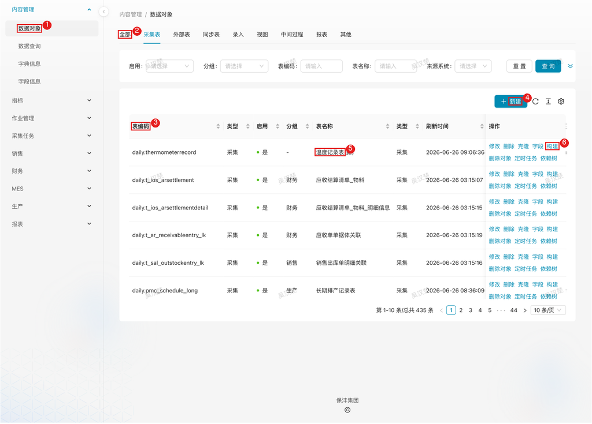

# 报表管理

## 1. 模块说明

报表管理模块由数据管理员使用，负责把外部系统的数据接入数据中心并产出业务报表：

- **数据对象配置**：管理采集表、报表、视图等各类数据对象的元数据
- **数据采集**：从 ERP、MES、云之家等外部系统抽取数据到数据中心
- **报表生成**：基于采集数据自动生成业务报表，支持自定义查询逻辑
- **字段管理**：配置字段中文名、字典翻译，提升数据可读性
- **数据源管理**：配置外部数据库连接，供采集任务使用

## 2. 页面速查表

| 页面 | 菜单位置 | 主要操作 |
|------|----------|----------|
| 数据对象 | 内容管理 → 数据对象 | 新增、修改、构建（目标表/增量索引/ETL/中文视图）、检索对象、刷新、依赖树、定时任务、删除 |
| 字段信息 | 内容管理 → 字段信息 | 检索字段、修改字段中文名、关联字典类型键、排序 |
| 数据源 | 采集任务 → 数据源 | 新增、修改、测试连接 |
| 定时任务 | 数据对象行内「定时任务」 | 查看/修改任务配置（CRON、路由策略等）、手动执行 |



图中：
1. 左侧菜单「内容管理 → 数据对象」；
2. 类型页签（全部/采集表/外部表/同步表/录入/视图/中间过程/报表/其他）；
3. 筛选条件（表编码等）；
4. 「新建」按钮；
5. 数据对象行；
6. 行操作（修改/删除/克隆/字段/构建/删除对象/定时任务/依赖树）。

## 3. 核心概念

### 3.1 数据对象

数据对象是系统管理的核心单元，代表数据库中的一张表或视图。系统通过元数据驱动的方式管理所有数据对象，实现采集、处理、报表的自动化。

**对象类型**（列表顶部标签按类型筛选）：

| 类型 | 说明 | 典型场景 |
|------|------|----------|
| **采集表** | 从外部系统（ERP/MES/SCADA）抽取的数据表 | MES 生产数据、ERP 物料数据 |
| **外部表** | 通过数据库 fdw 关联的外部表 | 实时查询外部系统数据 |
| **同步表** | 通过 API 接口同步的数据表 | 云之家审批数据、第三方平台数据 |
| **录入** | 通过数据中心系统界面手动录入的数据表 | 手工填报数据、临时数据录入 |
| **视图** | 用户自定义的数据库视图 | 自定义查询视图 |
| **中间过程** | 经 Python 脚本或物化视图处理的中间数据 | 工时分摊计算、库存账龄分析 |
| **报表** | 面向用户展示的最终数据表 | 日报、月报、分析报表 |
| **其他** | 未配置类型的数据库对象 | 检索后尚未分类的对象 |

数据对象可按业务模块分组：库存、质量、人员、云之家、财务、安全、销售、生产。在新建或修改数据对象时设置分组属性，便于筛选管理。

### 3.2 Schema 命名规范

系统按数据来源和用途划分 Schema：

| Schema | 说明 |
|--------|------|
| `daily` | MES/SCADA 实时数据、日维度数据 |
| `info` | ERP 基础数据（物料、组织、BOM 等） |
| `report` | 报表数据存储 |
| `project` | 项目管理数据 |
| `market` | 营销管理数据 |
| `yunzhijia` | 云之家集成数据 |
| `dict` | 字典值数据 |
| `conf` | 系统配置数据 |

### 3.3 中文视图

系统可为数据对象生成中文视图（前提是已配置字段信息），功能包括：

- 字段名转换为中文显示
- 编码值转换为中文名称（通过字典映射）
- 布尔值转换为「是/否」

中文视图命名规则：`{表名}_cn`

### 3.4 报表命名规范

报表类型的数据对象涉及三个层次的命名：

| 命名 | 类型 | 说明 |
|------|------|------|
| `{表名}` | 视图 | 报表对象定义的 SQL 视图（用户创建） |
| `{表名}_data` | 报表数据表 | 刷新报表时系统自动生成的数据表 |
| `{表名}_cn` | 中文视图 | 基于 `_data` 表系统自动生成 |

**数据刷新流程**：

```
视图定义 → 刷新 → _data 报表数据表 → 生成 → _cn 中文视图
```

> **命名约定**：`_data` 和 `_cn` 后缀由系统功能自动创建，用户定义报表视图时请勿使用这两个后缀。检索对象时系统也会自动跳过以此结尾的表。

### 3.5 字段定义检索

在字段信息界面，点击 **检索字段** 按钮，系统自动从数据库表的 comment 中读取字段中文名，可在此基础上二次修改。

comment 支持用竖线分隔多段信息，格式：`中文名|备注`，检索时自动拆分填入对应属性。

### 3.6 元数据驱动与依赖管理

所有数据对象的配置存储在 `conf.table_info` 表中，系统根据元数据自动：

- 创建数据库表结构
- 生成 DataX 采集任务
- 创建视图和索引
- 管理依赖关系

系统维护对象之间的依赖关系，确保数据刷新顺序正确：

- 上游对象刷新后自动触发下游刷新，避免数据不一致
- 对象依赖每天晚上自动刷新，无需手动维护
- 可通过数据对象操作栏的 **依赖树** 查看完整依赖链路

## 4. 流程

一条新数据从外部系统到可用报表的完整流程：

```
配置数据源 → 配置采集对象 → 构建采集表和采集任务 → 创建中间对象（可选）→ 创建报表对象
```

### 4.1 配置数据源：建立与外部系统的连接

**什么时候做**：第一次从某个外部系统（如 MES、ERP）接入数据时；同源系统已配置则跳过本节。

**要达成什么**：数据中心能连通外部系统数据库，采集任务才有取数入口。

**怎么做**：

1. 在左侧菜单展开 **采集任务**，点击 **数据源**
2. 点击 **新增** 按钮，打开数据源配置表单
3. 填写数据源信息：

   | 字段 | 说明 | 示例 |
   |------|------|------|
   | 数据源名称 | 唯一标识 | `mes_xmbf` |
   | 数据库类型 | 选择数据库类型 | SQL Server |
   | JDBC URL | 数据库连接地址 | `jdbc:sqlserver://192.168.51.18:1433;database=xmbf` |
   | 用户名 | 连接账号 | `sa` |
   | 密码 | 连接密码 | `******` |

4. 点击 **保存**
5. 点击 **测试连接** 验证配置是否正确

**特殊情况**：

| 情况 | 处理 |
|------|------|
| 测试连接失败 | 核对 JDBC URL、账号密码；确认数据中心服务器到源库网络是否可达 |

**结果**：数据源列表中出现可用连接，后续采集对象配置时可选。

### 4.2 配置采集对象：定义采集什么、怎么采

**什么时候做**：确定要接入某张外部表后。

**要达成什么**：完成采集表的元数据定义——表名、来源、采集方式、调度与增量策略。

**怎么做**：

1. 在左侧菜单展开 **内容管理**，点击 **数据对象**
2. 点击 **新增** 按钮，打开数据对象配置表单
3. 填写基本信息：

   | 字段 | 说明 | 是否必填 |
   |------|------|----------|
   | 表键 | 格式：`schema.表名` | 必填 |
   | 类型 | 选择「采集表」 | 必填 |
   | 中文名 | 对象中文名称 | 可选 |
   | 源系统 | 数据来源系统 | 必填 |
   | 源数据库 | 具体数据库实例 | 条件必填 |

4. 配置数据采集方式：

   **方式一：原始表对应**（适用于全表采集）——直接指定源表键，系统自动采集整张表的所有数据。

   | 字段 | 说明 |
   |------|------|
   | 源表键 | 外部系统表名，如 `dbo.production_data` |
   | 查询 SQL | 留空，系统自动生成全表查询 |

   **方式二：自定义查询语句**（适用于字段筛选或数据过滤）——手动编写查询 SQL，只采集需要的字段或过滤特定数据。

   | 字段 | 说明 |
   |------|------|
   | 源表键 | 外部系统表名（用于标识来源） |
   | 查询 SQL | 自定义查询语句 |

   查询 SQL 示例：

   ```sql
   -- 只采集部分字段
   SELECT
     id,
     name,
     create_time
   FROM dbo.production_data
   WHERE status = 1
   ```

5. 配置采集调度参数：

   | 字段 | 说明 | 对任务的影响 |
   |------|------|--------------|
   | 调度时间 | CRON 表达式，如 `0 0 2 * * ?`（每天凌晨 2 点） | 必填。创建定时任务时使用此调度时间 |
   | 增量采集 | 勾选启用增量模式 | 勾选后创建两个任务：`{表键}_full`（全量）和 `{表键}_increment`（增量）；不勾选只创建全量任务 |
   | 增量查询条件 | 增量过滤条件，如 `update_time > :last_time` | 用于从源系统查询增量数据，`:last_time` 会被替换为上次采集时间 |
   | 前置删除条件 | 增量任务执行前删除目标表数据的条件，如 `update_time > :last_time` | 增量任务执行前先删除目标表中符合此条件的数据，再插入新数据 |

   **增量查询条件与前置删除条件的对应关系**——两个字段逻辑相同但语法不同，分别对应不同的数据库：

   - **增量查询条件**：用于源系统（SQL Server），使用 SQL Server 语法
   - **前置删除条件**：用于目标系统（PostgreSQL），使用 PostgreSQL 语法

   **实际配置示例**：

   | 场景 | 增量查询条件（SQL Server） | 前置删除条件（PostgreSQL） |
   |------|---------------------------|----------------|
   | 近 60 天数据 | `fdate > DATEADD(day,-60, GETDATE())` | `fdate > CURRENT_TIMESTAMP - INTERVAL '60 days' + INTERVAL '1 days'` |
   | 按更新时间增量 | `update_time > :last_time` | `update_time > :last_time` |

   > **注意**：`:last_time` 在两个系统中都会被替换为上次采集时间，语法兼容。

   **全量 vs 增量任务**：

   - **全量任务**：每次执行时先清空目标表，再插入全部数据
   - **增量任务**：只采集新增或变更的数据，通过增量查询条件过滤

   > **注意**：启用增量采集时，系统会同时创建全量任务作为兜底，定期全量刷新确保数据一致性。

6. 点击 **保存**

**结果**：数据对象列表出现采集表对象，等待构建落地。

### 4.3 构建采集表与采集任务：落地表结构和定时采集

**什么时候做**：采集对象保存后，正式启用采集前。

**要达成什么**：在目标数据库创建表结构、增量索引（可选）和 DataX 采集任务，采集具备执行条件。

**怎么做**：

**创建目标表**：

1. 在数据对象列表中，找到刚创建的采集表对象
2. 点击 **构建** 按钮，选择 **目标表创建**
3. 点击 **确认** 执行构建
4. 查看执行结果：
   - 成功：表结构创建完成
   - 失败：检查数据源连接、字段配置等，根据错误提示修正

> **说明**：目标表结构与源表保持一致；如果使用自定义查询 SQL，表结构根据查询结果的字段创建

**创建增量索引**（仅增量采集需要）：

增量刷新时，系统会先删除目标表中符合前置删除条件的数据，再插入新数据。创建索引可加速此删除操作，提升增量刷新性能。

**索引创建规则**：

- 普通系统：索引字段取前置删除条件的第一个字段
- MES 系统：额外包含 `org_id` 字段（用于区分厂区，提升增量删除性能）
- 索引名称：`{表名}_pre_index`

1. 点击 **构建** 按钮，选择 **增量索引创建**
2. 点击 **确认** 执行构建

**创建采集任务**：

1. 点击 **构建** 按钮，选择 **ETL 创建**
2. 点击 **确认** 执行构建
3. 构建完成后，点击该行的 **定时任务** 操作按钮，查看生成的采集任务（任务名格式：`{表键}_full` 或 `{表键}_increment`）
4. 如需修改调度配置，点击任务行的 **配置** 按钮：

   | 字段 | 说明 |
   |------|------|
   | 执行 CRON | 定时执行的时间表达式 |
   | 路由策略 | 任务分配策略 |
   | 阻塞处理 | 任务堆积时的处理方式 |
   | 任务超时 | 超时时间（秒） |

5. 点击 **保存**

**特殊情况**：

| 情况 | 处理 |
|------|------|
| 构建失败 | 按错误提示检查数据源连通性、查询 SQL 是否可执行 |

**结果**：目标表与采集任务就绪。是否立即首次采集按业务需求判断：

- **立即刷新**：数据需求迫切，点击该行的 **定时任务** 操作按钮，手动执行对应任务
- **等待定时任务**：数据无紧急需求，等待定时任务自动执行

### 4.4 创建中间对象：预计算复杂数据（可选）

**什么时候做**：采集数据需要多表关联、复杂转换，或报表查询需要预计算提升性能时（如工时分摊计算、库存账龄分析）；数据可直接出报表则跳过。

**要达成什么**：把复杂计算从报表层前移到中间层，报表生成时只做简单查询。

**怎么做**：

**方式一：Python 脚本处理**（适用于复杂业务逻辑）

1. 在数据对象列表中，新增类型为 **中间过程** 的数据对象
2. 配置基本信息：表键（格式 `schema.表名`）、类型（中间过程）、中文名
3. 点击 **保存**
4. 在 `module/middle/process/` 目录下创建 Python 脚本，命名规则：`{schema}_{table}.py`

脚本必须包含 `generate_data(table_info)` 函数：

```python
# 示例：daily_inventory_age.py
def generate_data(table_info):
    """生成库存账龄数据"""
    from util.pandas import pg_copy_insert
    from extension.db_manager import business_db
    from sqlalchemy import text

    # 数据处理逻辑
    # ...

    # 写入目标表
    pg_copy_insert(df, table_info.table_key)
```

**常用工具**：

- `util.pandas.pg_copy_insert` - 高效批量插入数据
- `flask_frame.extension.database.db` - 配置库数据库连接
- `extension.db_manager.business_db` - 业务库数据库连接

**方式二：物化视图**（适用于查询优化）

1. 在数据对象列表中，新增类型为 **视图** 的数据对象
2. 配置基本信息：表键（格式 `schema.视图名`）、类型（视图）、中文名
3. 点击 **保存**
4. 在数据库中创建物化视图：

```sql
-- 示例：创建物化视图简化报表计算
CREATE MATERIALIZED VIEW daily.inventory_summary AS
SELECT
  warehouse,
  material_code,
  SUM(quantity) AS total_qty,
  AVG(unit_price) AS avg_price
FROM daily.inventory
GROUP BY warehouse, material_code;
```

> **说明**：中间数据由 Airflow 按调度自动触发生成，通常无需人工干预

**结果**：中间过程数据按调度自动产出，可作为报表的上游。

### 4.5 创建报表对象：产出业务报表

**什么时候做**：采集数据（或中间数据）就绪后。

**要达成什么**：报表对象上线并出数——用户可在查询界面看到带中文字段名的报表数据。

**怎么做**：

**前置条件**：在数据库中创建报表视图。

```sql
-- 示例：创建报表视图
CREATE OR REPLACE VIEW daily.production_report AS
SELECT
  字段1,
  字段2,
  ...
FROM daily.采集表名
WHERE 条件;
```

**检索并创建报表对象**：

1. 在数据对象列表中，点击顶部标签 **其他**
2. 点击 **检索对象** 按钮
3. 系统扫描数据库中未纳入管理的表和视图（扫描范围：`daily`、`info`、`market`、`project`、`mes`、`yunzhijia` schema）
4. 在检索结果中找到目标视图
5. 点击 **修改**，将类型改为 **报表**
6. 配置报表属性：

   | 字段 | 说明 |
   |------|------|
   | 类型 | 选择「报表」 |
   | 中文名 | 报表中文名称 |
   | 分组 | 所属业务分组 |

7. 点击 **保存**

**配置字段信息**（生成中文视图需要）：

1. 在左侧菜单展开 **内容管理**，点击 **字段信息**
2. 在筛选条件中选择刚创建的报表对象
3. 点击 **检索字段** 按钮，系统自动从数据库表的 comment 中读取字段中文名
4. 根据需要修改字段属性：

   | 字段 | 说明 |
   |------|------|
   | 字段中文名 | 报表显示的中文名称 |
   | 字典类型键 | 关联字典进行值翻译（如 `status_type`） |
   | 排序索引 | 字段显示顺序（数值越小越靠前） |

5. 点击 **保存**

**刷新报表数据**：

中间数据和报表数据由 Airflow 按调度自动触发生成，通常无需人工干预。如需手动刷新（如首次创建后需立即出数）：

1. 在数据对象列表中，切换到 **报表** 标签页
2. 找到目标报表对象
3. 根据需要点击操作栏中的刷新按钮：

   | 按钮 | 说明 |
   |------|------|
   | 刷新结构 | 重新生成 `_data` 报表数据表结构 |
   | 增量刷新 | 只刷新增量数据 |
   | 全量刷新 | 清空 `_data` 报表数据表后重新生成全部数据 |

4. 查看刷新状态（进行中/成功/失败）
5. 如需查看刷新日志，点击 **日志** 按钮

> **说明**：报表刷新后的 `_data` 报表数据表和 `_cn` 中文视图可直接在数据库中查询

**结果**：报表上线，数据按调度自动更新；查询界面可通过《04_标准数据查询》访问。

### 4.6 日常维护：中文视图、链路刷新、对象删除

**什么时候做**：日常运维数据对象时。

**怎么做**：

**创建中文视图**（大部分数据对象可用，前提是已配置字段信息）：

1. 在数据对象列表中，找到目标对象
2. 点击 **构建** 按钮，选择 **中文视图创建**
3. 点击 **确认** 执行构建

中文视图命名规则：`{表名}_cn`。

**手动刷新整条数据链路**（数据修正后需要立即重刷时）：

1. 在数据对象列表中，找到目标对象
2. 点击操作栏的 **依赖树** 按钮
3. 在依赖树列表中勾选需要刷新的数据对象：采集数据、中间数据、报表数据
4. 点击 **刷新** 按钮
5. 系统按依赖顺序依次刷新选中的对象
6. 在 **刷新时间** 和 **日志** 列查看刷新结果

**删除数据对象**：

1. 在数据对象列表中，找到目标对象
2. 点击 **删除** 按钮
3. 点击 **确认** 执行删除

## 5. 常见问题

**Q：删除数据对象会把数据库里的表删掉吗？**

A：不会。删除只移除系统中的对象定义（元数据），数据库中的实际表或视图仍保留；如需删除数据库对象，需手动执行 SQL。

**Q：MES 数据采集有什么特殊处理？**

A：配置了 MES 数据源的数据对象，系统会同时从湖北和厦门两个厂区的数据库采集数据，采集后的数据通过 `org_id` 字段区分厂区：

| org_id | 厂区 |
|--------|------|
| `A100` | 厦门保沣 |
| `C101` | 湖北保沣 |

- 创建增量索引时，MES 系统会额外包含 `org_id` 字段
- 报表查询时可通过 `org_id` 筛选特定厂区数据
- 部分报表视图中会根据组织名称自动映射 `org_id`

**Q：为什么不能自定义以 `_data`、`_cn` 结尾的表名？**

A：这两个后缀由系统功能自动创建（报表数据表、中文视图），重名会冲突；检索对象时系统也会自动跳过以此结尾的表。

**Q：报表数据一直没有更新？**

A：按依赖链路排查：数据对象 **依赖树** 查看上游对象刷新时间 → 采集任务是否正常（见《03_系统调度》）→ 必要时用依赖树勾选刷新或报表页手动全量刷新。
