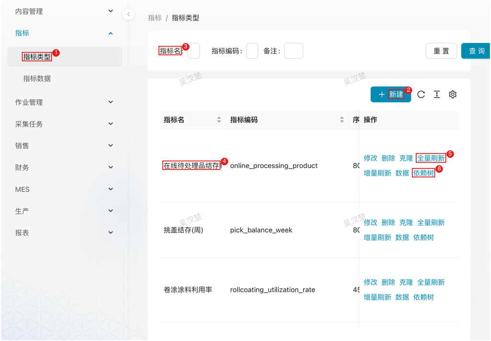

# 指标管理

## 1. 模块说明

指标管理模块由数据管理员使用，基于报表数据按配置的计算公式和维度进行汇总计算，生成结构化的指标数据：

- **指标定义**：配置指标的计算公式、查询条件、时间维度、业务维度
- **指标计算**：支持合计、平均、除法等计算方式，自动生成指标数据
- **数据刷新**：支持全量刷新和增量刷新，定时任务自动更新指标数据
- **大屏展示**：指标数据供大屏展示和分析使用

## 2. 页面速查表

| 页面 | 菜单位置 | 主要操作 |
|------|----------|----------|
| 指标类型 | 指标 → 指标类型 | 新建、修改、全量刷新、增量刷新、依赖树、数据 |
| 指标数据 | 指标 → 指标数据 | 按指标类型筛选查看计算结果 |



1. 左侧菜单「指标 → 指标类型」；
2. 「新建」按钮；
3. 筛选条件（指标名等）；
4. 指标行（指标名/指标编码/序号/刷新时间/时间维度/业务维度/单位）；
5. 行操作「全量刷新」（另有 修改/删除/克隆/增量刷新/数据）；
6. 行操作「依赖树」。

## 3. 核心概念

### 3.1 指标类型与指标数据

| 概念 | 说明 | 存储位置 |
|------|------|----------|
| **指标类型** | 指标的定义：查询条件、维度、计算公式等配置 | 配置库 `conf.indicator_type` |
| **指标数据** | 指标的计算结果，按时间维度和业务维度组织 | 业务库 `report.indicator_data` |

### 3.2 指标计算机制

- **计算方式**：系统将计算公式套在查询条件返回的数据上，按时间维度和业务维度分组计算
- **计算公式**：支持除法表达式（如 `a/b`），此时会额外记录各部分的明细值到「公式数据」列，展示为 `分子/分母` 形式
- **数据合并**：相同维度组合的指标数据重复生成时自动覆盖更新，不会产生重复数据
- **空值处理**：维度字段为空时统一显示为 `-`
- **年度汇总**：时间维度选择「年」时，月份列统一显示为「年合计」

### 3.3 数据流程

```
┌─────────────┐     ┌─────────────────┐     ┌─────────────┐
|   报表数据   │     |    指标类型配置   │     |   指标数据   |
| (_data 表)  |────▶| 查询条件+维度+公式 |────▶| (indicator_ |
└─────────────┘     └─────────────────┘     |    data)    |
                                            └─────────────┘
```

1. 指标类型通过查询条件从报表数据取数
2. 按时间维度、业务维度分组计算公式
3. 结果写入指标数据表，更新指标类型的刷新时间

## 4. 流程

### 4.1 创建指标类型：定义指标怎么算

**什么时候做**：需要新的统计指标（如产量合计、不良率）时。

**要达成什么**：指标的定义上线——取数来源、分组维度、计算公式明确，可被定时任务持续计算。

**怎么做**：

1. 在左侧菜单展开 **指标**，点击 **指标类型**
2. 点击 **新建** 按钮，打开指标类型配置表单
3. 配置基本信息：

   | 字段 | 说明 |
   |------|------|
   | 指标名 | 指标的中文名称 |
   | 指标编码 | 指标唯一标识 |
   | 序号 | 展示排序 |
   | 单位 | 生成指标数据的单位 |

4. 配置取数与计算逻辑：

   | 字段 | 说明 |
   |------|------|
   | 查询条件 | 计算指标需要的查询数据（SELECT 语句） |
   | 增量条件 | 增量刷新时追加到查询条件后面的过滤条件 |
   | 时间维度 | 按时间分组的字段，多个用 `\|` 分隔（如年、月、班次日期） |
   | 业务维度 | 按业务分组的字段，多个用 `\|` 分隔（如组织、车间） |
   | 计算公式 | 根据查询数据计算的公式（如 `sum(quantity)` 或 `sum(a)/sum(b)`） |

5. 点击 **保存**

**查询条件示例**：

```sql
SELECT
  org_id,
  shift_year,
  shift_month,
  quantity,
  defect_qty
FROM daily.production_data
WHERE org_id IS NOT NULL
```

> **注意**：查询条件返回的字段需包含时间维度、业务维度和计算公式中用到的字段

**结果**：指标类型创建完成，等待生成指标数据。

### 4.2 生成指标数据：执行计算并出数

**什么时候做**：指标数据由定时任务按调度自动增量刷新，通常无需人工干预；首次创建、修改公式或维度、数据修正后重算时手动执行。

**要达成什么**：指标数据表生成最新计算结果。

**怎么做**：

1. 在指标类型列表中，找到目标指标
2. 根据需要点击操作栏中的执行按钮：

   | 按钮 | 说明 |
   |------|------|
   | 全量刷新 | 删除该指标的全部旧数据，重新计算生成 |
   | 增量刷新 | 按增量条件过滤，只计算新数据（默认定时任务方式） |

3. 执行完成后，列表的 **刷新时间** 列会更新为本次执行时间

> **说明**：
> - 全量刷新会先清空该指标类型的所有指标数据，适用于维度调整、公式修改后的重算
> - 增量刷新依赖配置的增量条件，相同维度组合的数据会自动覆盖更新

**结果**：指标数据生成，可在指标数据页与大屏消费。

### 4.3 查看指标数据：验证计算结果

**什么时候做**：指标执行后核对数据，或分析排查时。

**怎么做**：

1. 在左侧菜单展开 **指标**，点击 **指标数据**
2. 通过筛选条件（指标类型等）定位目标指标
3. 查看指标数据：

   | 列 | 说明 |
   |------|------|
   | 公式数据 | 公式各部分的明细值（如 `分子/分母`），用于追溯计算过程 |
   | 数值 | 计算公式的最终结果 |
   | 维度列 | 时间维度和业务维度的具体值 |

4. 指标数据也可通过以下方式查询：

   - **原始数据表**：`report.indicator_data` — 存储完整的指标数据，包含所有维度字段
   - **中文视图**：`report.indicator_data_cn` — 字段名转换为中文，组织编码转换为组织名称，适合直接查看和分析

## 5. 常见问题

**Q：修改了指标定义，为什么数据不对？**

A：修改维度或公式后需执行 **全量刷新** 重新生成数据——旧数据的维度结构可能已不匹配。

**Q：指标数据异常，怀疑上游报表数据有问题？**

A：沿依赖链逐层刷新：

1. 在指标类型列表中，点击目标指标的 **依赖树** 按钮
2. 在依赖树列表中勾选需要刷新的上游数据对象（采集数据、中间数据、报表数据）
3. 点击 **刷新** 按钮，系统按依赖顺序依次刷新
4. 上游数据刷新完成后，再对该指标执行 **增量刷新** 或 **全量刷新**

**Q：想直接看某个指标已生成的数据？**

A：在指标类型列表中，点击目标指标的 **数据** 按钮，系统展示该指标类型下生成的指标数据，无需切换到指标数据界面筛选。
