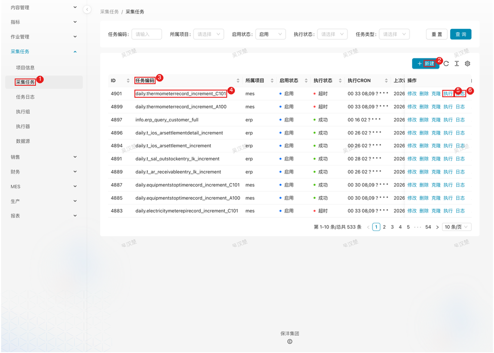

# 系统调度

## 1. 模块说明

系统调度模块由数据管理员和运维人员使用，负责任务的执行与监控，分为两部分：

- **作业管理**：管理系统内部 Python 作业，执行同步表同步、数据刷新、指标计算等操作
- **采集任务**：管理 DataX 数据采集任务，从 ERP、MES、云之家等外部系统定时抽取数据

通过本模块监控任务运行状态、排查执行失败原因、手动补跑任务。

> **说明**：大部分任务已在 Airflow 配置自动化调度，本模块主要用于监控和应急处理。系统定时任务的 CRON 配置主要用于 Airflow 故障时的备用调度机制。

## 2. 页面速查表

| 页面 | 菜单位置 | 主要操作 |
|------|----------|----------|
| 工作作业 | 作业管理 → 工作作业 | 按任务类型/编码筛选、手动执行 |
| 作业日志 | 作业管理 → 作业日志 | 按工作编码/日志级别筛选、查看详情 |
| 采集任务 | 采集任务 → 采集任务 | 筛选、手动执行、查看定时任务配置 |
| 任务日志 | 采集任务 → 任务日志 | 按任务/执行状态筛选、查看 DataX 调度详情 |
| 执行器 | 采集任务 → 执行器 | 查看 CPU/内存/负载/心跳 |
| 执行组 | 采集任务 → 执行组 | 新建、修改、删除、克隆 |
| 项目信息 | 采集任务 → 项目信息 | 新建、修改、删除、克隆 |
| 数据源 | 采集任务 → 数据源 | 新增、修改、删除、克隆 |



1. 左侧菜单「采集任务 → 采集任务」；
2. 「新建」按钮；
3. 筛选条件（任务编码/所属项目/启用状态/执行状态/任务类型）；
4. 任务行（ID/任务编码/所属项目/启用状态/执行状态/执行CRON/上次与下次调度时间等）；
5. 行操作「执行」（另有 修改/删除/克隆）；
6. 行操作「日志」。

## 3. 核心概念

### 3.1 两类任务的区别

| 对比项 | 工作作业（作业管理） | 采集任务（采集任务菜单） |
|--------|---------------------|------------------------|
| 任务载体 | 系统 Python 代码（`module/job/robot/`） | DataX 采集脚本 |
| 执行方式 | Celery 异步任务 | DataX 执行器执行 |
| 调度方式 | 定时任务调用或手动调用 | 调度中心按 CRON 调度 |
| 典型场景 | 同步表同步逻辑、报表/指标刷新、依赖链刷新 | 从 ERP/MES 抽取数据到采集表 |
| 日志位置 | 作业管理 → 作业日志 | 采集任务 → 任务日志 |

### 3.2 任务执行机制

- **防冲突锁**：相同任务同时只能有一个在执行（Redis 锁，30 分钟超时），避免任务相互冲突
- **执行链**：支持任务链式执行（`execute/chain`），前序任务完成后触发后续任务
- **同步/异步**：任务支持同步执行（等待完成）和异步执行（立即返回）
- **本地运行**：`local_run` 参数可让任务在本服务进程内直接执行，绕过 Celery 队列

### 3.3 调度架构（采集任务）

```
调度中心 ──按CRON触发──▶ 执行组 ──分配──▶ 执行器（可多个）
                              │
                              ▼
                        DataX 进程执行采集
                              │
                              ▼
                        任务日志记录结果
```

- 执行器会周期性自动注册，调度中心自动发现并触发执行
- 执行组可部署多个执行器，某个执行器故障时其他执行器继续任务，保证任务正常完成

## 4. 流程

### 4.1 查看任务执行状态：确认数据有没有按时更新

**什么时候做**：日常巡检，或业务反馈数据未更新时。

**要达成什么**：判断任务是正常运行、停用还是调度异常。

**怎么做**（采集任务）：

1. 在左侧菜单展开 **采集任务**，点击 **采集任务**
2. 在任务列表查看关键状态列：

   | 列 | 说明 |
   |------|------|
   | 启用状态 | 任务是否启用，停用的任务不再被调度 |
   | 执行状态 | 任务最近一次执行的结果 |
   | 执行CRON | 任务的调度时间表达式 |
   | 上次调度时间 / 下次调度时间 | 判断调度是否正常的重要依据 |
   | 超时时间（分钟） | 任务运行超时将被主动中断 |
   | 重试次数 | 执行失败后的自动重试配置 |

3. 若「下次调度时间」不再更新，说明任务已停用或调度中心异常

**查询正在执行的任务**：系统提供 `/job/active` 接口查询 Celery 当前正在执行（active）、待执行（reserved）、调度中（scheduled）的任务，用于判断任务队列是否堆积。

**结果**：任务运行状态明确，可进一步执行或排查。

### 4.2 手动执行任务：补数与应急触发

**什么时候做**：数据需要补采、上游修正后需要立即刷新、Airflow 调度异常需要手动触发时。

**要达成什么**：目标任务立即执行一次。

**怎么做**（采集任务）：

1. 在左侧菜单展开 **采集任务**，点击 **采集任务**
2. 通过筛选条件（任务编码、所属项目、启用状态、执行状态、任务类型）找到目标任务
3. 点击该行的 **执行** 按钮
4. 任务提交执行，相同任务同时只能有一个在执行（防冲突锁）
5. 点击该行的 **日志** 按钮，查看本次执行的结果

**怎么做**（工作作业）：

1. 在左侧菜单展开 **作业管理**，点击 **工作作业**
2. 通过筛选条件（任务类型、工作编码、名称）找到目标作业
3. 点击该行的 **执行** 按钮
4. 同一作业通过不同的传入参数，可以处理不同的数据

**注意**：执行失败提示「任务已在运行」时，是防冲突锁生效——等待当前执行完成或锁超时（30 分钟）后再试。

**结果**：任务按需补跑，日志可追溯。

### 4.3 排查任务执行失败：定位原因并恢复

**什么时候做**：任务列表或日志显示失败、业务反馈数据缺失时。

**要达成什么**：找到失败原因，恢复任务正常执行。

**怎么做**（采集任务失败排查）：

1. 在左侧菜单展开 **采集任务**，点击 **任务日志**
2. 通过筛选条件（任务、执行组、执行器IP、调度结果、执行状态）缩小范围，定位失败的记录
3. 点击该行的 **查看详情**，查看 DataX 调度的运行信息和详细日志
4. 常见失败原因：

   | 现象 | 排查方向 |
   |------|----------|
   | 调度结果失败 | 调度中心到执行器网络不通、执行组配置错误 |
   | 执行状态失败 | 数据源连接失败、源表结构变更、查询 SQL 报错 |
   | 任务一直不执行 | 任务停用、CRON 配置错误、执行器全部离线 |

**怎么做**（工作作业失败排查）：

1. 在左侧菜单展开 **作业管理**，点击 **作业日志**
2. 通过筛选条件（工作编码、对象编码、日志级别）定位问题记录
3. 日志级别说明：`info`（正常信息）、`warn`（警告）、`error`（错误）
4. 点击该行的 **详情**，查看作业的详细执行过程
5. 「消耗时间(秒)」列可用于定位执行缓慢的步骤

**结果**：失败原因定位，修复后重跑任务验证。

### 4.4 监控执行器与维护执行组：保障采集任务可执行

**什么时候做**：采集任务大面积调度失败、新增采集节点或调整任务分配时。

**要达成什么**：执行器在线、执行组配置正确，采集任务有可用的执行资源。

**怎么做**（监控执行器）：

1. 在左侧菜单展开 **采集任务**，点击 **执行器**
2. 查看各执行器的关键指标：

   | 列 | 说明 |
   |------|------|
   | 注册组 / 注册键 / 注册值 | 执行器的注册信息 |
   | CPU 使用率 | 执行器节点 CPU 占用 |
   | 内存使用率 | 执行器节点内存占用 |
   | 平均负载 | 节点负载情况 |
   | 更新时间 | 心跳时间，长时间未更新说明执行器离线 |

3. 执行器异常时的处理：
   - 确认执行器进程是否存活
   - 检查执行器与调度中心的网络连通性
   - 执行组内如有多台执行器，单台故障不影响任务执行

**怎么做**（维护执行组）：

1. 在左侧菜单展开 **采集任务**，点击 **执行组**
2. 查看执行组配置：

   | 列 | 说明 |
   |------|------|
   | 执行器AppName | 执行器注册的应用名，任务按此分配 |
   | 执行器名称 | 执行组的显示名称 |
   | 排序 | 展示排序 |
   | 执行器地址类型 | 自动注册 / 手动录入 |
   | 执行器地址列表 | 手动录入模式下的执行器地址 |

3. 点击 **新建** 添加执行组，或对已有执行组进行 **修改** / **删除** / **克隆**

**怎么做**（维护项目信息与数据源）：

- **项目信息**（采集任务 → 项目信息）：点击 **新建** 填写项目名称、项目描述；已有项目可 **修改** / **删除** / **克隆**。新建采集任务时选择所属项目，便于按项目筛选管理任务
- **数据源**（采集任务 → 数据源）：点击 **新建** 填写数据源名称、类型、数据源分组、数据库名、JDBC URL、JDBC 驱动类等；保存后可 **修改** / **删除** / **克隆**。数据源配置错误是采集任务失败的常见原因，可通过「状态」列和更新时间辅助判断。详细配置步骤参见《01_报表管理》4.1 节

**结果**：采集执行资源就绪，任务可正常调度执行。

## 5. 常见问题

**Q：任务异常退出后提示锁被占用？**

A：防冲突锁未正常释放时，等待 30 分钟锁自动超时，或手动清除 Redis 锁。任务链执行时，链内任务会跳过防冲突检查，允许链式顺序执行。

**Q：想立即拿到执行结果调试任务？**

A：工作作业支持三种执行方式：

| 参数 | 说明 | 适用场景 |
|------|------|----------|
| **同步执行**（sync=true） | 等待任务完成后再返回 | 需要立即获取执行结果、调试任务 |
| **异步执行**（sync=false） | 任务提交后立即返回 | 批量执行、长时间运行的任务 |
| **本地运行**（local_run=true） | 在当前服务进程内直接执行，绕过 Celery 队列 | 调试任务、Celery 异常时的应急执行 |

## 6. 附：工作作业与 Airflow 调度清单

### 6.1 系统工作作业列表

工作作业是数据中心内部的任务处理单元，Airflow DAG 通过 API 调用触发执行：

| 作业名称 | 说明 | 典型触发场景 |
|----------|------|--------------|
| `refresh_report` | 报表数据刷新 | 定时刷新各业务模块报表 |
| `refresh_middle` | 中间过程数据刷新 | 计算库龄分析、工时分摊等中间数据 |
| `refresh_indicator_data` | 指标数据刷新 | 重新计算指标数据 |
| `refresh_sync` | 同步表数据刷新 | 从云之家、金蝶云等系统同步数据 |
| `refresh_obj` | 数据对象刷新（通用） | 按依赖链刷新数据对象 |
| `execute_datax_job` | 执行 DataX 采集任务 | 执行数据采集任务 |
| `vacuum_analyze` | 数据库表清理与分析 | 定期维护数据库性能 |
| `re_execute_failed_task` | 重新执行失败任务 | 重跑采集失败的任务 |
| `sync_king_cloud` | 金蝶云数据同步 | 同步金蝶云业务数据 |
| `sync_yuinzhjia_form` | 云之家表单数据同步 | 同步云之家审批表单 |
| `sync_yunzhijia_employee` | 云之家员工数据同步 | 同步员工信息变更 |
| `sync_yunzhijia_error_data_modify` | 云之家错误数据修正 | 修正同步异常数据 |
| `sync_ehs_improvement` | EHS 改进项同步 | 同步安全环保改进项 |
| `sync_it_service` | IT 服务数据同步 | 同步IT服务管理数据 |
| `push_to_external` | 推送数据到外部系统 | 推送数据到第三方平台 |
| `archive_project` | 项目归档处理 | 归档研发项目数据 |

### 6.2 Airflow 自动化调度

Airflow 是主要的任务调度平台，通过调用数据中心 API 触发工作作业执行。大部分数据刷新、同步任务已在 Airflow 配置自动化调度。

**调度架构**：

```
Airflow DAG ──OAuth2认证──▶ API接口 ──触发──▶ 工作作业 ──执行──▶ 具体任务
```

**调用方式**：Airflow DAG 通过 OAuth2 认证调用 `api/data_center/job/execute` 接口，传入 `job_key` 参数执行对应的工作作业。

**报表刷新任务**：

| DAG ID | 调度时间 | 说明 |
|--------|----------|------|
| refresh_report_production | 40 8 * * * | 刷新生产相关报表，包括产量、效率、停机等数据 |
| refresh_report_production_fix | 40 9,10 * * * | 生产报表补救刷新，处理上午刷新失败的报表 |
| refresh_report_quality | 1 5 * * * | 刷新质量相关报表，包括质检数据、不良率等 |
| refresh_report_market | 41 5 * * * | 刷新销售市场报表，包括客户、订单、发货数据 |
| refresh_report_inventory | 15 5 * * * | 刷新库存报表，包括库存余额、周转率等 |
| refresh_report_finance | 6 5 * * * | 刷新财务报表，包括成本、费用、研发工时等 |
| refresh_report_inspection | 05 8 * * * | 刷新质检报表，包括检验记录、合格率等 |
| refresh_report_yunzhijia | 5 9 * * * | 刷新云之家相关报表，包括审批数据、表单数据 |
| refresh_report_user | 5 0 * * * | 刷新人员相关报表，包括考勤、绩效等 |
| refresh_report_1300 | 0 13 * * * | 13点刷新特定报表，用于中午数据修正 |
| refresh_report_cap_shutdown | 5,13 8 * * * | 刷新制盖厂停机报表，每天两次 |
| refresh_report_customer_complaint | 57 7,10,13,15 * * * | 刷新客户投诉率报表，每天四次 |
| refresh_report_full_truncate | 0 1 2 * * | 每月2号凌晨全量刷新所有报表 |

**中间数据刷新任务**：

| DAG ID | 调度时间 | 说明 |
|--------|----------|------|
| refresh_middle_finance | 40 3 * * * | 刷新财务中间数据，包括成本分摊、费用归集等 |
| refresh_middle_inventory_age | 0 14 1-6 * * | 刷新库存账龄分析数据，每月1-6号下午执行 |

**指标刷新任务**：

| DAG ID | 调度时间 | 说明 |
|--------|----------|------|
| refresh_Indicator | 被动触发 | 刷新指标数据，由其他 DAG 触发执行 |

**数据同步任务**：

| DAG ID | 调度时间 | 说明 |
|--------|----------|------|
| sync_kingdee_report | 20 7 * * * | 从金蝶系统同步财务报表数据 |
| sync_kingdee_receipt_issue_and_storage_of_inventory | 10 7 1-6 * * | 同步存货收发存汇总表，每月1-6号 |
| sync_customer_complaint_file | 0 */6 * * * | 每6小时同步一次客户投诉附件 |

**外部数据上报任务**：

| DAG ID | 调度时间 | 说明 |
|--------|----------|------|
| upload_energe_data | 42 0 * * * | 上报能源消耗数据到政府平台 |
| archive_yunzhijia_project | 1 9 * * * | 归档云之家研发项目数据 |

**系统维护任务**：

| DAG ID | 调度时间 | 说明 |
|--------|----------|------|
| trigger_timeout_check | 35 8 * * * | 检测超时的采集任务并发送告警 |
| trigger_error_task | 12 3 * * * | 重触发前一天执行失败的采集任务 |
| fix_table_refresh_time | */30 * * * * | 每30分钟修复数据对象的刷新时间字段 |
| db_data_cener_analyze | 50 5 * * * | 刷新数据库缓存和统计信息 |
| refresh_obj_downstream | 0 2 * * * | 按依赖关系刷新下游数据对象 |

> **说明**：Airflow 共配置了 85 个 DAG，涵盖数据中心、MES、监控、维护、云之家等多个模块。完整 DAG 列表参见 `airflow_dags/README.md`。
