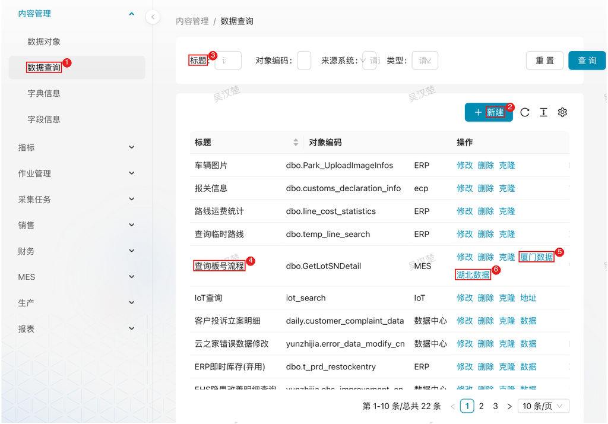

# 标准数据查询

## 1. 模块说明

标准数据查询模块面向两类使用者：

- **数据管理员**：配置统一字典、查询 Schema 与查询页面，让数据可被查询和对接
- **开发对接人员 / 查询用户**：通过统一查询页面取数，或调用标准 API（PostgREST 风格）把数据接入第三方系统

提供的能力：

- **统一字典**：定义整个数据中心的标准字典，配置字段值的翻译映射（编码值 → 中文名称）
- **本地数据查询**：针对数据中心数据提供 PostgREST 风格的统一查询接口，供外部系统对接
- **外部系统查询**：针对对接数据库提供统一查询页面和 API，支持自定义查询语句
- **统一查询页面**：提供外部系统数据查询的统一入口，支持将查询页面外挂到第三方系统

## 2. 页面速查表

| 页面 | 菜单位置 | 主要操作 |
|------|----------|----------|
| 字典信息 | 内容管理 → 字典信息 | 新建字典类型、维护字典值 |
| 字段信息 | 内容管理 → 字段信息 | 为字段关联字典类型键 |
| 数据查询 | 内容管理 → 数据查询（需管理员权限） | 新建查询 Schema/查询页面、通过「数据」等按钮进入查询页面 |



图中：
1. 左侧菜单「内容管理 → 数据查询」；
2. 「新建」按钮；
3. 筛选条件（标题/对象编码/来源系统/类型）；
4. 查询 Schema 行；
5. 查询页面入口「厦门数据」（按来源系统/厂区显示，另有「数据」「地址」等）；
6. 查询页面入口「湖北数据」。

## 3. 流程

### 3.1 配置统一字典：让编码值显示为中文名称

**什么时候做**：报表或查询页面中出现编码值（如组织编码 `A100`）需要翻译为中文时。

**要达成什么**：字段在查询界面和 API 返回中自动显示中文名称。

**怎么做**：

1. 配置字典类型：在左侧菜单展开 **内容管理**，点击 **字典信息** → **新建**：

   | 字段 | 说明 |
   |------|------|
   | 类型键 | 字典类型的唯一标识，如 `org_id`（组织编码） |
   | 类型名称 | 字典类型的显示名称，如「组织名称」 |

2. 配置字典值：在字典类型列表中，点击目标字典类型的 **字典值** 按钮 → **新建**：

   | 字段 | 说明 | 示例 |
   |------|------|------|
   | 值 | 编码值 | `A100` |
   | 中文名 | 编码值对应的中文名称 | 厦门保沣 |
   | 排序 | 显示顺序 | 1 |

3. 应用字典翻译：在 **内容管理 → 字段信息** 中找到目标字段 → **修改** → 设置 **字典类型键** → **保存**

**注意**：数据对象需已配置字段信息并关联字典类型键，查询界面才会显示翻译后的中文名称。

**结果**：查询该字段时，编码值自动翻译为中文名称（如 `org_id: "A100"` 显示为 `org_id_cn: "厦门保沣"`）。

### 3.2 配置查询 Schema：把数据库对象开放为查询接口

**什么时候做**：需要把表、视图、存储过程或自定义 SQL 开放为统一查询接口时。

**要达成什么**：通过标准 URL 即可查询该对象。

**怎么做**：

1. 在左侧菜单展开 **内容管理**，点击 **数据查询**（需管理员权限）
2. 点击 **新建** 按钮，配置查询 Schema：

   | 字段 | 说明 |
   |------|------|
   | 对象键 | 查询接口的唯一标识，如 `mes_production_data` |
   | 来源系统 | 数据源系统，支持 `mes`、`erp`、`data_center` |
   | Schema 名称 | 数据库 Schema，如 `dbo` |
   | 对象名称 | 数据库对象名称，如存储过程名、表名 |
   | 类型 | 查询类型：表、视图、存储过程、SQL |
   | SQL 语句 | 自定义 SQL 查询语句（SQL 类型时填写） |

3. 点击 **保存**

**查询类型选择**：

| 类型 | 说明 | 适用场景 | URL 操作符 | 参数传递 |
|------|------|----------|------------|----------|
| **表** | 直接查询数据库表 | 查询基础数据表，如配置表、字典表 | 支持 | WHERE 条件参数 |
| **视图** | 查询数据库视图 | 查询已定义的视图，视图已包含关联逻辑 | 支持 | WHERE 条件参数 |
| **存储过程** | 调用数据库存储过程并返回结果 | 复杂业务逻辑查询，如生产数据汇总、财务报表计算 | 不支持 | 存储过程参数 |
| **SQL 语句** | 执行自定义 SQL 查询 | 灵活的自定义查询，可关联多表、使用复杂条件 | 支持（包装为子查询） | SQL 参数替换 |

选择建议：优先使用视图（性能较好）；多步计算、临时表场景用存储过程；临时查询、测试查询用 SQL 类型（注意性能）。

**来源系统说明**：

| 来源系统 | 说明 | 典型数据 |
|----------|------|----------|
| `mes` | MES 系统（制造执行系统） | 生产数据、设备数据、质检数据 |
| `erp` | ERP 系统（企业资源计划） | 财务数据、采购数据、销售数据 |
| `data_center` | 数据中心 | 报表数据、指标数据、配置数据 |

**结果**：可按接口格式调用查询（接口格式与操作符见第 4 章）。

### 3.3 配置查询页面：提供界面查询并外挂第三方系统

**什么时候做**：需要给业务人员或第三方系统提供界面化的查询入口时。

**要达成什么**：一个可筛选、可排序、可导出的查询页面，且能通过 URL / iframe 外挂。

**怎么做**：

1. 在左侧菜单展开 **内容管理**，点击 **数据查询**
2. 点击 **新建** 按钮，配置查询页面：

   | 字段 | 说明 |
   |------|------|
   | 标题 | 查询页面的显示名称 |
   | 对象编码 | 数据库对象标识（schema.object_name 或 object_name） |
   | 来源系统 | 数据源系统（MES、ERP、数据中心等） |
   | 类型 | 查询类型：表、视图、存储过程、SQL |
   | 配置 | JSON 数组，定义表格列的展示和查询方式 |
   | SQL | 自定义 SQL 查询语句（SQL 类型时填写） |

3. 点击 **确认** 保存
4. 使用页面：在查询 Schema 列表中，点击目标记录的 **数据**、**厦门数据**、**湖北数据** 等操作按钮进入查询页面 → 设置查询条件（可选）→ 点击 **查询** → 结果支持排序、筛选、导出

**注意**：查询页面需先配置好「配置」字段，才能正常显示列标题、搜索条件和表格内容。

**外挂到第三方系统**（两种方式）：

```html
<!-- 方式一：iframe 嵌入 -->
<iframe src="http://192.168.111.243:31016/data_center/dict/query_schema/{object_key}/data" width="100%" height="600"></iframe>
```

```
# 方式二：URL 直接访问
http://192.168.111.243:31016/data_center/dict/query_schema/{object_key}/data
```

`{object_key}` 为查询 Schema 的对象编码，如 `dbo.GetLotSNDetail`。

**配置字段说明**——「配置」字段是一个 JSON 数组，定义表格列的展示方式、查询方式和交互行为：

```json
[
  {
    "dataIndex": "field_name",
    "title": "字段中文名",
    "valueType": "text",
    "width": "md",
    "hideInSearch": false,
    "hideInTable": false,
    "sorter": true,
    "filters": true
  }
]
```

| 字段 | 类型 | 说明 |
|------|------|------|
| `dataIndex` | string | 字段名，对应数据库字段 |
| `title` | string | 列标题，显示的中文名称 |
| `valueType` | string | 字段类型：text、digit、date、dateTime、select、image、erp_attach、jsonCode |
| `width` | string | 列宽度：xs、sm、md、lg、xl |
| `hideInSearch` | boolean | 是否隐藏搜索条件 |
| `hideInTable` | boolean | 是否隐藏表格列 |
| `sorter` | boolean | 是否支持排序 |
| `filters` | boolean | 是否支持筛选 |
| `fixed` | string | 固定列：left、right |
| `rowMerge` | boolean | 相同值合并行 |
| `fieldProps` | object | 字段属性 |
| `render` | string | 自定义渲染函数名 |
| `valueEnum` | object | 枚举值映射，如 `{ "value1": { "text": "文本1" } }` |
| `valueEnumProc` | string | 存储过程名，动态获取枚举值 |
| `initialValue` | any | 默认值 |
| `matchPattern` | string | 查询匹配模式：like（模糊匹配）、eq（精确匹配） |

`valueType` 取值：`text` 文本、`digit` 数字、`date` 日期、`dateTime` 日期时间、`select` 下拉选择、`image` 图片、`erp_attach` ERP 附件、`jsonCode` JSON 代码。

**配置示例**：

```json
// 示例 1：设备查询（存储过程）
[
  {
    "dataIndex": "EquipmentCode",
    "title": "设备编码",
    "sorter": true,
    "formItemProps": { "required": true }
  },
  {
    "dataIndex": "EquipmentName",
    "title": "设备名称",
    "width": "lg"
  },
  {
    "dataIndex": "Status",
    "title": "状态",
    "valueType": "select",
    "valueEnum": {
      "running": { "text": "运行中" },
      "stopped": { "text": "已停机" }
    }
  },
  {
    "dataIndex": "CreateTime",
    "title": "创建时间",
    "valueType": "dateTime",
    "hideInSearch": true
  }
]

// 示例 2：带枚举查询的配置
[
  {
    "dataIndex": "Workshop",
    "title": "车间",
    "valueEnumProc": "GetWorkshopList"
  },
  {
    "dataIndex": "ProductLine",
    "title": "产线",
    "rowMerge": true
  },
  {
    "dataIndex": "Quantity",
    "title": "数量",
    "valueType": "digit"
  }
]

// 示例 3：隐藏搜索条件
[
  {
    "dataIndex": "id",
    "title": "ID",
    "hideInSearch": true
  },
  {
    "dataIndex": "name",
    "title": "名称",
    "matchPattern": "like"
  },
  {
    "dataIndex": "status",
    "title": "状态",
    "valueType": "select",
    "valueEnum": {
      "active": { "text": "启用" },
      "inactive": { "text": "停用" }
    }
  }
]
```

**结果**：查询页面上线，可在数据中心内使用，也可外挂到大屏、移动应用等第三方系统。

## 4. 接口参考

### 4.1 本地数据查询

本地数据查询提供 PostgREST 风格的统一查询接口，支持在 URL 中对**实体字段**使用**操作符表达式**来精确定位数据。

**基础用法**：

```http
# 查询 Schema 为 daily、对象名为 people 的数据
GET /daily/people HTTP/1.1

# 查询年纪小于 13 岁的人
GET /daily/people?age=lt.13 HTTP/1.1

# 查询年纪大于等于 18 岁并且 student 字段为 true 的人
GET /daily/people?age=gte.18&student=is.true HTTP/1.1
```

**URL 操作符**：

| 操作符 | 说明 | 示例 |
|--------|------|------|
| `eq` | 等于 | `age=eq.18` |
| `neq` | 不等于 | `age=neq.18` |
| `gt` | 大于 | `age=gt.18` |
| `gte` | 大于等于 | `age=gte.18` |
| `lt` | 小于 | `age=lt.18` |
| `lte` | 小于等于 | `age=lte.18` |
| `like` | 模糊匹配 | `name=like.*张*` |
| `ilike` | 不区分大小写模糊匹配 | `name=ilike.*ZHANG*` |
| `in` | 包含于 | `age=in.(18,19,20)` |
| `is` | 是否为 true/false/null | `student=is.true` |
| `not` | 否定 | `age=not.lt.18` |

> **参考**：URL 操作符表达式的完整语法说明参见 [PostgREST API 文档 — 表和视图](https://postgrest.postgresql.ac.cn/en/v12/references/api/tables_views.html)

**翻页**：支持 URL 参数 `limit`（查询数量限制）和 `offset`（查询偏移）：

```http
GET /bigtable?limit=20&offset=0 HTTP/1.1
```

**数据总数**：在请求报头加入 **Prefer: count=exact**，返回报头的 **Content-Range** 中会返回对应数量：

```http
GET /bigtable?limit=20&offset=0 HTTP/1.1
Prefer: count=exact
```

```http
HTTP/1.1 206 Partial Content
Content-Range: 0-19/3573458
```

说明返回的是索引 0-19 的数据，总数量为 3573458。

### 4.2 外部系统查询接口

**接口格式**：

```http
GET /query/{source_system}/{schema_name}/{obj_name} HTTP/1.1
```

或

```http
GET /query/{source_system}/{obj_name} HTTP/1.1
```

**示例**：查询 MES 系统的生产数据

```http
GET /query/mes/dbo/production_data HTTP/1.1
```

**表和视图支持 URL 操作符**（与本地数据查询一致）：

```http
GET /query/mes/dbo/production_data?org_id=eq.A100&date=gte.2026-01-01 HTTP/1.1
```

支持的操作符：`eq`、`neq`、`gt`、`gte`、`lt`、`lte`、`like`、`ilike`、`in`、`is`、`not`、`or`、`and`。

**存储过程仅支持参数传递**（参数名称需与数据库定义一致；SQL 语句的参数使用 `{参数名}` 占位符，剩余参数会构建为 WHERE 条件）：

```http
GET /query/mes/dbo/production_summary?start_date=2026-01-01&end_date=2026-01-31 HTTP/1.1
```

### 4.3 返回数据结构

查询接口返回 JSON 格式数据：

```json
{
    "data": [
        {
            "field1": "value1",
            "field2": "value2"
        }
    ],
    "code": "0",
    "message": "操作成功",
    "create_time": "2026-08-20T10:09:47.647739"
}
```

| 字段 | 说明 |
|------|------|
| `data` | 查询结果数组，包含所有返回的数据行 |
| `code` | 响应码，`"0"` 表示成功 |
| `message` | 响应消息 |
| `create_time` | 响应生成时间 |

**示例**：查询 `daily/people` 表的数据

请求：

```http
GET /daily/people?limit=2 HTTP/1.1
```

返回：

```json
{
    "data": [
        {
            "id": 1,
            "name": "张三",
            "age": 25,
            "student": false,
            "org_id": "A100"
        },
        {
            "id": 2,
            "name": "李四",
            "age": 18,
            "student": true,
            "org_id": "C101"
        }
    ],
    "code": "0",
    "message": "操作成功",
    "create_time": "2026-08-20T10:09:47.647739"
}
```

**示例**：查询客户投诉数据

```http
GET /query/data_center/report/customer_complaint?limit=2 HTTP/1.1
```

返回（节选）：

```json
{
    "data": [
        {
            "saleorg": "A100",
            "saleorg_name": "厦门保沣",
            "org_id": "A100",
            "org_name": "厦门保沣",
            "date": "2026-08-18 00:00:00",
            "shift_year": "2026",
            "shift_month": "08",
            "custname": "昇兴（青岛）包装有限公司",
            "productname": "23.209.F.00015",
            "productdescription": "209FA银鹭刻字专用金拉环盖（无英文字母） 520pcs/条",
            "defect_name": "盖底油污",
            "f_paez_qty": 349440.0,
            "create_user": "陈涵菲"
        }
    ],
    "code": "0",
    "message": "操作成功",
    "create_time": "2026-08-20T10:09:47.647739"
}
```

**字典翻译**：如果字段配置了字典类型键，编码值会翻译为中文名称（如 `org_id: "A100"` 显示为 `org_id_cn: "厦门保沣"`）。

## 5. 常见问题

**Q：查询页面打开后没有列标题和搜索条件？**

A：「配置」字段（JSON 数组）未配置或格式有误，按 3.3 节的配置字段说明补充后保存。

**Q：查询接口返回的还是编码值？**

A：字段未关联字典类型键。在 **内容管理 → 字段信息** 中为目标字段设置 **字典类型键**（前提：字典类型与字典值已配置，见 3.1 节）。

**Q：存储过程接口传了筛选参数不生效？**

A：存储过程类型不支持 URL 操作符，参数按名称直接传递给存储过程，需与数据库定义的参数名一致；需要条件过滤请改用表、视图或 SQL 类型。
