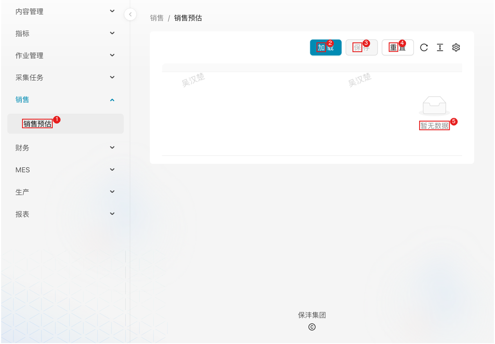

# 销售管理

## 1. 模块说明

销售管理模块由销售人员使用，提供销售数据的预估录入与数据可视化功能：

- **销售预估**：销售人员定期录入各客户分类（内销/外销）的销售预测数据
- **销售数据**：数据可视化报表，展示销售数据的同比分析

## 2. 页面速查表

| 页面 | 菜单位置 | 主要操作 |
|------|----------|----------|
| 销售预估 | 销售 → 销售预估 | 加载、录入、保存、重置 |
| 销售数据 | 报表 → 销售数据 | 筛选（区域/组织/日期）、切换维度（客户/部门/销售员） |

图中：
1. 左侧菜单「销售 → 销售预估」；
2. 「加载」按钮：加载当前预估数据；页面同时提供文件上传区域，可下载 **内销模板** / **外销模版**，按模板整理后上传导入；
3. 「保存」按钮；
4. 「重置」按钮；
5. 预估数据表格。

## 3. 流程

### 3.1 录入销售预估：为生产计划提供需求参考

**什么时候做**：按公司要求定期（月度）录入销售预测时。

**要达成什么**：本期销售预测数据录入完成，生产计划制定可参考；上次保存的历史数据自动归档留痕。

**怎么做**：

1. 在左侧菜单展开 **销售**，点击 **销售预估**
2. 点击 **加载** 按钮：加载当前已有的预估数据；页面同时提供文件上传区域，可下载 **内销模板** / **外销模版**，按模板整理后上传导入
3. 在表格中录入或修改预估数据
4. 点击 **保存** 提交数据
5. 如需放弃未保存的修改，点击 **重置**

**数据字段**：

| 字段 | 说明 |
|------|------|
| 年月 | 预测的评估月份，格式 YYYY-MM |
| 客户分类 | 内销 / 外销 |
| 字段编码 | 客户编码（关联 ERP 客户信息） |
| 预估类型字段 | 预估类型 |
| 盖型/客户 | 盖型或客户名称（内销） |
| 出口客户 | 出口客户名称（外销） |
| 开口 | 开口类型 |
| 品类 | 产品品类 |
| 子/分公司 | 子公司或分公司 |

**录入口径**：

- **内销**：录入次月、次次月预测值，以及各客户的预测值
- **外销**：录入各月份的预测值（如 1月、2月、...、2026年1月）

**注意**：每次保存会自动将相同「评估月份 + 客户分类」的历史数据标记为历史（`history = True`），新保存的数据作为当前有效预测值；历史数据保留供追溯分析。

**结果**：预估数据保存至 `market.market_sale_forecast` 表，通过 `daily.sale_forecast` 视图供下游使用。

### 3.2 查看销售数据：跟踪销量与同比表现

**什么时候做**：需要分析销量完成情况、对比去年同期表现时。

**要达成什么**：按区域、组织、时间维度掌握销量及同比变化，定位增长或下滑的客户/部门/销售员。

**怎么做**：

1. 在左侧菜单展开 **报表**，点击 **销售数据**
2. 设置筛选条件：

   - **销售区域**：外销 / 内销
   - **组织**：全部 / 厦门 / 湖北
   - **日期范围**：选择起止月份

3. 查看数据指标：

   - **盖数**：当前期间销量总和
   - **同期盖数**：去年同期销量
   - **同比**：同比增长率

4. 切换分析维度：客户 / 部门 / 销售员
5. 查看图表展示，同比图例说明：

   - ≤-50%：同比下降超过 50%
   - -50%~0%：同比下降
   - 0%~50%：同比增长
   - ≥50%：同比增长超过 50%

**结果**：销量与同比分析结论，用于销售复盘与预测校准。

## 4. 常见问题

**Q：保存后发现录错了？**

A：重新加载、修改后再次保存即可——新数据会覆盖为当前有效预测值，旧数据自动归档为历史，可在追溯分析时查看。

**Q：销售数据页看不到最新数据？**

A：销售数据来自报表数据表，按调度定时刷新；如需立即更新，联系数据管理员在报表管理中手动刷新对应报表。
