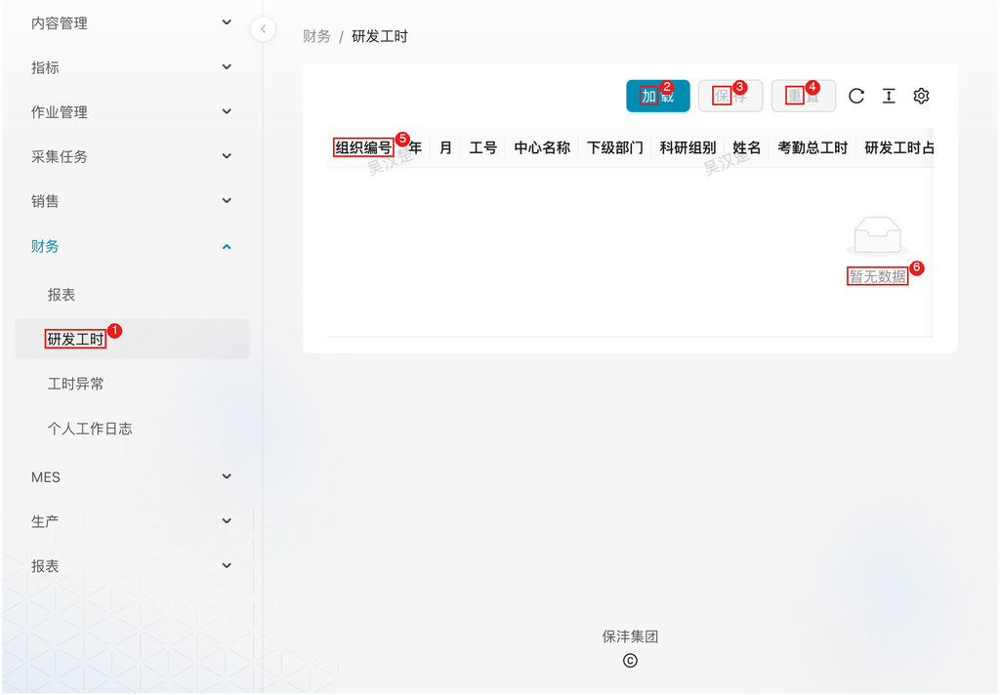

# 财务管理

## 1. 模块说明

财务管理模块由财务人员使用，提供财务相关报表的统一入口，以及研发工时数据的录入与异常监控功能：

- **报表**：财务相关数据对象的集中查看入口
- **研发工时**：研发人员工时数据录入，用于研发费用核算
- **工时异常**：工时分配异常的监控与查询，便于财务人员排查处理
- **个人工作日志**：按人员、项目查询研发人员的个人工作日志明细

页面关系：

```
研发工时录入 → 数据保存 → 工时分配计算 → 异常识别 → 工时异常查询
     ↓                                              ↓
   数据存储                                    异常处理
     ↓                                              ↓
  费用核算 ←←←←←←←←←←←←←←←←←←←←←←←←←←←←←←←←← 异常修正
```

1. **研发工时录入**：财务人员录入各研发项目的工时分配数据
2. **数据保存**：系统将工时数据保存到数据库，并触发工时分配计算
3. **异常识别**：系统自动检测工时分配异常（如研发工时与实际分配不一致）
4. **工时异常查询**：财务人员在异常页面查看并处理异常数据
5. **异常修正**：修正异常后重新录入工时，确保费用核算数据准确

## 2. 页面速查表

| 页面 | 菜单位置 | 主要操作 |
|------|----------|----------|
| 报表 | 财务 → 报表 | 筛选、查看刷新日志、依赖树 |
| 研发工时 | 财务 → 研发工时 | 加载、录入、保存、重置 |
| 工时异常 | 财务 → 工时异常 | 按年/月/工号/姓名/项目编码筛选、定位修正 |
| 个人工作日志 | 财务 → 个人工作日志 | 按年/月/研发项目/研发人员筛选、导出 |



图中：
1. 左侧菜单「财务 → 研发工时」；
2. 「加载」按钮；
3. 「保存」按钮；
4. 「重置」按钮；
5. 工时数据列头（组织编号/年/月/工号/中心名称/下级部门/科研组别/姓名/考勤总工时/研发工时占考勤工时比例等）；
6. 工时数据表格。

## 3. 流程

### 3.1 查看财务报表：核对采集来的财务数据

**什么时候做**：需要查看从 ERP 采集的财务数据（应收明细、应收结算清单、其他付款申请单、研发项目相关报表）时。

**要达成什么**：确认报表数据已更新、口径正确；数据异常时能定位上游。

**怎么做**：

1. 在左侧菜单展开 **财务**，点击 **报表**
2. 通过筛选条件（表编码、表名称、启用状态、备注）查找目标报表
3. 点击操作栏按钮查看详情：

   - **日志**：查看数据刷新日志
   - **依赖树**：查看该报表的上游依赖对象

**结果**：财务报表数据可查，数据问题可沿依赖树定位到上游采集对象。

### 3.2 录入研发工时：研发费用核算的基础数据

**什么时候做**：按核算周期（月度）录入研发人员工时分配时。

**要达成什么**：各研发项目的工时分配数据录入完成，系统触发工时分配计算，研发费用核算有据可依。

**怎么做**：

1. 在左侧菜单展开 **财务**，点击 **研发工时**
2. 点击 **加载** 按钮，加载当前已有的工时数据
3. 在表格中录入或修改工时数据（各研发项目的工时分配、研发工时占考勤工时比例、按项目分配的工时明细）
4. 点击 **保存** 提交数据
5. 如需放弃未保存的修改，点击 **重置**

**注意**：保存后系统自动计算工时分配；若研发工时与实际分配不一致会记录到工时异常，需在工时异常页处理（见 3.3）。

**结果**：工时数据入库并完成分配计算，支撑研发费用核算、项目成本分析与人员效率统计。

### 3.3 处理工时异常：保证费用核算数据准确

**什么时候做**：录入工时并保存后，或在工时异常页发现有未处理异常时。

**要达成什么**：异常记录清零，工时分配与研发工时一致。

**怎么做**：

1. 在左侧菜单展开 **财务**，点击 **工时异常**
2. 通过筛选条件（年、月、工号、姓名、项目编码）定位异常记录
3. 查看异常详情，分析异常原因
4. 返回 **研发工时** 页面修正数据
5. 重新触发工时分配计算，确认异常消除

**常见异常类型**：

| 异常信息 | 原因说明 | 处理方式 |
|------|------|------|
| 无考勤记录，无法分配工时 | 员工在指定月份无考勤数据 | 确认考勤数据是否缺失 |
| 工时分配比例异常 | 实际分配工时与研发工时不匹配 | 调整工时分配比例 |

**结果**：异常修正完成，费用核算数据准确。

### 3.4 查询个人工作日志：核对研发人员工时明细

**什么时候做**：需要核对某研发人员在项目上的工作内容与工时投入，或配合项目检查、审计取证明细时。

**要达成什么**：按人员/项目取得工作日志明细，可导出留存。

**怎么做**：

1. 在左侧菜单展开 **财务**，点击 **个人工作日志**
2. 设置筛选条件：年、月、研发项目、研发人员
3. 查看明细列表：姓名、科研组别、项目名称、日期、工作内容、工时（H）
4. 点击 **导出** 导出数据

**结果**：研发人员工作日志明细可查可导出，用于工时核对与追溯。

## 4. 常见问题

**Q：财务报表数据不是最新的？**

A：报表数据按调度定时刷新。在报表列表查看 **日志** 确认最近刷新时间；如有异常，通过 **依赖树** 定位上游对象并联系数据管理员处理。

**Q：研发工时保存后立刻有异常记录，是录错了吗？**

A：不一定是录入错误。异常表示「研发工时与实际分配不一致」或「无考勤记录」，常见原因是考勤数据缺失或分配比例需调整，按 3.3 节排查修正后重新计算即可。
