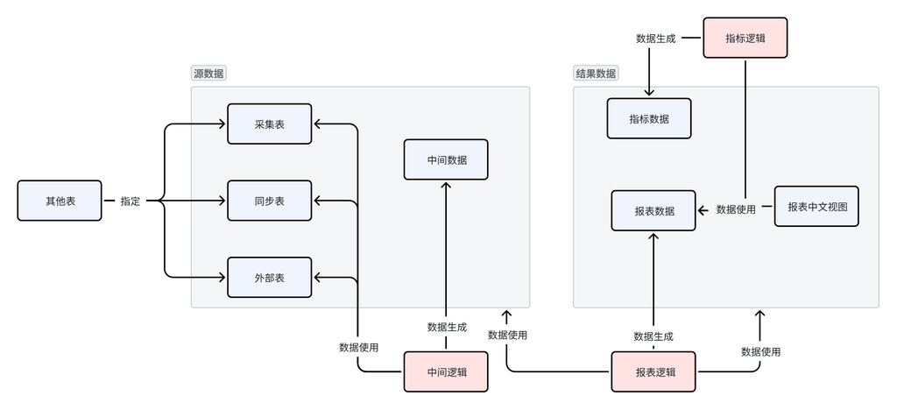

# 数据中心 — 使用文档

## 1. 系统简介

数据中心是保沣统一的数据集成与分析平台，承担三类工作：

- **数据接入与报表生产**：从 ERP、MES、云之家等外部系统自动采集数据，加工成业务报表与指标，每天定时更新
- **数据服务**：提供统一查询页面与标准 API（PostgREST 风格），供大屏、移动应用等第三方系统取数
- **业务数据录入**：销售预估、研发工时等无法从外部系统取得的数据，由业务人员在线录入

数据链路：**采集 → 中间过程（可选）→ 报表 → 指标**，全部由元数据驱动、定时任务自动执行。

数据自左向右经过「采集 → 处理 → 报表 → 指标」四个环节，采集表与报表数据均可直接生成中文视图（`_cn`）供查询。

## 2. 交互界面与访问入口

| 界面 | 载体 | 使用角色 |
|------|------|----------|
| 数据中心管理界面 | 协同门户顶栏「数据中心」进入 | 数据管理员、录入人员 |
| 统一查询页面 | 数据中心内进入，或 URL 直接访问 / iframe 外挂 | 查询用户、第三方系统 |

- **对内入口**：登录协同门户后，点击顶栏「数据中心」进入，无需二次登录
- **统一查询页面外挂**：配置好的查询页面可通过 URL 直接访问或嵌入第三方系统 iframe（参见《04_标准数据查询》）

## 3. 角色与功能矩阵

| 角色 | 主要模块 | 功能 |
|------|----------|------|
| 数据管理员 | 内容管理、指标、作业管理、采集任务 | 数据对象配置、采集任务构建与监控、字典与字段维护、指标定义、任务排查 |
| 销售人员 | 销售、报表 | 销售预估录入、销售数据查看 |
| 财务人员 | 财务 | 财务报表查看、研发工时录入、工时异常处理、个人工作日志查询 |
| 查询用户 / 第三方系统 | 内容管理（数据查询）、统一查询页面 | 界面查询、标准 API 取数 |

菜单总览（管理界面左侧菜单）：内容管理（数据对象/数据查询/字典信息/字段信息）、指标（指标类型/指标数据）、作业管理（工作作业/作业日志）、采集任务（项目信息/采集任务/任务日志/执行组/执行器/数据源）、销售（销售预估）、财务（报表/研发工时/工时异常/个人工作日志）、MES（Lots工具箱）、生产（制盖厂月生产计划）、报表（销售数据）。

> MES「Lots工具箱」（按生产订单号/成品卷号做批次溯源）与「生产 → 制盖厂月生产计划」（按年月/机台/盖型维护月度计划，加载后编辑保存）为工具型页面，按页面内筛选与操作使用，不单独成篇。

## 4. 业务主线

### 4.1 数据接入主线（数据管理员）

新数据从外部系统到可用报表：**配置数据源 → 配置采集对象 → 构建目标表与采集任务 →（可选）中间过程 → 创建报表对象 → 配置字段与字典 → 定时自动刷新**。全流程操作见《01_报表管理》；任务监控与失败排查见《03_系统调度》。

### 4.2 业务录入主线（销售 / 财务）

- 销售：每月录入次月与次次月销售预估（内销/外销），为生产计划提供参考，见《05_销售管理》
- 财务：定期录入研发人员工时分配，系统自动计算分配并识别异常，异常回改后重算，见《06_财务管理》

### 4.3 数据消费主线（查询用户 / 第三方）

配置好的报表通过两种方式消费：统一查询页面（界面查询、可外挂）与标准 API（PostgREST 风格 URL 查询），见《04_标准数据查询》；指标数据供大屏展示，见《02_指标管理》。

## 5. 文档导航

| 文档 | 内容 | 主要读者 |
|------|------|----------|
| 《01_报表管理》 | 数据源配置、采集表创建、报表生成、字段管理 | 数据管理员 |
| 《02_指标管理》 | 指标类型配置、指标数据生成 | 数据管理员 |
| 《03_系统调度》 | 作业管理、采集任务调度与监控、Airflow 调度清单 | 数据管理员、运维 |
| 《04_标准数据查询》 | 字典、数据查询界面、标准 API、查询页面外挂 | 数据管理员、开发对接人员 |
| 《05_销售管理》 | 销售预估录入、销售数据查看 | 销售人员 |
| 《06_财务管理》 | 财务报表、研发工时录入、工时异常、个人工作日志 | 财务人员 |

## 6. 外部系统集成

| 系统 | 用途 |
|------|------|
| ERP | 采集物料、组织、财务、客户等基础与业务数据 |
| MES | 采集生产、设备、质检数据（厦门 A100 / 湖北 C101 双厂区，`org_id` 区分） |
| 云之家 | 同步审批表单、员工信息等数据 |
| 金蝶云 | 同步财务报表、存货收发存等数据 |
| DataX | 数据采集执行引擎 |
| Airflow | 主调度平台，按 DAG 定时调用数据中心 API 触发刷新 |
| 政府能源平台 | 每日上报能源消耗数据 |

## 7. 开发与测试参考

| 项 | 说明 |
|----|------|
| 后端仓库 | `/Users/wuhanchu/project/baofeng/data_center_service`（Python/Flask，模块：bi/dict/ehr/erp/etl/job/market/middle/project/query/yunzhijia） |
| 前端仓库 | `/Users/wuhanchu/project/baofeng/data_center_web`（umi / Ant Design Pro，路由见 `config/routes.ts`） |
| 数据库连接 | 见后端仓库 `config.py` 配置 |
| 测试账号 | 18225283（吴汉楚，管理员），密码请联系管理员获取 |
| 测试环境 | http://192.168.111.243:31016 |
