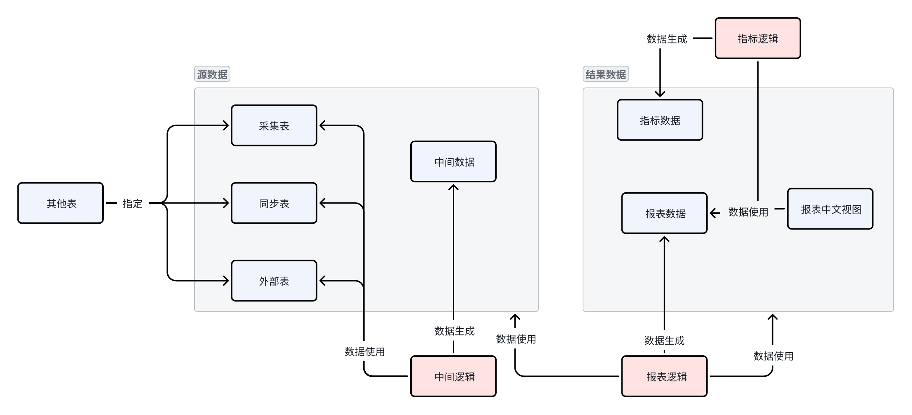

# 系统说明

## 系统功能

数据中心是一个统一的数据集成与分析平台，实现以下核心功能：

- **数据采集**：从 ERP、MES、云之家等外部系统自动抽取数据
- **报表管理**：配置和维护各类业务报表，数据每天自动更新
- **数据查询**：提供统一界面查询各业务系统的数据，支持筛选、排序、导出
- **指标计算**：基于报表数据按维度汇总计算指标，供大屏展示和分析使用
- **数据录入**：提供销售预估、研发工时等数据的在线录入功能
- **标准 API**：提供 PostgREST 风格的标准查询接口，支持 URL 嵌入其他系统

## 系统作用

### 数据集中采集

- **高效整合**：将分散在不同业务系统、部门或地理位置的数据集中到一个统一的平台中。这样可以避免数据孤岛现象，确保数据的一致性和完整性，提高数据管理的效率。
- **自动化提取**：通过数据接口、文件传输等方式自动从各个业务系统中提取数据。减少了人工操作的繁琐性和错误率，加快了数据的收集速度，确保数据的及时性和准确性。

### 数据统一分析

- **深度洞察**：利用先进的数据分析工具和技术，对集中后的数据进行统一的分析和挖掘。可以发现数据之间的关联和规律，为企业的决策提供有力支持。
- **智能决策**：结合人工智能和机器学习算法，实现对数据的智能分析和预测。帮助企业预测市场趋势、优化业务流程、提高运营效率。

### 多渠道统一标准访问

- **便捷访问**：提供统一的数据访问接口和工具，使得用户可以通过多种渠道方便地访问和使用数据。无论是通过内部系统、移动设备还是外部接口，都能实现快速、一致的数据访问。
- **标准化管理**：制定统一的数据标准和规范，确保数据在不同系统和渠道之间的一致性和可互操作性。包括数据的格式、编码、属性校验等方面的标准，使得数据能够顺畅地在各个业务部门和系统之间流通。

## 功能模块

| 模块 | 主要功能 | 参见文档 |
|------|----------|----------|
| **报表管理** | 数据对象配置、数据采集、报表生成、字段管理 | 《01_报表管理》 |
| **指标管理** | 指标定义与计算 | 《02_指标管理》 |
| **系统调度** | 作业管理、采集任务调度与监控 | 《03_系统调度》 |
| **数据查询** | 界面查询、标准 API | 《04_标准数据查询》 |
| **销售管理** | 销售预估数据录入 | 《05_销售管理》 |
| **财务管理** | 财务报表、研发工时、工时异常 | 《06_财务管理》 |

## 数据流程

**流程说明**：

1. **采集**：通过 DataX 从外部系统抽取数据到采集表
2. **处理**：通过 Python 脚本或物化视图生成中间过程数据
3. **报表**：基于采集表和中间过程生成报表数据
4. **指标**：基于报表数据按维度计算指标

## 文档目录

| 文档 | 内容 |
|------|------|
| 《00_系统说明》 | 系统功能、数据流程（本文档） |
| 《01_报表管理》 | 数据源配置、采集表创建、报表生成、字段管理 |
| 《02_指标管理》 | 指标类型配置、指标数据生成 |
| 《03_系统调度》 | 作业管理、采集任务调度与监控 |
| 《04_标准数据查询》 | 数据查询界面、标准 API、操作符说明 |
| 《05_销售管理》 | 销售预估数据录入 |
| 《06_财务管理》 | 财务报表、研发工时录入、工时异常查询 |
