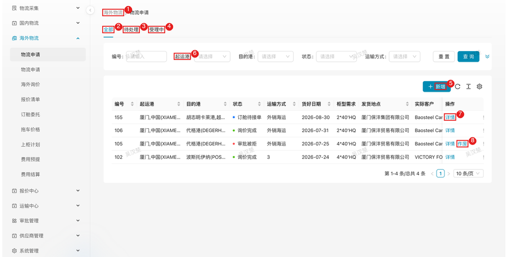
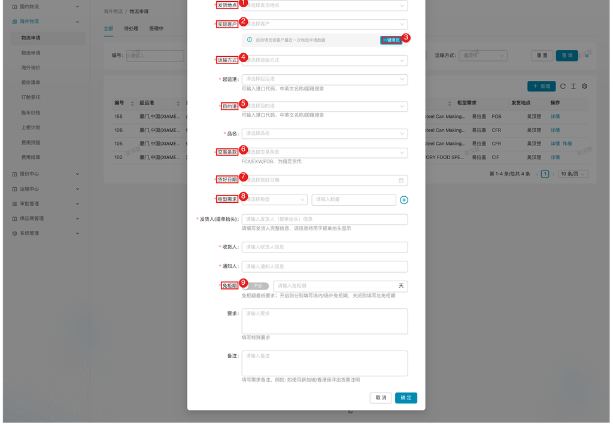

# 国外物流 — 申请人

> 角色：内部申请发起人（如销售），PC 端操作。海外物流业务的起点角色。

## 1. 角色说明

你是出运需求的源头。订单要出货了，由你向物流部提出**物流申请**；物流管理员接单后组织询价、订舱、上柜出运。你要做的不多，但**信息准、提得早**直接决定后面整条链路顺不顺。

你的三件事：

- **发起申请**：货物、港口、柜型柜量、货好日期等信息一次填准
- **跟踪进度**：看申请状态（待处理 → 受理中 → 询价完成 → 订舱待接单 → …）
- **配合修改**：被驳回时改了重提；货期变化时主动更新

## 2. 登录入口

内部员工通过**云之家**打开协同门户，**免登录**：

1. 打开云之家 → 点击「**协同门户**」
2. 顶部菜单选择「**物流管理**」子系统
3. 左侧菜单 **海外物流 → 物流申请**

**1.** 海外物流 → 物流申请菜单；    
**2.** 3 4 状态页签（全部 / 待处理 / 受理中）；    
**5.** 新增按钮；    
**6.** 筛选条件（编号、起运港、目的港、状态、运输方式）；    
**7.** 行操作「详情」；    
**8.** 行操作「作废」（仅特定状态可作废）。  

## 3. 页面速查表

| 页面 | 路径 | 主要操作 |
|------|------|---------|
| 物流申请（业务员视角） | 海外物流 → 物流申请 | 新增、查询、详情、作废 |
| 申请详情 | 列表行操作「详情」 | 查看明细与进度、驳回后修改重提 |

## 4. 流程

### 4.1 发起物流申请：把出货需求交给物流部

**什么时候做**：外销订单出货确定（客户要货/信用证交期锁定）时。**给物流部留足作业时间——一般货好日期前 7-10 天提出**；旺季、偏远港口更早。临门一脚才提申请，订不到舱、赶不上船，交期风险在业务侧。

**这一步要达成**：物流管理员可依据申请直接开展后续操作，无需再次向你确认港口、柜量、条款。

**怎么做**：列表（新增）→ 填关键信息 →（确定）提交。

**1.** **发货地点**；  
**2.** **实际客户**——选中后系统自动带出该客户最近一次物流申请数据；  
**3.** 可点「一键填充」快速回填历史信息；  
**4.** **运输方式**（如外销海运）；  
**5.** **目的港**（与起运港均支持港口代码、中英文名称/国籍搜索）；  
**6.** **交易条款**（FCA/EXW/FOB 为指定货代）；  
**7.** **货好日期**；  
**8.** **柜型需求**（选择柜型 + 数量，可多条）；  
**9.** **免柜期**（可分场内/场外填写，或不分，单位天）。

其余字段按需填写：品名、发货人（提单抬头）、收货人、通知人、要求、备注。

**注意**：

- **HS 编码必须准确**：同一起运港/目的港的多个申请要**合并订舱**时，HS 编码不同合并不了，会直接拆单、多花钱
- **货好日期是排产基准**：从它倒推询价、订舱、排柜，填「理想值」会导致整个计划虚的；按实际生产进度填
- **免柜期提前向客户确认**：目的港清关提货较慢的客户（如部分中东/非洲港），免柜期要求要在申请中写明，避免柜子到港后产生滞箱费
- FCA/EXW/FOB 是**指定货代**条款——客户指定货代的，要求里注明，物流部不走自家询价
- 和上次出运一样时：选实际客户 →（一键填充）按历史回填，再改差异项（柜量、货好日期）

**结果**：申请进入物流管理员待处理列表。后续在列表跟踪状态：待处理 → 受理中 → 询价完成 → 订舱待接单 → 已接单/已开船。

### 4.2 被驳回后修改重提：修改后重新提交

**什么时候做**：申请被物流管理员驳回时（常见：柜量与生产不符、条款选错、信息缺漏）。

**怎么做**：列表找到被驳回的申请 →（详情）看驳回原因 → 改完重新提交。

**注意**：别只改表面字样——驳回原因指向的根因（如货期没变但产能跟不上）要一并处理，否则二驳三驳耽误船期。

**结果**：修改后的申请重新进入物流管理员的待处理列表，由其重新审核。

## 5. 常见问题

| 情况 | 怎么办 |
|------|--------|
| 货好日期需延迟 | **立即**修改申请或通知物流管理员——排柜、拖车均按原日期安排，变更越早损失越小 |
| 柜量要加/减 | 未受理：作废重提或联系管理员退回修改；已进入询价/订舱：立即联系物流管理员评估差价与舱位 |
| 申请填错未被驳回 | 尽快联系物流管理员退回修改；已接单的变更需与货代、船司协调，代价大 |
| 申请要取消 | 未受理的行操作「**作废**」；已进入订舱环节的联系物流管理员处理 |
| 找不到自己的申请 | 用编号/港口筛选，确认页签（全部/待处理/受理中）选对 |

**Q：提交申请后，物流部多久受理？**

A：申请进入物流管理员待处理列表，按货好日期排序处理；临近货好或紧急出货建议同步线下知会。

**Q：和上次一样的出货，能快速填单吗？**

A：选实际客户后系统带出该客户最近一次申请数据，点「一键填充」回填，改差异项即可。

**Q：交易条款为什么会影响货代？**

A：FCA/EXW/FOB 条款下为指定货代，物流部按客户指定货代安排订舱；其他条款由保沣指定货代并组织询价。

**Q：免柜期怎么填？**

A：默认「不分」填总天数；需区分场内/场外时开启开关分别填。免柜期有最低要求，以表单提示为准；不确定时向客户确认目的港清关时效。

**Q：状态里的「订舱待接单」是什么意思？**

A：物流管理员已完成订舱委托，等货代确认接单，属正常流转。长期停留在该状态可联系物流管理员跟进。

**Q：为什么我的申请比别人慢？**

A：按货好日期紧急度排序，且审批中/异常报价的委托会多一道环节；临近货好还未受理请直接联系物流管理员。
