# 国外物流 — 申请人

> 角色：内部物流申请发起人（如销售），PC 端操作。海外物流业务的起点角色。

## 1. 角色说明

你是物流需求的源头。订单要出货了，由你向调度员提出**物流申请**；物流调度员接单后组织询价、订舱、上柜出运。

你的三件事：

- **发起申请**：货物、港口、柜型柜量、货好日期等信息一次填准
- **跟踪进度**：看申请状态（待处理 → 询价中 → 询价完成 → 订舱待接单 → 订舱已接单 →  …）
- **配合修改**：被驳回时改了重提；货期变化时主动更新

## 2. 登录入口

### 2.1 访问入口

- 内部员工通过**云之家**打开协同门户：

1. 打开云之家 →点击「**企业门户**」  →点击「**全部应用**」 →点击「**协同门户**」

   

2. 顶部菜单选择「**物流管理**」子系统

3. 左侧菜单 **海外物流 → 物流申请**

   

- 通过协同门户网站地址打开（https://collab.xmbaofeng.com/）打开：

   1. 打开网站 → 选择**账号密码**或**微信扫码**完成登录操作

    

    2.顶部菜单选择「**物流管理**」子系统

### 2.2 绑定微信公众号

**什么时候做**：需要采用微信扫描登录时，需要提前在个人中心完成微信公众号绑定。

**绑定方法**：PC 登录协同平台 → 右上角头像 → **个人中心** → 绑定公众号 → 微信扫码 → 微信里确认授权。

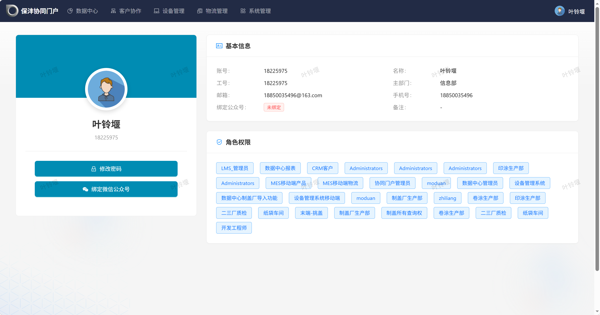

1. 「修改密码」按钮；
2. 「解绑微信公众号」按钮，未绑定时此处为绑定入口；
3. 绑定公众号状态，**已绑定**即微信绑定生效；
4. 角色权限，决定你能使用的功能。

**注意**：

- 一个微信只能绑一个账号，一个账号也只能绑一个微信
- 扫码授权时确认公众号为「厦门保沣集团有限公司」
- 绑定后通知有分钟级延迟，属正常现象
- 切换微信：个人中心「解绑微信公众号」后重新绑定新微信

## 3. 页面速查表

| 页面 | 路径 | 主要操作 |
|------|------|---------|
| 物流申请 | 海外物流 → 物流申请 | 新增、查询详情、作废 |
| 申请详情 | 物流申请 → 列表操作「详情」 | 查看明细与进度、驳回后修改重提 |
| 上柜计划 | 海外物流 → 上柜计划 | 查看上柜计划信息 |
| 个人中心 | 用户→ 个人中心 | 基本信息、角色权限、修改密码、绑定微信公众号 |

## 4. 流程

### 4.1 发起物流申请：

**什么时候做**：外销订单出货确定时。**给调度员留足作业时间——一般货好日期前 7-10 天提出**；旺季、偏远港口更早。

**这一步要达成**：物流管理员可依据申请直接开展后续操作，无需再次向你确认港口、条款、订舱等信息。

**怎么做**：列表（新增）→ 填关键信息 →（确定）提交。

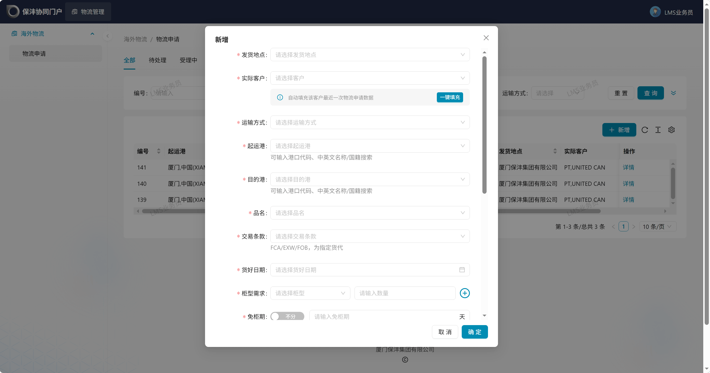

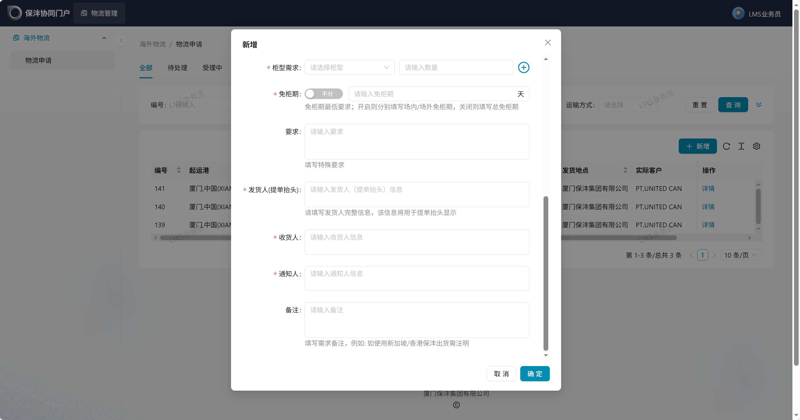

1. **发货地点**：必填，厦门或湖北发货；  

2. **实际客户**：必填，实际客户；

   **一键填充**：选中后系统自动带出该客户最近一次物流申请数据；   

3. **运输方式**：必填，如外销海运；  

4. **目的港/起运港：**必填，均支持港口代码、中英文名称/国籍快速搜索；

5. **品名**：必填，用于货代订舱使用；

6. **交易条款：**必填，FCA/EXW/FOB 为指定货代，指定货代需选择操作货代字段；

   **是否实盘**：非指定货代时选择，默认是；

   **操作货代：**指定货代必填，实际操作供应商；

7. **货好日期：**必填；  

8. **柜型需求：**必填，选择柜型 + 数量，可新增多个柜型；  

9. **免柜期：**必填，可分场内/场外填写，不分则填写总免柜期，区分则分别填写场内外免柜期，单位天；

10. **要求：**填写其他特殊要求；

11. **发货人（提单抬头）**：必填，填写发货人完整信息，该信息用于提单抬头显示；

12. **收货人：**必填，填写收货人完整信息;

13. **通知人：**必填，填写通知人完整信息；

**快捷方式发起**：在申请列表选择相应申请，点击克隆进行发起，系统会自动填充选定申请的信息，可快速发起。

**注意**：

- FCA/EXW/FOB 是**指定货代**条款：客户指定货代的，不走询价流程，新增物流申请后自动创建订舱委托；
- 一键填充：选实际客户 →（一键填充）按历史回填，再自行更改差异项（柜量、货好日期）；
- 港口无法找到：联系物流管理员或者IT开通；

**结果**：申请进入物流管理员待处理列表。后续在列表跟踪状态：待处理 → 受理中 → 询价完成 → 订舱待确认→ 订舱已接单。

### 4.2 修改/删除物流申请：

**什么时候可以做**：物流申请未被调度员受理时，可修改或删除申请需求。

**怎么做：**列表【编辑】按钮→ 修改关键信息 →（确定）提交。

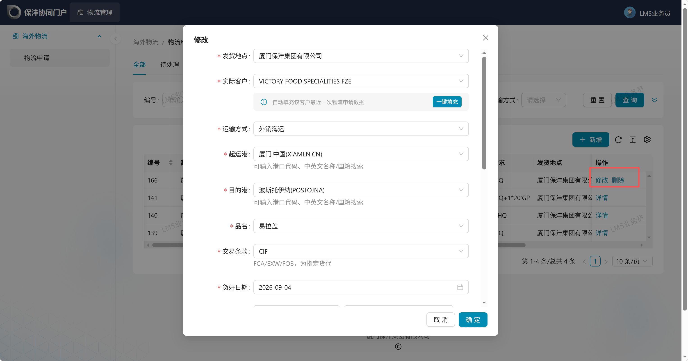

### 4.3 被驳回后修改重提：

**什么时候做**：申请被物流调度员员驳回时（常见：条款选错、信息缺漏）。

**怎么做**：列表找到被驳回的申请 →（详情）看驳回原因 → 点击【重新提交】按钮→ 修改内容后重新提交。

**注意**：重新发起需要修改驳回原因指向的根因，否则二驳三驳耽误船期。

**结果**：修改后的申请重新进入物流调度员的待处理列表，由其重新审核。

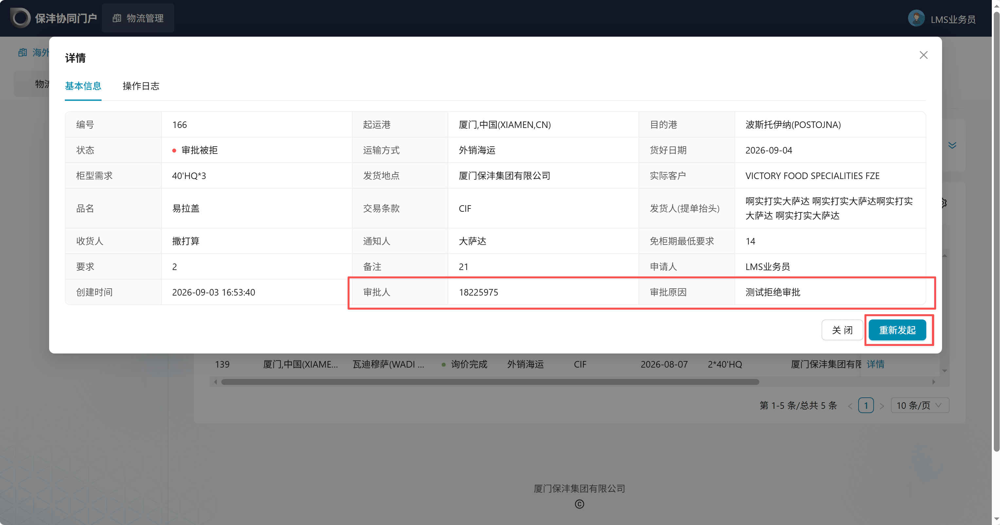

### 4.4 订舱备注：

**什么时候做**：当调度员订舱时，未选择最佳方案时，与调度员线下沟通后确认订舱，可以增加订舱选择原因备注。

**怎么做**：列表找到对应的物流申请 →（详情）看订舱、报价信息  → 点击[订舱备注] 唤起弹窗 → 填写并保存。

**结果**：填写备注信息后，业务员与调度员都能查看该字段信息，以便后续核对。

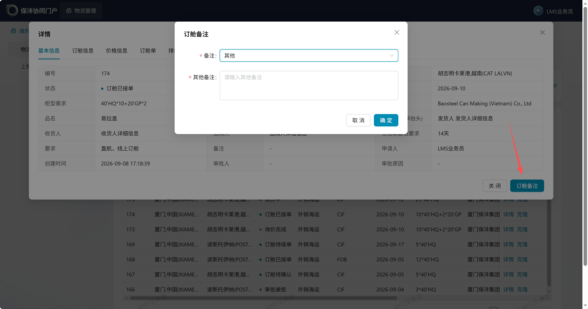

### 4.5 指定货代：上传订舱单、排载单：

**什么时候做**：当发去物流申请是指定货代时，需要增加操作货代的选择，创建后会自动生成订舱委托单信息，需要业务员手动填写订舱单、排载单信息。

**怎么做**：在创建完物流申请后，打开详情，点击【新增订舱单】或【新增排载单】按钮完成操作。

**注意**：当调度员选择推送同步至金蝶后，业务员无法再进行删除或替换订舱单必填字段。若需要变更，请联系调度员操作。

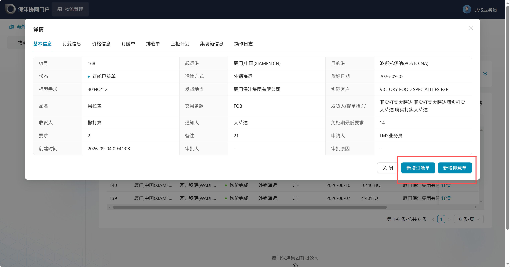

#### 4.5.1 上传订舱单

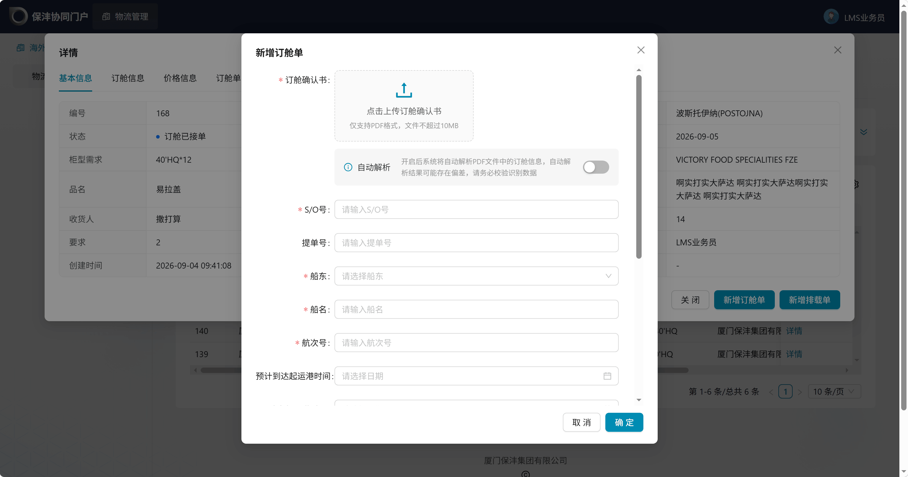

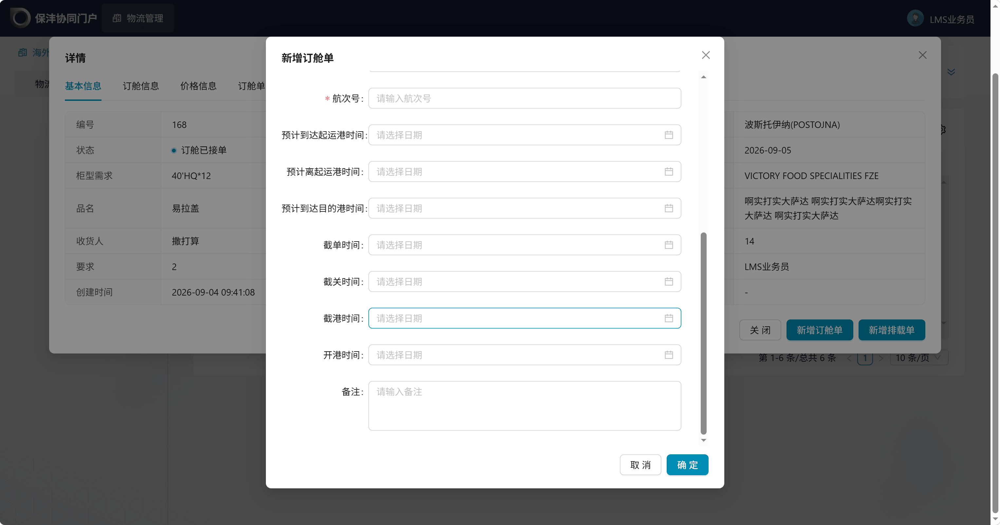

1. **订舱确认书**：必填，上传订舱确认书，仅支持PDF格式；

   **自动解析：**开启后系统将自动解析PDF文件中的订舱信息，自动解析结果可能存在偏差，请自行核对识别数据；  

2. **S/O号**：必填，订舱号；

3. 提单号：提单编号；

4. 船东：必填，选择船东，可查询搜索；

5. 船名：必填；

6. 航次号：必填；

7. 预计到达起运港时间、预计离开起运港时间、预计达到目的港时间、截单时间、截关时间、截港时间、开港时间、备注字段非必填，可随时补充修改

**注意：**订舱确认书、S/O号、提单号、船东、航次号在调度员完成推送金蝶后无法进行变更，其余字段可按需进行编辑。

#### 4.5.2 上传排载单

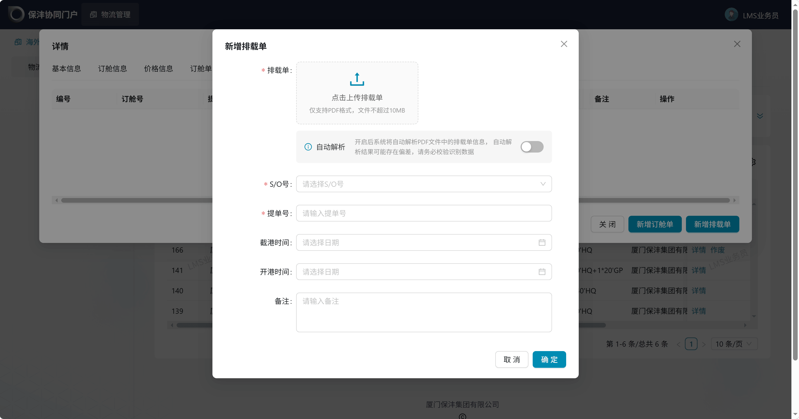

1. **订舱确认书**：必填，上传订舱确认书，仅支持PDF格式；

   **自动解析：**开启后系统将自动解析PDF文件中的订舱信息，自动解析结果可能存在偏差，请自行核对识别数据；  

2. **S/O号**：必填，订舱号；

3. 提单号：必填；

4. 截港时间、开港时间、备注非必填；

**注意：**排载单无限制上传时间。

## 5. 上柜计划

在左侧菜单 **海外物流 → 上柜计划**中可查看上柜计划看板。

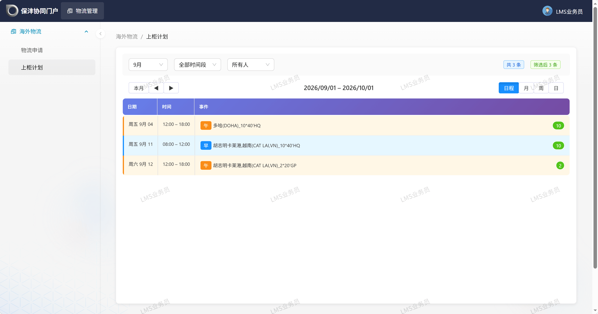

- 过滤数据：通过切换月份、时间段、业务发起人可过滤看板数据。

- 切换视图：可使用日程、月、周、日视图进行切换。

- 查看详情：点击看板中的事件，可查看当前上柜计划的详细数据，包含起运港、目的港、运输方式、交易条款、业务员、提单号、上柜柜量、发货通知单、物流调单等信息。

  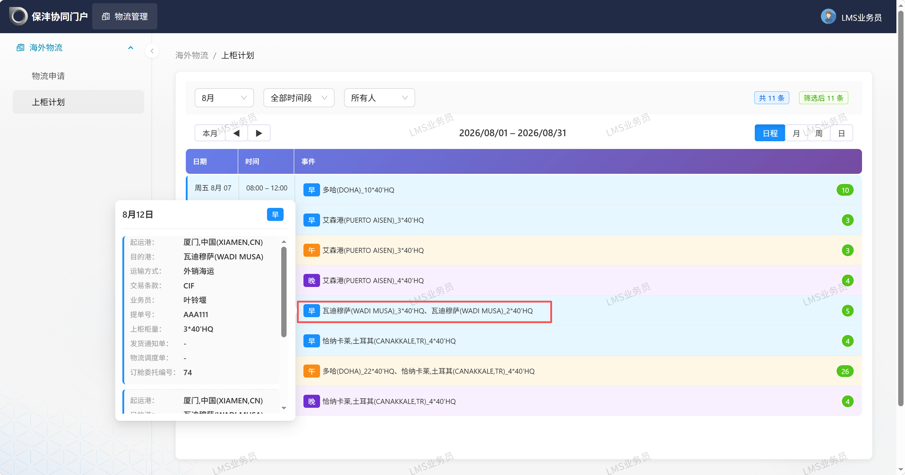

## 6. 常见问题

**Q：无法选择需求港口？**

A：联系物流管理员新增港口信息。

**Q：和上次一样的需求，能快速填单吗？**

A：选实际客户后，点「一键填充」按钮，系统会自动带出该客户最近一次申请数据，修改差异项即可。

**Q：免柜期怎么填？**

A：默认「不分」填总天数；需区分场内/场外时开启开关分别填。免柜期有最低要求，以表单提示为准。

**Q：状态里的「订舱待接单」是什么意思？**

A：物流管理员已完成订舱委托，等货代确认接单，属正常流转。长期停留在该状态可联系物流调度员跟进。
