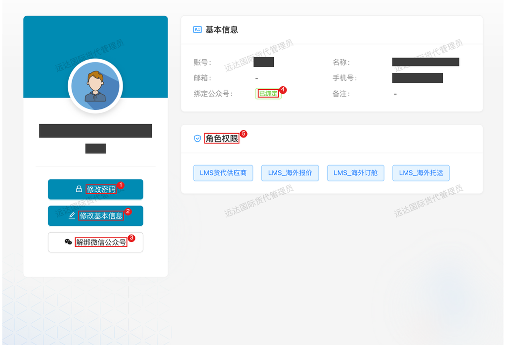

# 国内物流 — 托运

> 角色：国内运输供应商（车队/拖车行），报价与执行方。业务通知通过微信公众号模板消息推送。

## 1. 角色说明

你是保沣国内运输运力的采购对象，流程为**报价竞争 → 中标锁价 → 按价执行**。

- **参与询价**：收到邀请后，按线路 + 柜型提交底价（整车），或按重量区间分级报价（零担）
- **多轮应价**：保沣可能多轮询价压价，跟不跟价你自己定
- **中标执行**：中标价格经审批写入保沣金蝶路线价目表，后续该线路运输按此价结算

> 账号来源：由保沣物流管理员在供应商管理中维护并开通平台账号；报价邀请以轮次的供应商范围为准。

## 2. 登录入口

### 2.1 访问入口

日常操作以 **PC 端为主**；微信公众号为辅，主要用于接收消息通知。

- **PC 端（主要操作入口）**：浏览器打开对外协同平台 <https://collab.xmbaofeng.com/>，使用平台账号登录后进入**报价中心**
- **移动端（辅助）**：微信公众号「**厦门保沣集团有限公司**」→ 底部菜单「**合作伙伴**」→「**供应商协作**」进入操作页面；主要用来接收询价邀请与业务消息推送，点开消息可直接进入对应页面

### 2.2 账号开通与登录

- 首次使用请联系保沣对接人开通平台账号（账号由保沣统一创建）
- PC 端使用账号密码登录；忘记密码联系保沣管理员重置
- 换手机不影响登录，凭账号密码使用

### 2.3 绑定微信公众号（必做）

询价邀请与业务消息都通过公众号模板消息推送，公众号里的页面也靠绑定识别身份——**不绑定即收不到通知，页面也无法正常使用**。

**绑定方法**：PC 登录协同平台 → 右上角头像 → **个人中心** → 绑定公众号 → 微信扫码 → 微信里确认授权。

1. 「修改密码」按钮；
2. 「修改基本信息」按钮，供应商可自助维护名称、邮箱、手机号等资料；
3. 「解绑微信公众号」按钮，未绑定时此处为绑定入口；
4. 绑定公众号状态，**已绑定**即微信绑定生效；
5. 角色权限，决定你能使用的功能。

**注意**：

- 一个微信只能绑一个账号，一个账号也只能绑一个微信
- 扫码授权时确认公众号为「厦门保沣集团有限公司」
- 绑定后通知有分钟级延迟，属正常现象
- 换微信或人员交接：个人中心「解绑微信公众号」后重新绑定新微信

## 3. 页面速查表

| 页面 | 入口 | 主要操作 |
|------|------|---------|
| 报价中心（国内报价） | 协同平台 → 报价中心 | 查看询价单、按线路填写报价、提交 |
| 议价补充 | 询价邀请进入 | 填写车辆/资质等基础资料 |
| 公众号通知 | 微信公众号「厦门保沣集团有限公司」 | 接收询价/业务消息 |

> 报价界面截图待实测供应商账号后补充。

## 4. 流程

### 4.1 查看询价与提交报价：按线路柜型或重量区间报价

**什么时候做**：收到保沣询价邀请（微信公众号消息）后**尽快报价**，务必在截止时间前提交——截止后系统自动收口，无法补报。

**这一步要达成**：按保沣的计价口径报出真实有竞争力的价格。

**报价规则（按运输类型）**：

| 运输类型 | 报价方式 |
|---------|---------|
| 整车 | 按线路 + 柜型，一条线路一个柜型报一个**底价** |
| 零担 | 按 3 个重量区间（轻货 / 中货 / 重货）分别报单价 |

**怎么做**：登录协同平台 → 报价中心 → 打开询价单 → 按线路逐条填写（整车填底价；零担分区间填单价）→ 截止前提交。

**注意**：

- **报真实成本价**：保沣会记录每轮报价历史做底价趋势分析，虚高会被淘汰，击穿成本中了也做不长久
- 零担报价格外注意：三个区间单价是整体方案，某区间报价异常会拖累整条线路中标
- 只对邀请范围内的线路报价；不在范围内的线路报了也无效

**特殊情况**：

| 情况 | 怎么办 |
|------|--------|
| 没收到询价通知 | 确认微信已关注公众号；联系保沣物流管理员确认是否在本轮供应商范围内 |
| 报价填错已提交 | 截止前修改重新提交即可；已截止的联系物流管理员处理 |
| 部分线路运力排不开 | 只报有把握的线路，别为凑数报空价 |

**结果**：报价提交进入比价池；截止后保沣自动比价，你的报价与排名实时可查。

### 4.2 多轮压价应价：跟进下一轮报价

**什么时候做**：第一轮后未中标、保沣发布新一轮询价时。

**这一步要达成**：理性跟价——中标的前提是不亏本。

**怎么做**：收到新一轮通知 → 对比当前排名与自己成本 → 决定跟随降价或维持原价 → 重新提交。

**注意**：

- 每轮的线路范围、供应商范围、截止时间独立设置——本轮没被邀请的线路不会出现
- **不跟随降价 = 维持原价继续参与比价**，不会被惩罚；保沣按最低价自动比价，选不选你由市场决定
- 降幅空间留给有把握的线路；全线虚跟不如重点线路报实

**结果**：以最新一轮价格参与比价；不跟随降价即维持原价参与。

### 4.3 议价补充：先补资料才有报价资格

**什么时候做**：保沣询价单勾选了**议价补充模式**时——保沣要先看你的车辆、资质再谈报价。

**怎么做**：收到补充邀请 → 在系统中填写基础信息（车辆、资质等）→ 等保沣确认 → 资料确认后进入正式报价（同 4.1）。

**注意**：资料填全填实——这是保沣评估运力可靠的依据，也影响后续人工选标判断。

**结果**：资料经保沣确认后获得报价资格，转入正式报价（同 4.1）。

### 4.4 中标后执行：价格生效与履约

**什么时候做**：你的报价被选中（可能经人工选标调整）、保沣内部审批通过后。

**结果**：

- 中标价格写入保沣**金蝶路线价目表**——从这时起该线路发货自动按你的价格结算
- 运输任务执行与回单按保沣物流管理员的通知安排；运费按中标价结算
- **价格有有效期**：到期或市场变化后保沣会重新询价，届时再次参与即可

**注意**：中标价就是执行价，执行中加价（油价、旺季）需提前与物流管理员协商调价机制，事后补差难被接受。

## 5. 常见问题

**Q：错过报价截止时间怎么办？**

A：本轮无法补报；等待下一轮或联系物流管理员发起新一轮。

**Q：未中标会有通知吗？**

A：比价按「线路 + 柜型」取最低价，未中标无单独通知；继续参与下一轮即可。

**Q：中标后运力无法履约怎么办？**

A：立即联系保沣物流管理员说明，协商部分线路让出或补偿方案，避免执行失败。

**Q：账号无法登录怎么办？**

A：联系保沣物流管理员重置平台账号。

**Q：整车和零担报价有什么区别？**

A：整车按「线路 + 柜型」报一个底价；零担按 3 个重量区间分别报单价，保沣比价时按区间优先级取最低价。

**Q：会被强制压价吗？**

A：不会。保沣通过多轮询价邀请供应商自愿调价，每轮你可自主决定报价；不跟随降价即维持上一轮价格参与比价。

**Q：中标后价格马上生效吗？**

A：选标结果需经保沣内部审批，审批通过并同步金蝶后，价格进入路线价目表生效。

**Q：为什么我报了最低价却没中标？**

A：保沣保留人工选标权利，将综合运力稳定性、历史履约等因素确定，最低价仅是重要参考。

**Q：中标价是一口价到底吗？**

A：有效期内按中标价结算；价格到期后保沣重新询价，届时按新市场情况报价。
