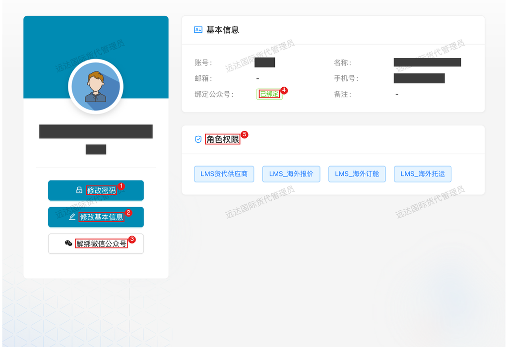
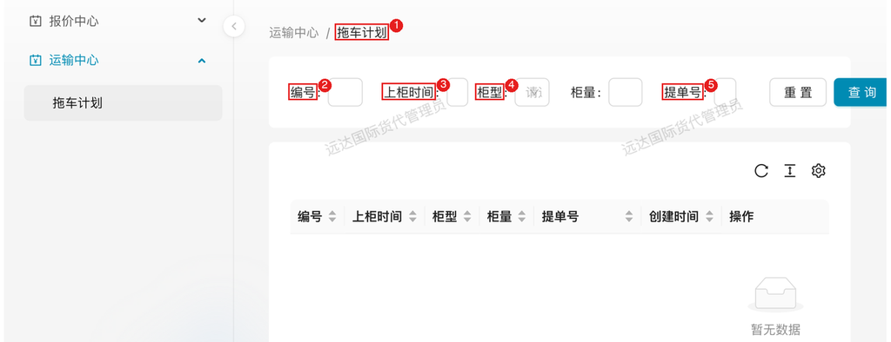

# 国外物流 — 托运

> 角色：外部拖车/运输供应商。操作界面：**对外协同平台 PC 端**（拖车计划查询）为主，微信公众号内嵌页面为辅（主要接收排车等业务通知）。

## 1. 角色说明

拖车供应商负责海外柜源的**拖车执行**环节，按排车计划把柜子按时提出来、装上货、交回场站：

- **接收排车任务**：物流管理员完成上柜计划、分配拖车公司后，通过公众号模板消息收到排车通知（含计划上柜日期和时段）
- **安排运力并回填信息**：按计划时段安排车辆，回填司机姓名、电话、车牌号
- **提柜与装柜执行**：按时段提柜、装柜、还场，完成交接

> 协作关系：上柜计划与拖车公司分配由物流管理员在 PC 端完成，供应商按通知执行即可。

## 2. 登录入口

### 2.1 访问入口

日常操作以 **PC 端为主**；微信公众号为辅，主要用于接收消息通知。

- **PC 端（主要操作入口）**：浏览器打开对外协同平台 <https://collab.xmbaofeng.com/>，使用平台账号登录 → **运输中心 → 拖车计划**（查询排车计划）
- **移动端（辅助）**：微信公众号「**厦门保沣集团有限公司**」→ 底部菜单「**合作伙伴**」→「**供应商协作**」进入操作页面；主要用来接收排车任务推送，点开消息可直接进入对应页面

> 注：拖车供应商账号与货代账号分角色管理。登录后首页仅显示本角色可用的功能入口。

### 2.2 账号开通与登录

- 首次使用请联系保沣对接人开通平台账号（账号由保沣统一创建）
- PC 端使用账号密码登录；忘记密码联系保沣管理员重置
- 换手机不影响登录，凭账号密码使用

### 2.3 绑定微信公众号（必做）

排车任务与业务消息都通过公众号模板消息推送，公众号里的页面也靠绑定识别身份——**不绑定即收不到排车任务，页面也无法正常使用**。

**绑定方法**：PC 登录协同平台 → 右上角头像 → **个人中心** → 绑定公众号 → 微信扫码 → 微信里确认授权。

1. 「修改密码」按钮；
2. 「修改基本信息」按钮，供应商可自助维护名称、邮箱、手机号等资料；
3. 「解绑微信公众号」按钮，未绑定时此处为绑定入口；
4. 绑定公众号状态，**已绑定**即微信绑定生效；
5. 角色权限，决定你能使用的功能。

**注意**：

- 一个微信只能绑一个账号，一个账号也只能绑一个微信
- 扫码授权时确认公众号为「厦门保沣集团有限公司」
- 绑定后通知有分钟级延迟，属正常现象
- 换微信或人员交接：个人中心「解绑微信公众号」后重新绑定新微信

## 3. 页面速查表

| 页面 | 入口 | 主要内容 |
|------|------|---------|
| 排车任务通知 | 公众号模板消息 | 计划上柜日期、时段、柜型数量 |
| 排车任务/调度单 | 凭物流管理员提供的二维码扫码进入 | 回填司机姓名、电话、车牌 |
| 拖车计划（PC） | 协同平台 → 运输中心 → 拖车计划 | 查询排车安排（编号/上柜时间/柜型/柜量/提单号） |
| 我的 | 移动端底部导航 | 账号信息、任务核对 |

> 移动端界面以实际显示为准。

## 4. 流程

### 4.1 接收排车通知：获取上柜时间与柜数

**什么时候做**：物流管理员完成上柜计划并分配给你的当天。通知会给出**计划上柜日期、时段、柜型与数量**。

**这一步要达成**：按时段备好运力——时段是保沣按装柜顺序和场地容量错峰安排的，须严格执行。

**怎么做**：微信收到「排车任务通知」模板消息 → 点开进入排车任务页 → 核对日期/时段/柜型柜量 → 安排车辆。

**注意**：

- 通知里是**柜型 + 数量**（如 2×40'HQ），核对车辆承载与柜型匹配（大柜小柜用车不同）
- 时段冲突（与其他任务重叠）应立即反馈：可调整的自行调整，无法调整的由保沣另行安排其他拖车公司——当日才反馈视同违约

**特殊情况**：

| 情况 | 怎么办 |
|------|--------|
| 没收到通知但确有任务 | 确认微信已关注/未屏蔽公众号；联系物流管理员重新推送（通知支持手动重发） |
| 运力不足/时段冲突 | 立即联系物流管理员调整时段或换排其他拖车公司 |

**结果**：按通知的日期/时段/柜型柜量备好运力，等待执行。

### 4.2 回填车辆与司机信息：通知拖车安排

**什么时候做**：确定执行车辆后、**到场前提早**回填。

**这一步要达成**：调度单上司机/车牌与实际执行车辆完全一致——保沣门禁与堆场按调度单放行，信息对不上车进不了场。

**怎么做**：收到物流管理员提供的**二维码**后，扫码进入对应柜子的调度单回填页 → 填写**司机姓名、联系电话、车牌号**。回填入口由物流管理员发起（二维码），**无法自行填写**。

**注意**：

- **车牌号是关键匹配字段**：门禁核放、费用归属都靠它，临时换车必须更新
- 一柜一单，多柜任务逐柜核对，别串填

**特殊情况**：

| 情况 | 怎么办 |
|------|--------|
| 没收到二维码 | 联系物流管理员提供后再回填，无法自行进入回填页 |
| 司机/车牌临时变更 | 到场前重新扫码更新回填，并电话告知现场，避免核放受阻 |

**结果**：调度单司机/车牌与实际车辆一致，门禁与堆场可正常核放。

### 4.3 提柜与装柜执行：按时完成交接

**什么时候做**：按计划时段执行提柜、装柜、还场。

**这一步要达成**：按时完成当天排定的柜子交接——**这是结算的依据**。

**怎么做**：

1. 按时段到场提柜、装柜
2. 每柜作业完成后核对调度单状态与实际一致（柜号、车牌）
3. 全部完成后确认当日任务无遗漏

**注意**：

- **拖车费按地磅单结算：城市单价 × 柜数**，按实际完成柜数结算
- 现场交接异常（柜号/封条不符、柜体损伤）当场拍照留证并联系物流管理员

**结果**：当天排定的柜子全部完成交接，费用结算有据可依。

**PC 端查询拖车计划**：协同平台 → 运输中心 → 拖车计划，按编号/上柜时间/柜型/提单号筛选，查看排车安排（柜量、创建时间等）。

**1.** 拖车计划页面；  
**2.** 3 4 5 筛选条件（编号 / 上柜时间 / 柜型 / 提单号）；
列表列：编号、上柜时间、柜型、柜量、提单号、创建时间、操作。

<!-- 截图占位：移动端排车任务页、调度单回填页（待实测拖车供应商账号后补充）

-->

## 5. 常见问题

**Q：没收到排车通知怎么办？**

A：先确认微信已关注公众号；仍无则联系物流管理员重新发送（通知可手动触发）。

**Q：排车通知里有时段，具体几点到？**

A：按通知中的计划上柜日期和时段安排，建议提前到场；现场以门禁/堆场安排为准。

**Q：时段冲突或临时有事执行不了怎么办？**

A：立即联系物流管理员调整时段或改派其他拖车公司，避免空置时段（该时段关联保沣整船的装柜计划）；当日才反馈视同违约。

**Q：司机信息一定要回填吗？临时变了怎么办？**

A：要。收到物流管理员提供的二维码后扫码进入回填页填写（无法自行填写）；调度单的运输人员信息（司机姓名、电话、车牌）用于现场核对放行与费用归属，车牌不一致车进不了场；临时变更须在到场前重新扫码更新回填并电话告知现场。

**Q：柜号/封条异常怎么办？**

A：现场拍照留证并联系物流管理员，按货代/船东要求处理。

**Q：压夜/滞期怎么办？**

A：提前预警给物流管理员（涉及截单时间与堆场费用归属）。

**Q：拖车费怎么算？**

A：按地磅单结算：城市单价 × 柜数。每柜作业完成后即时核对。
