# 保沣LMS系统操作手册——货代

> 角色：货代供应商。操作界面：**保沣协同平台 PC 端**为主，微信公众号内嵌页面为辅，两端数据实时同步。

## 1. 角色说明

货代供应商承担海外物流的**报价与订舱执行**：

- **海运报价**：接收保沣海外物流需求询价，按船东/航期/柜型价格等提交报价方案
- **订舱接单**：接收订舱委托，确认接单或拒绝
- **上传订舱单**：订舱确认后，上传订舱号、提单号、船名航次、截单/开港时间等订舱信息（订舱底单）
- **订舱信息跟踪**：可查看订舱委托信息，如保沣上柜计划、集装箱信息等

账号由保沣物流管理员开通，业务消息（新询价、新委托、接单结果等）通过公众号模板消息推送。

## 2. 登录入口

### 2.1 访问入口

日常操作以 **PC 端为主**，微信公众号为辅。

- **PC 端（主要操作入口）**：浏览器打开保沣协同平台 <https://collab.xmbaofeng.com/>，使用平台账号登录，菜单为「**报价中心**」（海运报价、订舱委托）。
- **移动端（辅助）**：微信公众号「**厦门保沣集团有限公司**」→ 底部菜单「**合作伙伴**」→「**供应商协作**」进入操作页面；主要用来接收业务消息推送，点开消息可直接进入对应页面。

移动端首页「物流管理」区提供两个入口：**海运报价**、**订舱委托**。

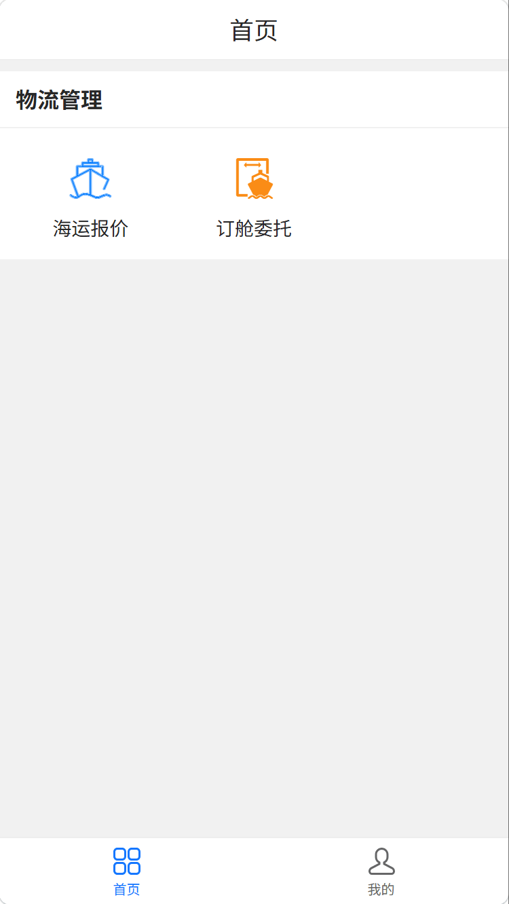

### 2.2 账号开通与登录

- 首次使用请联系保沣对接人开通平台账号，账号由保沣统一创建；
- 请保护好账号密码信息；
- 登录后请在个人中心中手动更改初始密码；
- PC端可使用账号密码或微信扫码登录，移动端通过公众号打开；
- 账号开通或者回收，请联系保沣对接人；

### 2.3 绑定微信公众号

询价邀请与业务消息都通过公众号模板消息推送，公众号里的页面也靠绑定识别身份——**不绑定即收不到通知，移动端页面也无法正常使用**。

**绑定方法**：PC 登录协同平台 → 右上角头像 → **个人中心** → 绑定公众号 → 微信扫码 → 微信里确认授权。

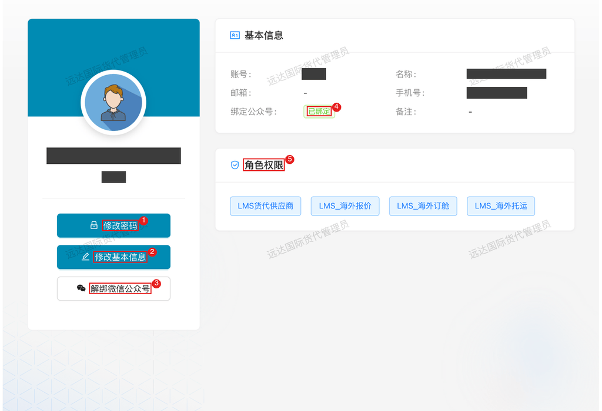

1. 「修改密码」按钮；
2. 「修改基本信息」按钮，供应商可自主维护名称、邮箱、手机号等资料；
3. 「解绑微信公众号」按钮，未绑定时此处为绑定入口；
4. 绑定公众号状态，**已绑定**即微信绑定生效；
5. 角色权限，决定你能使用的功能。

**注意**：

- 一个微信只能绑一个账号，一个账号也只能绑一个微信
- 扫码授权时确认公众号为「厦门保沣集团有限公司」
- 绑定后通知有分钟级延迟，属正常现象
- 换微信或人员交接：个人中心「解绑微信公众号」后重新绑定新微信

## 3. 页面速查表

| 页面 | 入口 | 主要操作 |
|------|------|---------|
| 海运报价（PC） | 协同平台 → 报价中心 → 海运报价 | 报价 / 详情；方案新增 / 编辑 / 克隆 / 删除 |
| 订舱委托（PC） | 协同平台 → 报价中心 → 订舱委托 | 接单 / 拒绝；订舱底单上传（S/O 号、截单时间、开港时间）与修改 |
| 移动端首页     | 公众号供应商协作               | 海运报价、订舱委托、我的信息入口                             |
| 海运报价列表 | 公众号供应商协作 → 海运报价 | 页签切换（全部/询价中/已完结/已作废）、查看询价、进详情 |
| 报价详情 | 报价列表「详情」 | 查看询价信息、当前排名、提交/修改报价方案（船期 + 按柜型价格 + 附加费） |
| 订舱委托列表 | 公众号供应商协作 → 订舱委托 | 页签切换（全部/待接单/已接单）、快捷接单 |
| 订舱详情 | 委托列表点卡片 | 核对订舱信息、确认接单 / 拒绝接单、查看 S/O 字段 |
| 我的 | 移动端底部「我的」 | 账号信息 |
| 个人中心（PC） | 协同平台→ 右上角用户选择 | 账号信息、修改密码、微信公众号绑定等 |

## 4. 流程

### 4.1 海运报价

**什么时候做**：收到询价推送（公众号消息）后**尽快响应**。保沣按报价信息自动比价排名，同样的价格，早报的先占位；截止时间一过系统自动结束询价。

**这一步要达成**：在截止前提交**有竞争力**的方案——价格有优势、船期匹配、有现舱等。

**怎么做**：

#### 4.1.1 报价入口

首页进入「**海运报价**」，看「询价中」页签的待报价询价，点击「**报价**」按钮，或者通过公众号消息打开报价页面。

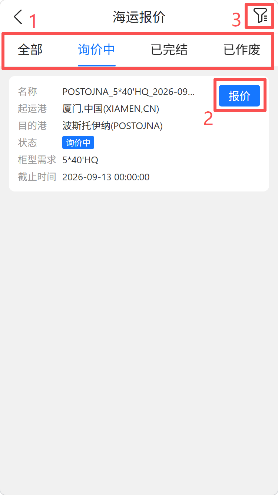

- 状态页签：询价中为默认；    
- 报价：进入报价页面；
- 过滤：通过条件筛选列表数据；

#### 4.1.2 新增报价

点「报价」进入详情，核对询价要求（截止时间、柜型需求、免柜期等条件），在「报价信息」区点「**新增报价**」

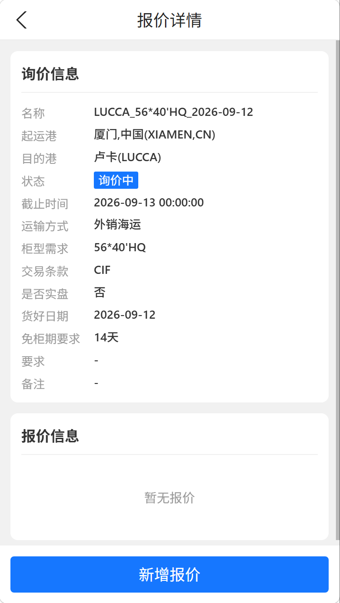

- **询价信息**：

​	名称、起运港、目的港、截止时间、柜型需求、交易条款、货好日期、免柜期要求、其他要求、备注等；

**注**：在截止时间前系统会自动结束报价，请在该时间前完成报价。

#### 4.1.3 保存报价

填写方案并「**保存报价**」

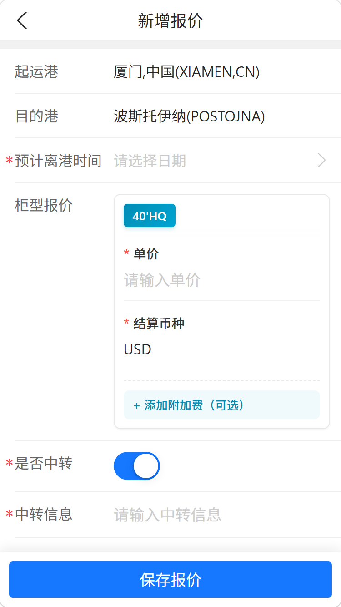

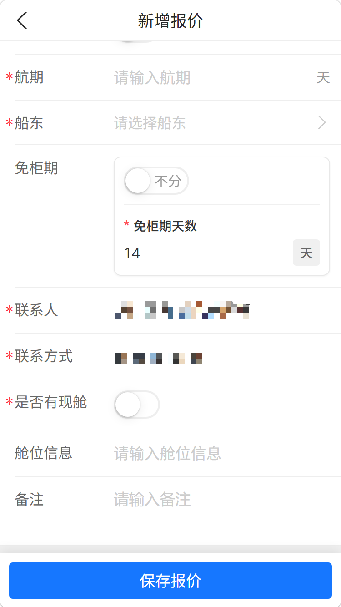

- **起运港/目的港**：根据询价信息自动自动带出，无需填写 ；
- **预计离港时间**：选择预计离岗日期；  
- **按柜型报价**：
  - 单价 + 结算币种：必填；
  - 附加费：按需添加附加费+附加费币种，以及附加费说明，例如（800+RMB+驳船费）；  
- **中转**：航线是否中转；
- **中转信息**：若需中转则必填中转信息，否则无需填写；
- **航期**：单位为天；
- **船东**：选择船东，选择弹窗可输入船东名称快速过滤；
- **免柜期**：是否区分场内外，选择不分填写总免柜期，区分则分别填写场内外免柜期，单位为天；
- **联系人**：自动带出当前账号的名称，可编辑；
- **联系方式**：自动带出当前账号的手机号，可编辑；
- **是否有现舱、仓位信息、备注**；

#### 4.1.4 查看排名

保存报价方案后系统根据所有报价方案计算当前询价中的排名信息，并可在截止时间前进行**「新增、修改、删除**」报价方案；

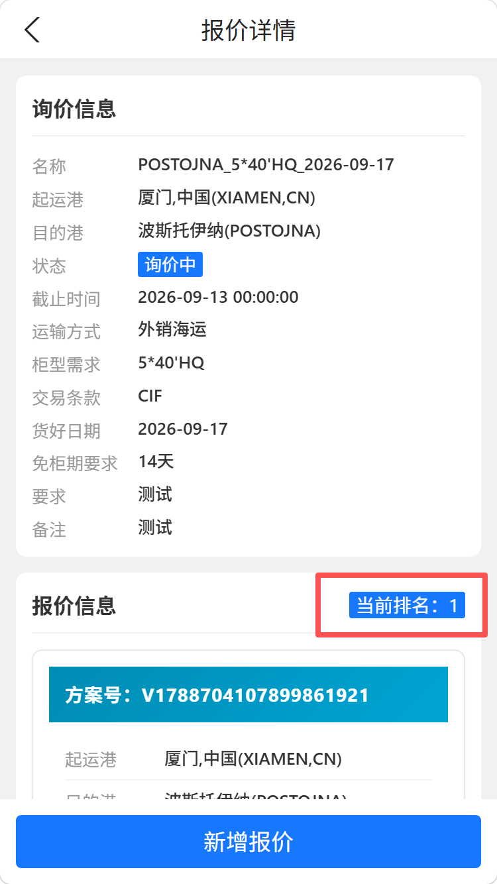

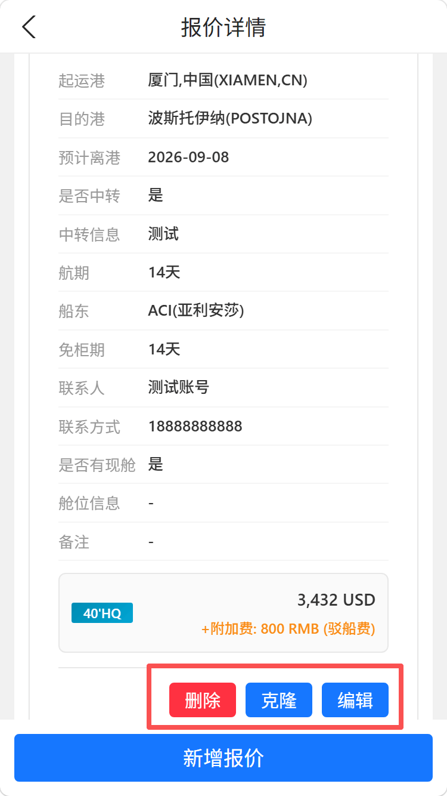

#### 4.1.5 PC端

报价在**移动端或 PC 端均可完成**，PC 端包含移动端的全部功能，并且数据互通。

- **海运报价列表**

  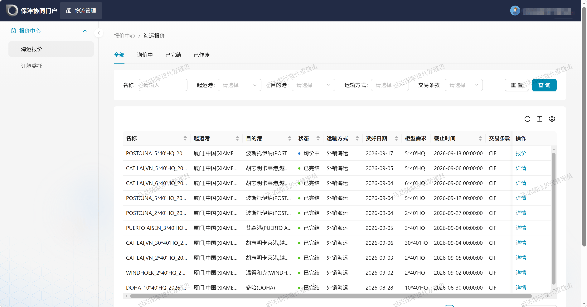

- **海运报价弹窗**

  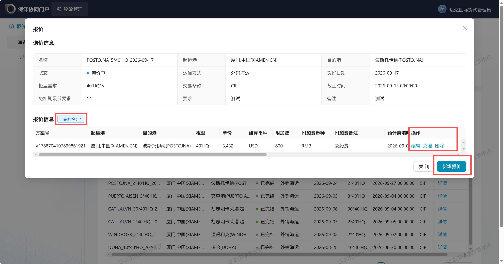

- **新增报价弹窗**

  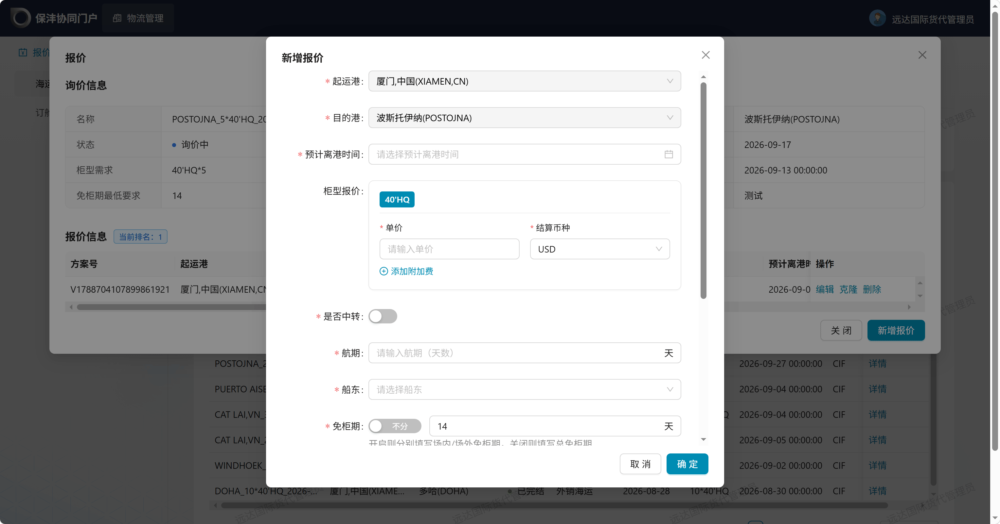

#### 4.1.5 注意信息

- 请仔细阅读询价要求，并按实填写报价方案；
- 一个询价可提交**多个方案**；
- 若询价结束后有报价方案变动，请联系保沣物流管理员；
- 移动端与PC端**数据互通**；

### 4.2 确认订舱委托：接单或拒绝

**什么时候做**：收到订舱委托（中标）后**尽快处理**。保沣按该方案锁舱排产，委托长期未确认将阻塞后续询价、上柜等。

**这一步要达成**：明确接单与否——确认接单即承诺按方案订舱；无法承接应尽早拒绝，以便保沣另行选标。

**怎么做**：

1.首页进入「**订舱委托**」，页签：全部 / 待接单 / 已接单；待接单卡片可直接「**接单**」进入详情

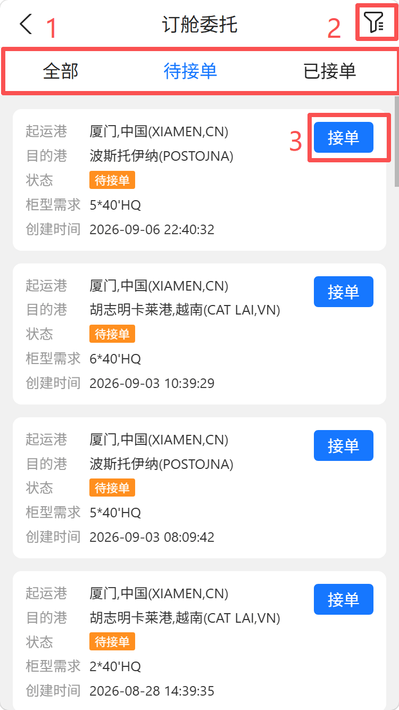

 **2.** 详情里核对订舱信息（起运港/目的港/柜型需求/货好日期/免柜期/要求/发货人/收货人/通知人等），确认自己能按方案履约

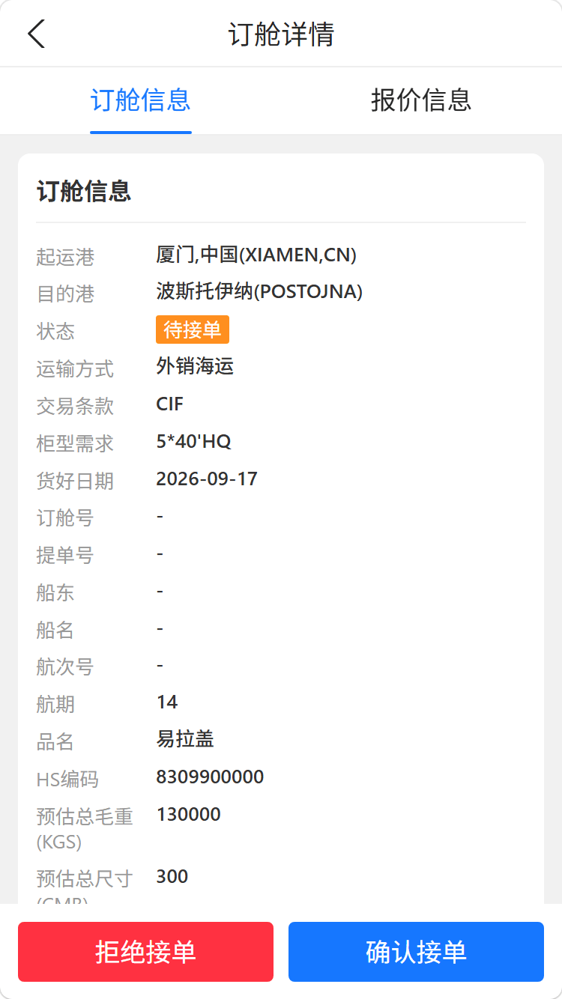

**3.** 能承接点「**确认接单**」并确认；不能承接点「**拒绝接单**」，并填写拒绝原因；

**PC 端**：

同样操作在**移动端或 PC 端均可完成**，PC端协同平台 → 报价中心 → 订舱委托 → 查看详情：

- **订舱委托列表**

  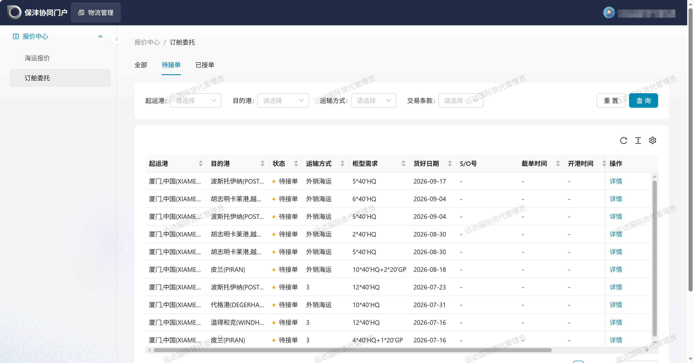

- **订舱委托详情**

  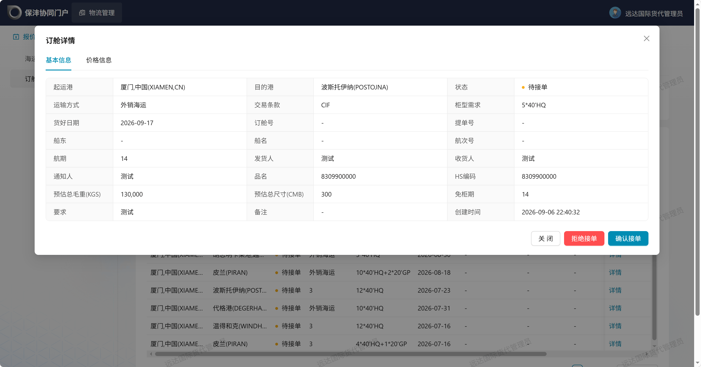

**结果**：确认接单后委托进入「已接单」，订舱正式生效，进入订舱底单上传环节。

### 4.3 上传订舱材料

**什么时候做**：船公司放单、订舱信息确定后**立即回填**。保沣的排柜计划、拖车安排、报关均依赖该组数据：**开港时间决定保沣的装柜时间，回填延迟将使后续环节整体顺延**。

**这一步要达成**：订舱号、船名航次、航期、截单/开港时间、排载单完整准确，保沣无需再线下询问。

**怎么做**：

1. 已接单订舱委托→ 详情→ 【新增订舱单】、【新增排载单】信息

   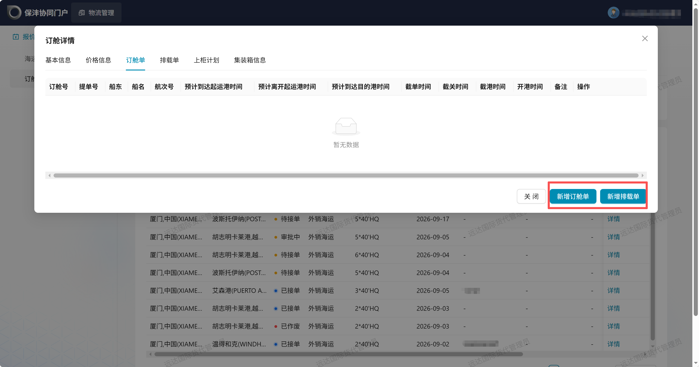

2. **新增订舱单**：上传订舱确认书、填写订舱单信息。

   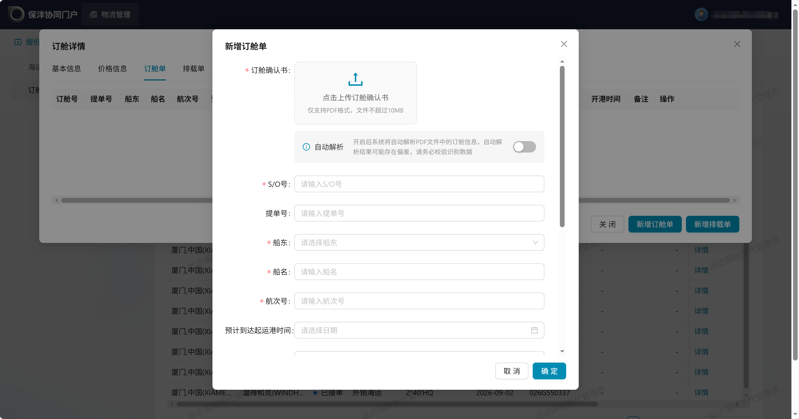

   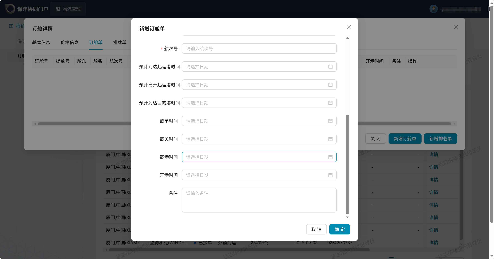

- **订舱确认书**：必填，上传订舱确认书，仅支持PDF格式；

​		**自动解析：**开启后系统将自动解析PDF文件中的订舱信息，自动解析结果可能存在偏差，请自行核对识别数据；  

- **S/O号**：必填，订舱号；
- 提单号：提单编号；
- 船东：必填，选择船东；
- 船名：必填；
- 航次号：必填；
- 预计到达起运港时间、预计离开起运港时间、预计达到目的港时间、截单时间、截关时间、截港时间、开港时间、备注字段非必填，可随时补充修改

3. **新增排载单**：上传排载单文件、填写信息。

   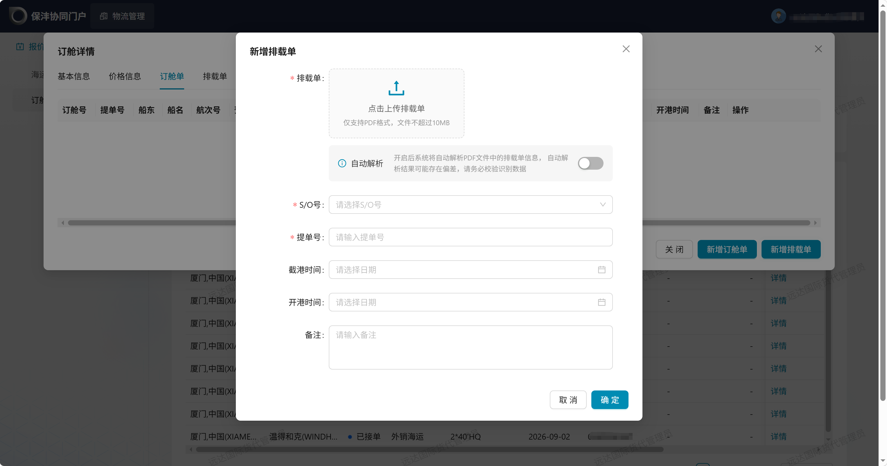

4. **修改与补充**（截单时间、开港时间等）：若订舱单的截单时间、开港时间等信息变化时，可在订舱单信息中完成修改/补充操作。

**注意**：

- 在保沣物流管理员完成上柜计划后，订舱单无法新增，订舱单部分信息无法编辑，若需更改请线下与保沣物流管理员联系。

## 5. 常见问题

**Q：报价里的排名是怎么来的？**

A：保沣按柜型需求对各家报价自动比价排序，提交/修改报价后排名实时更新；最终以询价方选标结果为准。

**Q：一个询价可以报几个方案？**

A：可以报多个方案（不同船东、船期、价格），由保沣比价选择；

**Q：附加费怎么填？**

A：按柜型报基本运价（USD），附加费单独列明（币种/金额），保沣核对费用时以「运价 + 附加费」为口径。

**Q：确认接单后还能改船期吗？**

A：需先与保沣物流管理员沟通；变更会影响上柜与拖车安排，请尽早提出。

**Q：移动端和 PC 端有什么区别？**

A：数据实时同步。报价在移动端或 PC 端均可完成，**PC 端包含移动端的全部功能**。日常以 PC 端为主，移动端便于随时接收通知快速处理。
