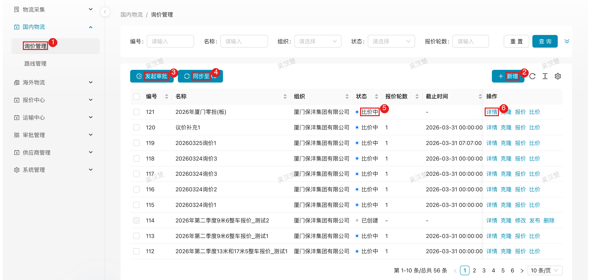
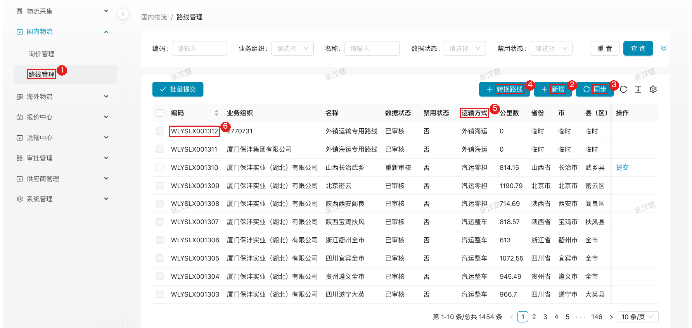

# 国内物流 — 物流管理员

> 角色：内部物流管理员，PC 端操作。国内运输采购询报价的主导角色：决定什么时候询价、怎么比价、价格怎么落地。

## 1. 角色说明

国内运输运力由你向车队/拖车行采购。你的核心职责是一条价格生命周期：

**发现采购需求 → 组织询价压价 → 比价选标 → 审批 → 价格写入金蝶 → 线路/报表日常维护**

可见菜单：**国内物流**（询价管理、路线管理）、**报价中心**（国内报价）、**审批管理**。

图中：
1. 国内物流 → 询价管理菜单；
2. 新增；
3. 发起审批；
4. 同步至K3；
5. 状态列（比价中）；
6. 行操作「详情」（行操作随状态变化：报价中/比价中 → 详情/克隆/报价/比价；已创建 → 详情/克隆/修改/发布/删除）。

## 2. 登录入口

内部员工通过**云之家**打开协同门户，**免登录**：

1. 手机/PC 打开云之家
2. 点击「**协同门户**」进入保沣协同平台
3. 左侧菜单 **国内物流 → 询价管理**

## 3. 页面速查表

| 页面 | 路径 | 主要操作 |
|------|------|---------|
| 询价管理 | 国内物流 → 询价管理 | 新增、发起审批、同步至K3；行操作：详情 / 克隆 / 报价 / 比价 / 修改 / 发布 / 删除 |
| 路线管理 | 国内物流 → 路线管理 | 线路新增 / 同步 / 转换路线 |
| 比价报表 | 询价单比价页 / 报表中心 | 9 个报表视图查询 |
| 审批管理 | 审批管理 → 流程 / 日志 | 审批进度跟踪 |

## 4. 流程

### 4.1 发起询价：什么时候需要向车队要价

**什么时候做**：出现以下任一情况，就该建询价单了——

- **新线路/新运力需求**：业务要发一条以前没采购过的线路（如新增零担板位、新柜型）
- **定期复询**：既有线路价格到期，或市场运价波动明显（油价、旺季）
- **降本**：某条线路成本偏高，需要重新竞争

**先想清楚两件事，再建单**：

1. **整车还是零担**：包整车走「整车」，一条线路 + 一个柜型报一个底价，比价简单直接；拼货走「零担」，按 3 个重量区间（轻/中/重货）分别报单价——货重波动大时零担更省钱，但比价和管理都更复杂。**按货物形态选，不要为了便宜选**。
2. **邀请哪些供应商**：至少 3 家有竞争，同一线路有运力、服务过或经资质审核的都可邀请；不放心的新供应商可配合「议价补充模式」先收资料再报价。

**怎么做**：询价管理（新增）→ 选运输类型 → 勾线路、发货组织、供应商范围 → 确定。

**特殊情况**：

| 情况 | 怎么办 |
|------|--------|
| 需要供应商先交资料（车辆、资质）再报价 | 建单时勾选**议价补充模式**：供应商先补资料，确认后才进入报价 |
| 建错了 | 未发布前可直接删除；已发布的多轮重新询价纠正 |
| 想复用上次询价 | 列表行操作「**克隆**」复制历史询价单改差异项 |

### 4.2 发布报价轮次：把询价推向市场

**什么时候做**：询价单信息齐了就发布第一轮；每轮结束价格仍不满意时继续发新一轮。

**这一步要达成**：供应商明确知道——报哪些线路、截止时间之前必须报出来。

**怎么做**：行操作（发布）→ 设本轮**线路范围、供应商范围、报价截止时间** → 确认。供应商收到微信公众号通知后开始报价。

**注意**：

- **截止时间留够**：给供应商 1-3 天反应期；设短了报不上来，白等一轮
- 每轮范围可变：第一轮全员广撒网，第二轮只留低价的前几家重点压
- 到点系统**自动结束轮次**，不会因为你忘了操作而无限收价

**特殊情况**：

| 情况 | 怎么办 |
|------|--------|
| 关键供应商没收到通知 | 确认它在轮次供应商范围内、微信已关注公众号；必要时线下提醒 |
| 截止时报价太少 | 不要勉强定标，直接发布新一轮并放宽范围/延长时间 |
| 某家报了明显亏本价 | 多轮中观察其是否跟进，异常低价选标时审批环节会被重点问 |

### 4.3 结束轮次与比价：让系统先算，你来判断

**什么时候做**：报价截止（系统自动结束）或提前收齐报价时。

**这一步要达成**：每组「线路 + 柜型」有一个明确的最低价和中标建议。

**怎么做**：结束轮次后系统自动比价——整车取线路+柜型**底价最低**者；零担按 3 个重量区间分级，按区间优先级取最低价。结果自动填入询价结果，状态转为「比价中」。

**注意**：

- **最低价 ≠ 必选**：自动结果只是建议。运力稳定性、历史履约（迟到、丢损）、淡旺季保供能力都要权衡——车队低价抢标后运力掉链子，损失远大于差价
- 用**目标底价**（预设心理价位）快速判断报价是否达标
- 零担报价要看区间衔接：三家各有区间优势时，按分级规则组合理解总价

**特殊情况**：

| 情况 | 怎么办 |
|------|--------|
| 最低价供应商不想要 | 用手动选标指定其他家，系统仍保留最低价记录；选非最低价在审批时需能说明理由 |
| 各组结果好坏不一 | 可先**草稿暂存**，分批确定 |
| 想反悔上一次确定 | **回撤重选**：回退到上一版选标快照重新比 |

### 4.4 确定选标结果：把决定固化下来

**什么时候做**：比价完成、决策做完。

**这一步要达成**：每条线路/柜型的中标供应商和价格无争议、可追溯。

**怎么做**：确认自动结果或手动选标（4.3）→ 需要暂缓的打草稿 → 全部确定后进入审批。

**注意**：选标记录会保留每轮报价对比历史（底价趋势），复盘压价是否有效就看这里。

### 4.5 发起审批：价格生效前的关卡

**什么时候做**：选标结果确定后、同步金蝶前。

**这一步要达成**：领导认可这批价格（尤其非最低价的选择）。

**怎么做**：列表勾单 →（发起审批）→ 审批人收到**云之家**通知 → 跟踪进度。

**注意**：

- 只有「比价中」或上次被驳回的询价单能发起审批
- 驳回最常见原因：非最低价未说明理由。手动选标时就在单据里写清楚原因（运力保障/历史合作/服务差异），别到审批时口头解释

**特殊情况**：

| 情况 | 怎么办 |
|------|--------|
| 审批被驳回 | 状态转「已驳回」，调整选标或补充说明后重新发起 |
| 审批人长时间未处理 | 云之家催办，或线下推动 |

### 4.6 同步金蝶：让价格真正生效

**什么时候做**：审批通过后尽快。

**这一步要达成**：中标价格写入**金蝶路线价目表**——业务下单时系统按这个价自动取价，询价闭环才算完成。

**怎么做**：（同步至K3）。同步失败多半是金蝶接口或数据问题，修复后重试。

**注意**：同步只做「审批通过」的单；同步完成后询价单走完生命周期（已结束）。

**特殊情况**：

| 情况 | 怎么办 |
|------|--------|
| 同步失败 | 检查金蝶接口状态与价目表数据，修复后重新同步 |
| 同步后发现价格错 | 紧急的先在金蝶侧手工停用错价，系统侧重新询价修正 |

### 4.7 比价复盘：用报表回答「我们买贵了吗」

**什么时候做**：询价结束后复盘；季度/年度价格回顾；领导要数据时。

系统提供 9 个比价报表，按整车/零担区分：线路统计、结果对比、封顶成本分析、价格比例分析、供应商维度报价、报价对比、报价明细对比、零担供应商维度、零担结果对比。

**怎么看**：

- **价格比例分析**：各家报价与最低价的比例——长期高比例的供应商要么降价要么淘汰
- **底价趋势**（多轮报价历史）：逐轮降幅小说明市场价已到底，不必再压
- **封顶成本**：给新线路定价、签年度协议时测算成本上限

### 4.8 路线管理：询价的地基

**什么时候做**：新线路第一次询价前；运输方式/计价口径变化时。

**怎么做**：国内物流 → 路线管理 →（新增）维护起讫、运输方式、公里数等。询价单里的线路都从这里来。

图中：
1. 国内物流 → 路线管理菜单；
2. 新增；
3. 同步；
4. 转换路线；
5. 列头「运输方式」（汽运整车/汽运零担/外销海运等）；
6. 数据行。筛选：编码/业务组织/名称/数据状态/禁用状态。

**注意**：路线数据与金蝶同步（同步/转换路线按钮）；改既有路线会影响在途询价，慎动。

## 5. 常见问题

| 情况 | 处理入口 |
|------|---------|
| 报价不理想、要继续压价 | 4.2 发布新一轮 |
| 选错了要反悔 | 4.3 回撤重选 |
| 审批驳回 | 4.5 补理由重提 |
| 金蝶同步失败 | 4.6 修复重试 |
| 供应商报不上价/没报 | 4.2 检查范围与截止时间，线下沟通 |

> 业务规则提示：系统按维度（港口/客户/供应商等）配置提醒、限制、供应商限定、审批规则，操作时按弹出的提示处理。

**Q：整车和零担询价有什么区别？**
A：整车按「线路 + 柜型」一个底价；零担按 3 个重量区间分别报单价，比价时按区间优先级取最低价。整车的货别报零担价，拼货别包整车。

**Q：议价补充模式是什么时候用？**
A：需要供应商先补充资料（车辆、资质等）再正式报价时勾选。供应商填完资料确认后，询价才进入报价阶段。

**Q：为什么「发起审批」点不了？**
A：询价单必须是「比价中」或上次被驳回状态。先结束轮次完成比价。

**Q：手动选标后系统还记录最低价吗？**
A：记录。最低价始终保留供参考，审批时用于解释为何没选最低价。

**Q：多轮询价每轮可以换供应商吗？**
A：可以。每轮的线路范围、供应商范围、截止时间都独立设置。

**Q：截止时间到了还能报价吗？**
A：不能，轮次自动结束。要补报只能发布新一轮并把它圈进范围。
