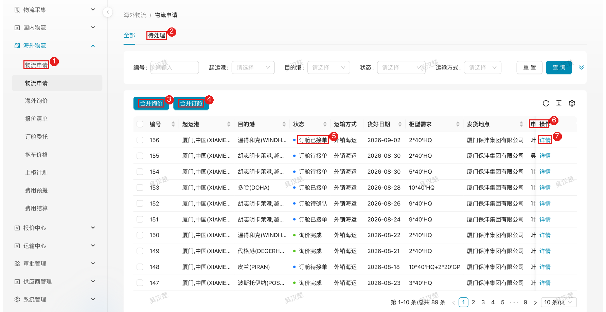
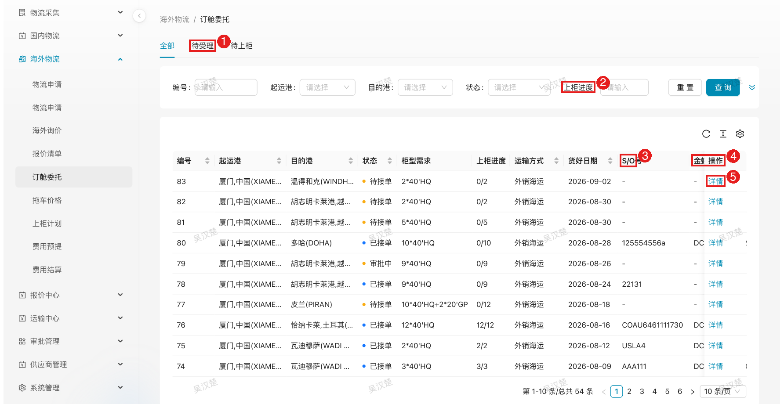
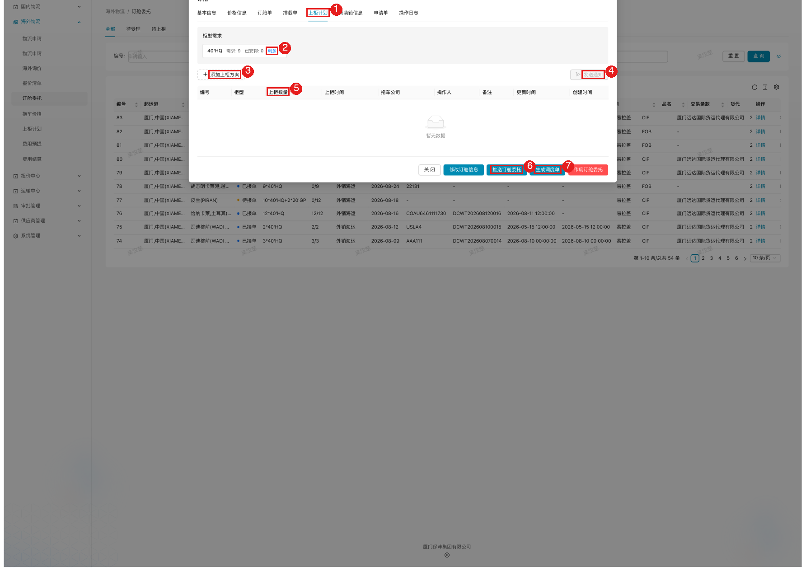
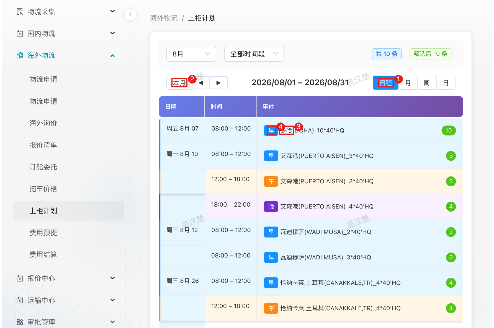
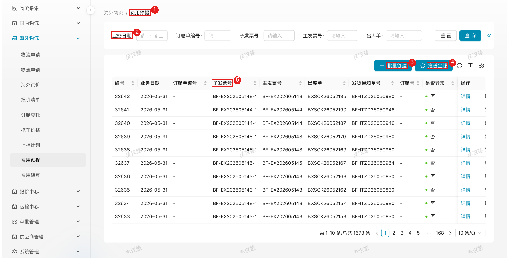
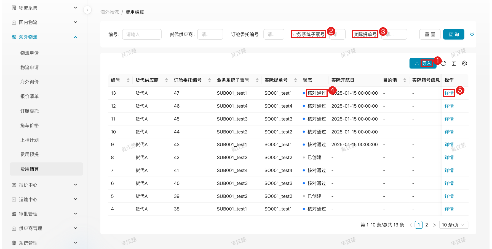

# 国外物流 — 物流管理员

> 角色：内部物流管理员，PC 端操作。海外（海运出口）物流全流程的执行主导角色。

## 1. 角色说明

你负责把一张销售出运申请，一路推进到「柜子装船、费用付掉」：

- **审核物流申请**：销售的出运申请先到你手里把关
- **海外询价**：向货代要船期和价格，选定合作方案
- **订舱委托**：把选定的报价正式委托给货代
- **订舱底单管理**：盯货代上传订舱底单（订舱号、船名航次、截单时间）
- **上柜计划与排载**：安排柜子按时上柜，指挥拖车公司
- **费用预提与结算**：预估成本入账，货代账单来了核对付款

一条业务主线串起来：**审核申请 → 询价比价 → 订舱委托 → 收订舱底单 → 排柜上柜 → 预提 → 结算付款**。每个环节断一环，后面全堵。

可见菜单（海外物流）：物流申请（堆场视角）、海外询价、报价清单、订舱委托、拖车价格、上柜计划、费用预提、费用结算；另有报价中心、审批管理等配套菜单。

## 2. 登录入口

内部员工通过**云之家**打开协同门户，**免登录**：

1. 打开云之家 → 点击「**协同门户**」
2. 顶部菜单选择「**物流管理**」子系统
3. 左侧菜单 **海外物流** 下按环节进入对应页面

## 3. 页面速查表

| 页面 | 路径 | 主要操作 |
|------|------|---------|
| 物流申请（堆场视角） | 海外物流 → 物流申请 | 待处理审核、通过/驳回 |
| 海外询价 | 海外物流 → 海外询价 | 创建/发布询价、查看报价 |
| 报价清单 | 海外物流 → 报价清单 | 报价汇总查看 |
| 订舱委托 | 海外物流 → 订舱委托 | 发起委托、非最低价审批、上柜计划/排载（详情内）、生成调度单 |
| 拖车价格 | 海外物流 → 拖车价格 | 拖车价格维护 |
| 上柜计划 | 海外物流 → 上柜计划 | 全局展示排柜安排（日历，只读） |
| 费用预提 | 海外物流 → 费用预提 | 创建预提单、同步金蝶 |
| 费用结算 | 海外物流 → 费用结算 | 导入账单、核对、同步费用申请单 |

## 4. 流程

### 4.1 审核物流申请：把好出货需求第一道关

**什么时候做**：申请人（销售）提交出运申请后，尽快处理——申请压着，后面的询价订舱时间就少一天。**建议货好日期前 7-10 天完成审核**。

**这一步要把关什么**：申请信息是否真实、完整、可执行。你要对后面整个链条负责，错的申请放过去，询价订舱全白做。

**怎么做**：

1. 进入 **海外物流 → 物流申请**（审核视角），「待处理」页签就是新申请
2. 点开「详情」，逐项核对：
   - **港口**：起运港目的港对不对（常见错：客户指定港口写错字）
   - **柜型柜量**：和订单量匹配吗？明显多报少报都要问
   - **货好日期**：和生产确认过吗？这是全流程的时间锚点
   - **交易条款**：FOB/FCA/EXW 是指定货代——客户自有货代的，走指定货代流程，不适用本章询价
3. 没问题 → **通过**，进入询价；有问题 → **驳回**，写清原因退回修改

图中：
1. 海外物流 → 物流申请（审核视角）；
2. 待处理页签（新申请在此）；
3. **合并询价**；
4. **合并订舱**——同一客户/港口的多张申请可合并为一张询价或订舱（N:1）；
5. 状态列（订舱待接单 / 订舱已接单 / 询价完成等）；
6. 列表列头（申请人/客户）；
7. 行操作「详情」。

**注意**：

- 同一客户同航线多张申请，审核时就想好**要不要合并**：合并订舱省费省事，但条件苛刻（见 4.3 的合并校验），早决定早调整申请
- 驳回务必写明改什么，来回踢皮球最耽误货期

**特殊情况**：

| 情况 | 怎么办 |
|------|--------|
| 货好日期太近（明天就要出货） | 按加急处理：先线下联系货代锁舱，系统流程并行补 |
| 信息明显错误但销售不在线 | 先驳回写明问题，同步电话沟通，别等 |
| 客户指定货代（FOB 等条款） | 不发询价，直接走指定货代订舱，委托对象为客户货代 |

### 4.2 向货代询价：用比价拿到好价

**什么时候做**：申请审核通过后立刻发起。船司舱位紧张时越早越好；一般货代需要 1-2 天收集船期报价，**给截止时间至少留 2-3 天**。

**这一步要达成什么**：拿到足够多的船期方案，选出价格、船期、舱位都合适的报价，确定这票用哪家货代。

**怎么做**：

1. 基于审核通过的申请创建询价单（**海外物流 → 海外询价**）：港口、柜型需求、货好日期、交易条款、免柜期要求。**免柜期要求和特殊要求（如直航）必须写全**——货代按你写的东西报价，事后加要求等于重新询价
2. 选择邀请的货代范围，发布询价。货代在微信公众号收到通知开始报价
3. 等报价期间在**报价清单**页盯进度：几家报了、各几个方案。临近截止还没动静的货代，电话催
4. **报价截止时间一到，系统自动结束询价**，之后货代不能再提交或修改报价
5. 比价决策，别只看价格排名，按这个顺序核对：
   - **有没有现舱**：没舱位的价格再低也是零
   - **航期和中转**：客户交期能不能赶上，申请写了「直航」就不能选中转
   - **免柜期**：达到询价里写的最低要求
   - 最后才比价格（系统已按柜型排好名次）

**注意**：

- 截止时间是硬约束，系统自动关单，发询价前想好给几天
- 同一询价单可以发布**多轮**：第一轮价格不满意，发布第二轮让货代再压

**特殊情况**：

| 情况 | 怎么办 |
|------|--------|
| 报价都不理想 | 发布新一轮询价继续压价；或线下约谈货代谈价后再开一轮 |
| 到截止没人报价 | 检查货代是否在邀请范围内；范围没问题就电话催报，必要时延长后重发 |
| 船司爆舱涨价期 | 缩短询价周期先锁舱，价格让步保交期，成本差异留给审批环节判断 |

**结果**：确定拟委托的报价，进入订舱委托。

### 4.3 发起订舱委托：锁定舱位与价格

**什么时候做**：询价选定报价后马上发起。**这一步是采购决策落地的动作，也是合规控制的卡口。**

**这一步要达成什么**：货代正式接单，订舱底单流程启动。

**怎么做**：

1. 进入 **海外物流 → 订舱委托**，基于询价结果发起委托，关联选定报价
2. **价格合规**（系统自动判断，你要做的是按提示处理）：
   - 选**最低价**方案 → 直接提交
   - 选**非最低价** → 必须写原因（原因代码 + 说明，比如客户指定船东、交期优先），委托进「待审批」，审批通过才能继续
   - **报价明显高于历史成交价**时，就算你选的是最低价，系统也会拦进「待审批」让申请人确认——这是防采购异常的第二道闸
3. **要不要合并订舱**：同一客户多张申请可合并成一张订舱（N:1），省柜省费。但合并是硬校验，**起运港、目的港、运输类型、交易条款必须一致，HS 编码也必须相同**，差一样都合不了，只能拆开发起
4. 提交后货代在微信端收到委托，**确认接单**或**拒绝接单**。货代接单后，系统自动把报价同步到金蝶路线价目（挂临时路线），创建订舱单并同步金蝶

> 委托状态机：**创建 → 待审批（非最低价 / 异常报价）→ 已确认 → 已接单 → 已开船 → 已完成**；「待审批」被拒转「审批被拒」，重新选报价再发起。只有「已确认」的委托货代才能接单。

图中：
1. 页签（全部 / 待受理 / 待上柜）；
2. 上柜进度筛选；
3. S/O 号列（货代接单回填后显示，如 USLA4）；
4. 金蝶编号列（同步金蝶后生成）；
5. 行操作「详情」。上柜进度 `0/2` 表示 2 个柜尚未上柜，`12/12` 即全部完成。

**注意**：

- 非最低价的原因说明会留痕审计，认真写，别写「客户要求」四个字交差
- 发起后盯紧货代接单：**委托发出 24 小时没接单反应就电话催**，货代拒单或失联要马上换备选报价重新委托

**特殊情况**：

| 情况 | 怎么办 |
|------|--------|
| 非最低价被审批拒绝 | 回到报价列表换方案（次低价或其他货代），重新发起委托 |
| 想合并订舱但校验不过 | 说明几张申请要素不一致。要么拆开发起，要么让申请人修改申请（HS 编码不同的货没法拼同一张订舱单） |
| 货代接单后说没舱 | 立即换报价重新委托，并通知申请人货期风险；原委托作废处理 |
| 货代接单后提出涨价 | 三选一：同意（走异常报价审批留痕）；换其他报价重新委托；重新询价 |

### 4.4 接收订舱底单（S/O）：拿到排产与提柜的凭据

**什么时候做**：货代确认接单后就开始盯 S/O。**S/O 拿不到，后面排柜全是空转**——上柜时间要以截单时间倒推。

**这一步要拿到什么**：订舱号（S/O 号）、船名、航次号、**截单时间**、下货纸。船开后再拿提单号。

**怎么做**：

1. 在订舱委托详情跟踪：状态「已接单」后，等货代上传订舱底单
2. 货代回填齐了（订舱号、船名航次、截单时间、下货纸附件），系统自动创建订舱单（booking_order）——这就是后续排载、调度、费用计算的基准数据
3. 核对回填内容与询价要求是否一致：船期符合货好日期吗？截单时间留够装柜时间吗？
4. 船开后货代补填提单号（预配 → 正式），系统自动关联

**注意**：

- **截单时间是排柜计划的输入**：拿到 S/O 第一时间看截单时间，倒推出柜计划，别等拖车通知才发现截单在明天
- 下货纸（S/O 原件）涉及码头放柜，货代回传后确认附件可读

**特殊情况**：

| 情况 | 怎么办 |
|------|--------|
| 订舱底单信息有误（船名/航次/截单错） | 通知货代在移动端/PC 端修正重新上传，修正后系统数据同步更新 |
| 截单时间太赶 | 与货代协商换船期（重新委托）或申请延迟截单；同步调整上柜计划 |
| 提单号迟迟未回填 | 船开后催货代；提单号影响电放/正本操作，不能拖 |

### 4.5 上柜计划与排载：安排柜子怎么装、车什么时候到

**什么时候做**：订舱底单到手、截单时间明确后立刻排。**从截单时间倒推：装柜完成 → 拖车到厂 → 提柜，各留缓冲**。

**这一步要达成什么**：每个柜按计划提到厂、装完货、按截单时间进港。

**怎么做**：

1. 排载的主战场在**订舱委托详情**里，不是上柜计划页面。进入 **海外物流 → 订舱委托**，打开对应委托详情的**上柜计划**页签：点「添加上柜方案」，按委托柜型填计划数量、上柜时间、拖车公司。此时还没有柜号，排的是计划
2. 排好后点「**发送通知**」，系统向该委托各拖车公司推送公众号排车通知（含上柜日期和时段）。拖车公司收到后安排车辆、回填司机车牌
3. 上柜计划排完后，点「**推送订舱委托**」把委托推到金蝶，**等相关人员在金蝶上配置好发货通知单**——这一步没完成，调度单生成不了
4. 发货通知单配好后，详情页「**生成调度单**」可用：把上柜计划和柜子汇总成**物流调度单**（调度明细含柜号、车牌司机、封条号、毛重/VGM、提柜/送货地点、要求到场时间；系统校验不超委托柜量），生成后下推金蝶
5. 拖车执行提柜装柜，柜子的实际交接数据由 **EIR（设备交接单）**自动回传：柜号、封条号、毛重/VGM、进出场时间、车牌司机——不需要人工登记
6. 系统会根据货代反写的**开港时间**自动建议上柜时间，排计划时参考
7. **海外物流 → 上柜计划**页面只是全局展示：日历上汇总各委托的排柜安排（目的港_柜型柜量、各时段计划柜数），用来总览协调，不能在这里排

订舱委托详情内的操作界面（上柜计划页签）：

图中：
1. 详情内的「上柜计划」页签，排载在这里做；
2. 柜型需求与安排进度（需求 / 已安排 / 剩余，排柜数量不能超需求）；
3. 「添加上柜方案」：填计划数量、上柜时间、拖车公司；
4. 「发送通知」：向本委托各拖车公司推送公众号排车通知；
5. 上柜方案列表（柜型、上柜数量、上柜时间、拖车公司等）；
6. 「推送订舱委托」：上柜计划排完后推到金蝶，等金蝶侧配好发货通知单；
7. 「生成调度单」：发货通知单配好后可用，汇总成物流调度单并下推金蝶。

图中：
1. 日程视图（可切月 / 周 / 日）；
2. 时间范围（本月，可前后翻页）；
3. 上柜事件（目的港_柜型柜量，如 多哈(DOHA)_10*40'HQ）——本页为全局展示，排载在订舱委托详情内完成；
4. 时段（早 / 午 / 晚）；右侧绿色数字为该时段计划柜数。

**注意**：

- **拖车供应商分配要想好再发**：通知发出后拖车公司就开始备运力，频繁改派影响合作
- 时段安排错开：同一时段堆太多柜，厂门口堵车，EIR 回传全延迟
- 排柜数量不能超委托柜量，调度单生成时会校验拦截

**特殊情况**：

| 情况 | 怎么办 |
|------|--------|
| 「生成调度单」点不了或生成失败 | 先查两件事：委托有没有点「推送订舱委托」推到金蝶；金蝶侧发货通知单有没有配置好。没配就催相关人员配完再生成 |
| 拖车公司说运力不足 | 立即改排其他拖车公司（重新发通知），别等——柜子误一天可能误整条船 |
| 开港延迟 | 系统按新开港时间重排计划，通知拖车调整；已提柜的先还场堆存 |
| EIR 数据没回传 | 先核柜号对不对；柜号没问题就查 Trackingeyes 对接状态，重推 |
| 生产延迟赶不上装柜 | 提前半天知道都要马上通知拖车停提，评估赶下一水或改船 |

### 4.6 费用预提：账提前算，不等月结

**什么时候做**：订舱完成后、**月末结账前**。预提是财务成本入账动作，拖到下月成本就跨期了。

**这一步要达成什么**：本票的预估费用准确入账金蝶，作为结算核对基准。

**怎么做**：

1. 进入 **海外物流 → 费用预提**，基于订舱单**批量创建**预提单（一票订舱一张）
2. 系统自动按下面的规则计算分摊，你核对金额和分摊是否合理
3. 核对没问题 → **推送金蝶**生成预估费用单

**费用分摊规则**（系统自动算，你需要知道口径）：

| 费用类型 | 分组依据 | 计算规则 |
|----------|----------|----------|
| 报关费 | 子发票号 | 每票 120 元，按子发票号下的板数比例分摊 |
| 港杂费（海运） | 提单号 | 柜数×1300 + 提单数×1105，按提单号下的柜数比例分摊 |
| 港杂费（空运/散货） | 子发票号 | 每票 500 元，按子发票号下的板数比例分摊 |
| 拖车费 | 地磅单 | 按城市单价×柜数，按地磅单下的板数比例分摊 |

图中：
1. 海外物流 → 费用预提；
2. 筛选条件（业务日期 / 订舱单编号 / 子发票号 / 主发票号 / 出库单）；
3. **批量创建**；
4. **推送金蝶**（生成预估费用单）；
5. 子发票号列（一票出库单可拆多个子发票号，报关费按其分摊）。列表含订舱号、柜量、货物总板数、地磅单号、金蝶单号等字段，可按「是否异常」排查。

**注意**：

- 预提的金额来源是**中标报价**，与货代对账时就以它为基准
- 「是否异常」= 是的记录**先处理再推金蝶**（见特殊情况）

**特殊情况**：

| 情况 | 怎么办 |
|------|--------|
| 预提单标记异常 | 系统在报关单数据匹配失败（出库单号→报关单号→发货通知单号三级都没匹配上）或 ECP 与 K3 运输方式不一致时标记异常，费用按默认海运计算——人工核对手工修正后再推金蝶 |
| 地磅单缺失 | 拖车费算不出来，先补录地磅单数据再创建预提 |
| 预提已推金蝶后发现错误 | 金蝶侧冲销 + LMS 重新创建推送，两边都要处理 |

### 4.7 费用结算与核对：把每一笔账对干净

**什么时候做**：货代账单到达后（一般船开后 1-2 周）。**账单越早核对完，付款越早，货代配合度越高。**

**这一步要达成什么**：货代账单与我方预提逐项对上，差异处理干净，结算单核对通过推金蝶付款。

**怎么做**：

1. 进入 **海外物流 → 费用结算**，「导入」货代费用清单（系统按**提单号优先、其次子票号**自动匹配预提单）
2. 系统自动核对，单条差异 **≤ 100 元直接判过**；超过 100 元的逐项人工核对五个要素：**柜号、报价、费用项目、数量、汇率**
3. 有差异 → 判断责任：货代算错就退回重开；我方漏记（如现场杂费）就沟通确认后调整
4. 处理干净后结算单转「**核对通过**」，同步金蝶生成**费用申请单**，进入付款流程

图中：
1. 「导入」货代费用清单入口；
2. 业务系统子票号——与预提单自动匹配的主键之一；
3. 实际提单号——匹配优先级最高；
4. 状态从「已创建」到「核对通过」，核对通过才能推金蝶；
5. 「详情」进入逐项核对（柜号、报价、费用项目、数量、汇率）。

**注意**：

- 核对没通过的结算单**推不了金蝶**，这是财务闸口，别想着绕
- 差异沟通要留痕（邮件/对账单），口头谈妥的差异后面审计说不清

**特殊情况**：

| 情况 | 怎么办 |
|------|--------|
| 货代账单金额与报价完全对不上 | 先查是不是币种/汇率口径不一致，再查柜号归属（拼柜分摊错误最常见） |
| 账单里有报价外的杂费 | 让货代列明费用产生依据（如查验费附海关单据），确认属实后计入，否则拒付 |
| 重复导入账单 | 系统按子票号/提单号识别，发现重复核对会报冲突，删除多余结算单 |
| 货代不肯让差异 | 差异小额（100 元内）系统自动过；大额差异谈不拢升级到领导裁决，不要拖到付款超期 |

## 5. 常见问题

日常高频异常已写在各环节的「特殊情况」里，这里只列跨环节的：

| 情况 | 处理方式 |
|------|---------|
| 货代拒绝接单/长时间未接单 | 联系确认原因；换备选报价重新发起委托 |
| 上柜计划超出委托柜量 | 调整计划数量，调度单生成时系统会校验 |
| 提单号一致性校验失败 | 排载单/柜子上记录的订舱单与 S/O 号不一致时，核对提单号归属后修正 |

**业务规则提示**：系统按港口/客户/货代/拖车供应商维度配置业务规则，操作时可能弹出**提醒标记**（点击查看规则内容）、**限制**（禁止提交）或**审批要求**（可配价格阈值百分比），按提示处理即可。

**Q：为什么选了非最低价还要审批？**
A：系统默认最低价直发；选择非最低价属于让价决策，需留痕审计（原因代码 + 说明）并经审批，防止舞弊与成本失控。

**Q：订舱单和订舱委托什么关系？**
A：订舱委托是业务侧动作，货代接单并上传订舱底单后，系统创建订舱单（= S/O）并同步金蝶；状态统一在委托层管理。

**Q：提单号什么时候有？**
A：船开后货代补填（预配 → 正式），回填后系统自动关联到订舱单。

**Q：上柜计划时还没有柜号怎么办？**
A：正常。上柜计划按柜型 + 数量 + 时间预排；柜号、封条号在提柜后由 EIR 自动回传。

**Q：港杂费 1300 和 1105 是什么？**
A：海运港杂费的计费参数：每个柜 1300 元、每个提单 1105 元，按提单号分组后再按柜数比例分摊到明细。

**Q：结算单核对通过之前可以同步金蝶吗？**
A：不能。双方核对一致（状态「核对通过」）后才同步金蝶费用申请单，确保付款依据准确。

## 6. 系统管理

物流管理员兼管系统管理下的基础数据与规则配置：

| 页面 | 用途 |
|------|------|
| 港口管理 | 维护起运港/目的港基础数据（代码、中英文名称、国籍），供询价/申请/订舱引用 |
| 码头管理 | 维护港口下属码头信息 |
| 标准费用 | 维护标准费用项目与计费参数（如港杂费单柜/单提单金额），作为费用预提与结算的分摊依据 |
| 通知配置 | 配置业务事件的通知规则（事件 → 接收角色 → 渠道），如上柜计划完成后向拖车角色推送公众号排车通知 |
| 业务规则 | 四类规则：**提醒 / 限制 / 供应商限定 / 审批**（如非最低价下单的价格阈值百分比）；维度覆盖港口/客户/货代/拖车供应商 |
| 对象日志 | 查看单据对象的操作留痕（创建、修改、状态变更、同步金蝶等），用于问题追溯 |
