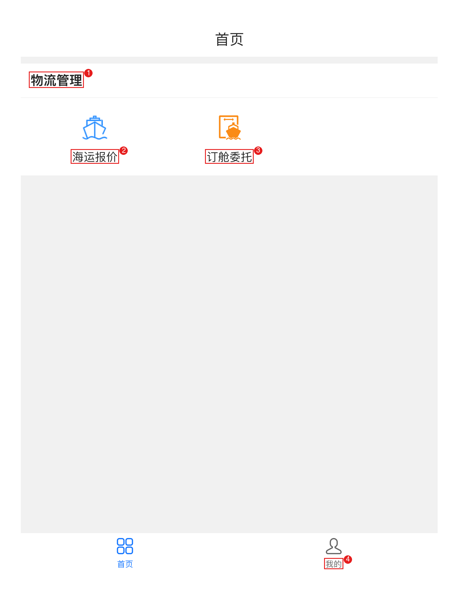
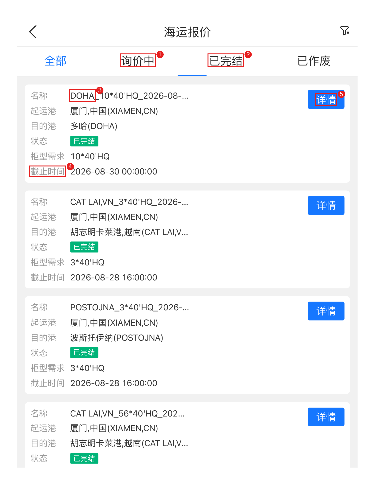
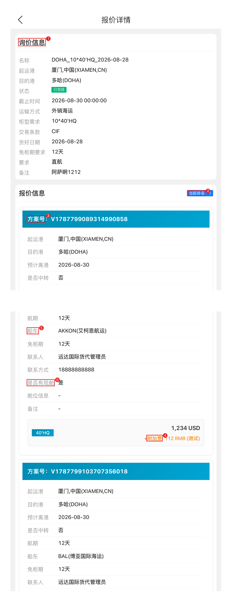
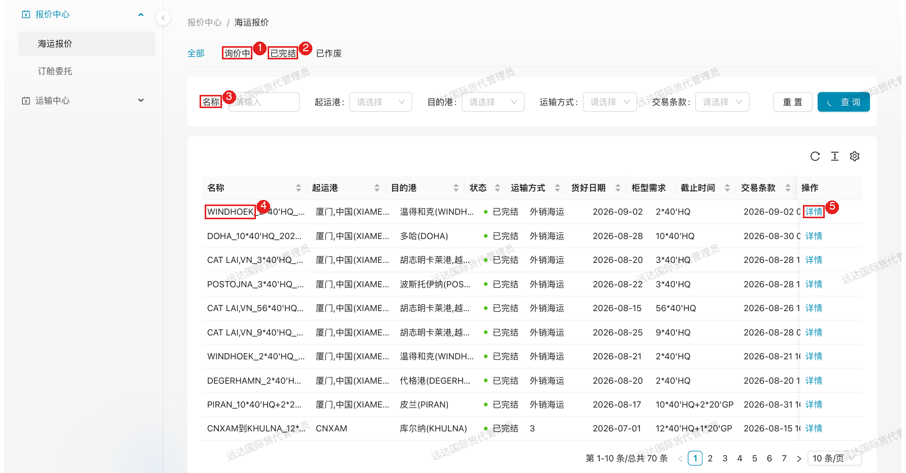
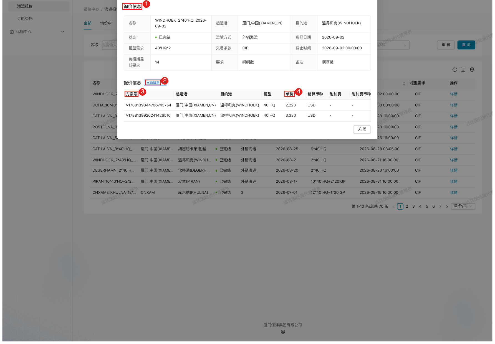
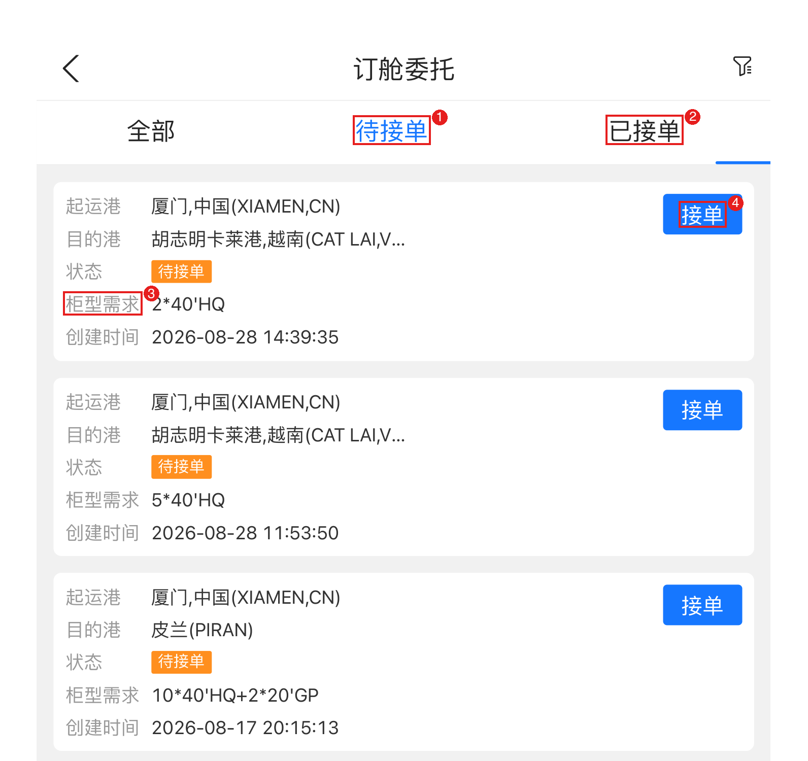
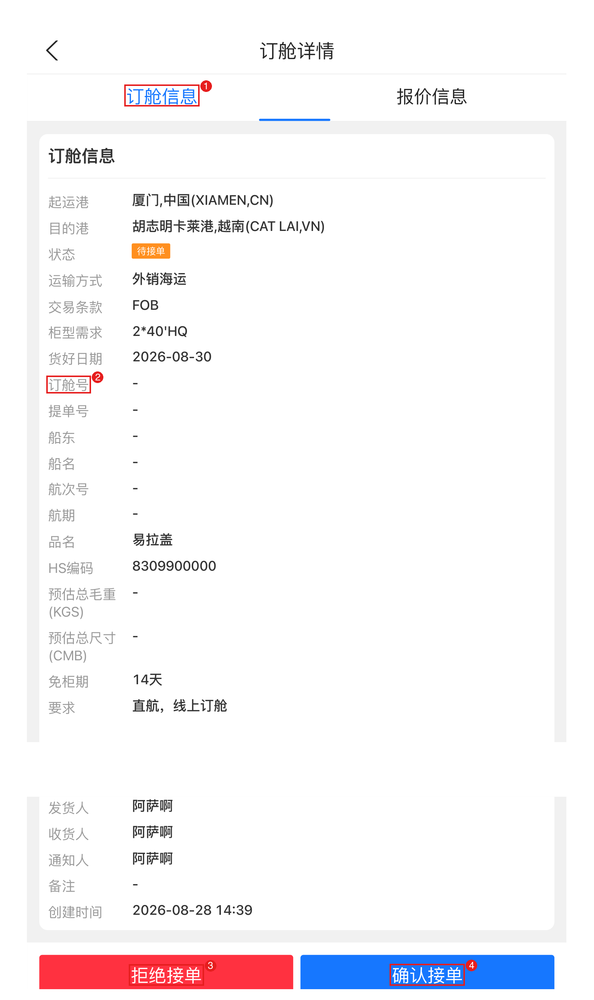
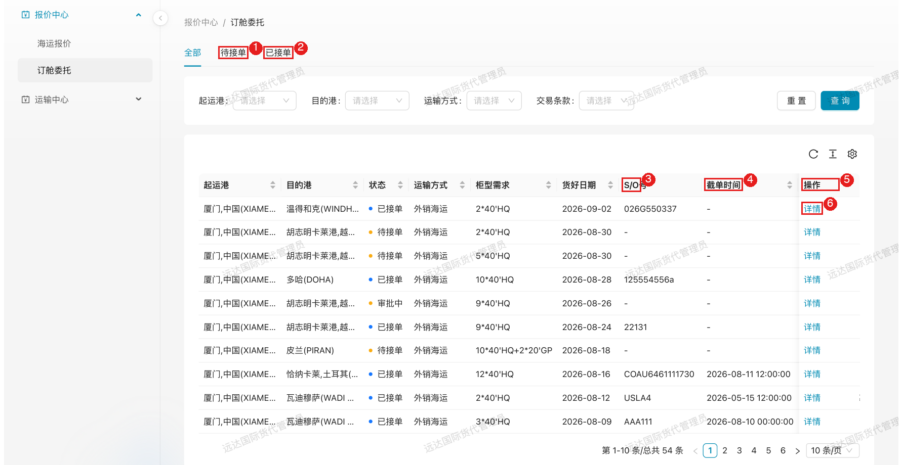
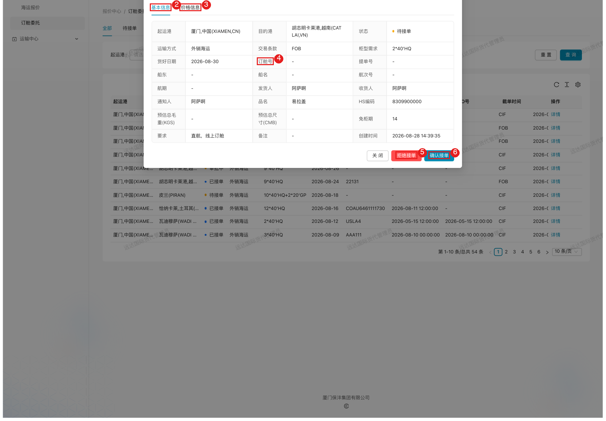

# 国外物流 — 供应商（货代）

> 角色：外部货代供应商。操作界面：**保沣微信公众号内嵌系统界面**（移动端为主）+ **对外协同平台 PC 端**（报价中心、运输中心），两端数据实时同步。业务通知通过微信公众号模板消息推送。

## 1. 角色说明

货代供应商承担海外物流的**报价与订舱执行**，赚的是专业和舱位资源：

- **海运报价**：接收保沣海外询价，按方案（船东/航期/柜型价格）提交报价，接受多轮比价
- **订舱接单**：接收订舱委托，确认接单或拒绝
- **上传订舱底单**：订舱确认后，上传订舱号、提单号、船名航次、截单/开港时间等订舱信息（订舱底单）
- **费用对接**：出运完成后提交费用单，进入费用核对流程

账号由保沣物流管理员开通，业务消息（新询价、新委托、接单结果等）通过公众号模板消息推送。

## 2. 登录入口

- **移动端（主要）**：微信公众号「**厦门保沣集团有限公司**」→ 底部菜单进入 LMS 系统界面
- **PC 端**：浏览器打开对外协同平台 <https://collab.xmbaofeng.com/>，使用平台账号登录，菜单为「**报价中心**」（海运报价、订舱委托）+「**运输中心**」（拖车计划）
- 业务消息通过公众号模板消息推送，点开消息可直接进入对应页面

移动端首页「物流管理」区提供两个入口：**海运报价**、**订舱委托**。

图中：
1. 底部「物流管理」；
2. 海运报价入口；
3. 订舱委托入口；
4. 「我的」（账号信息）。

## 3. 页面速查表

| 页面 | 入口 | 主要操作 |
|------|------|---------|
| 海运报价列表 | 移动端首页 → 海运报价 | 页签切换（全部/询价中/已完结/已作废）、查看询价、进详情 |
| 报价详情 | 报价列表「详情」 | 查看询价信息、当前排名、提交/修改报价方案（船期 + 按柜型价格 + 附加费） |
| 订舱委托列表 | 移动端首页 → 订舱委托 | 页签切换（全部/待接单/已接单）、快捷接单 |
| 订舱详情 | 委托列表点卡片 | 核对订舱信息、确认接单 / 拒绝接单、查看 S/O 字段 |
| 海运报价（PC） | 协同平台 → 报价中心 → 海运报价 | 报价 / 详情；方案新增 / 编辑 / 克隆 / 删除 |
| 订舱委托（PC） | 协同平台 → 报价中心 → 订舱委托 | 接单 / 拒绝；订舱底单上传（S/O 号、截单时间、开港时间）与修改 |
| 拖车计划（PC） | 协同平台 → 运输中心 → 拖车计划 | 查看排车计划（编号/上柜时间/柜型/柜量/提单号） |
| 我的 | 移动端底部「我的」 | 账号信息 |

## 4. 流程

### 4.1 海运报价：赢下询价的第一仗

**什么时候做**：收到询价推送（公众号消息）后**尽快响应**。保沣按报价自动比价排名，同样的价格，早报的先占位；截止时间一过系统自动结束，报不进来了。

**这一步要达成**：在截止前提交**有竞争力**的方案——价格有优势、船期匹配、有现舱。

**怎么做**：

1. 首页进入「**海运报价**」，看「询价中」页签的待报价询价

图中：
1\. 2 状态页签（询价中为默认，已完结可查历史）；  
3\. 询价名称（目的港_柜型需求_日期）；  
4\. **报价截止时间**——务必在截止前提交；  
5\. 「详情」进入询价与报价。  

2. 点「详情」看询价要求，在「报价信息」区提交方案

图中：
1. **询价信息**（起运港/目的港/柜型需求/交易条款/货好日期/免柜期要求/要求，如「直航」）；
2. **当前排名**——多轮比价中自己的名次；
3. **方案号**——一个方案即一条船期路线；
4. **按柜型价格**（如 40'HQ 1,234 USD + 附加费）；
5. 6 方案明细：预计离港、是否中转、航期、船东、免柜期、是否有现舱/舱位信息、联系人。

3. 一个询价可提交**多个方案**（不同船东/船期）；价格按柜型分列，附加费单独注明
4. 保沣多轮压价时，按「当前排名」决定是否跟价：排名靠前可小步跟，差距大就换船期方案或放弃，避免无底线击穿成本

**注意**：

- **方案要标明现舱**：同等价格下，保沣优先选有现舱的方案；没现舱的标出来反而失分
- 询价要求里写了「直航」「免柜期 12 天」这类硬条件的，方案不满足基本无效，别硬报
- 编辑方案、多方案管理在 **PC 端**更顺手：协同平台 → 报价中心 → 海运报价 → 行操作「报价」（仅询价中可报，已完结为只读「详情」），支持方案的新增/编辑/克隆/删除；同一**船东 + 预计离港**不能重复提交

图中：
1. 询价中页签（待报价询价在此）；
2. 已完结页签（历史询价与排名）；
3. 名称筛选；
4. 询价记录行（名称/起运港/目的港/状态/货好日期/柜型需求/截止时间/交易条款）；
5. 行操作——**询价中显示「报价」，已完结显示「详情」**（只读查看排名与方案）。

图中：
1. 询价信息（含免柜期最低要求、要求）；
2. **当前排名**；
3. 报价方案号；
4. 按柜型单价（USD）与附加费；「关闭」退出查看。

**特殊情况**：

| 情况 | 怎么办 |
|------|--------|
| 截止前来不及报价 | 立即联系保沣物流管理员说明，请求延长截止或重新发起询价 |
| 报过价的舱位没了 | **第一时间**通知保沣物流管理员并更新/撤换方案——比等到订舱时才发现强百倍 |
| 船期/价格要变更 | 尽快通知保沣物流管理员：同意变更则按新价确认；不同意可换报价方案或对受影响委托重新询价 |
| 排名一直上不去 | 复盘：价格、船期（航期/中转）、现舱、免柜期哪个短板就补哪个，不一定是价格问题 |

**结果**：截止后保沣自动比价选标；中标者会收到订舱委托。

### 4.2 确认订舱委托：中标后的承诺

**什么时候做**：收到订舱委托（中标）后**尽快处理**。保沣按你的方案锁舱排产，委托挂着一整天，后面的询价、上柜计划都堵着。

**这一步要达成**：明确「接」还是「不接」——接了就是承诺按方案出运；不能接的尽早拒绝，让保沣改选他人。

**怎么做**：

1. 首页进入「**订舱委托**」，页签：全部 / 待接单 / 已接单；待接单卡片可直接「**接单**」或先进详情

图中：
1\. 状态页签（待接单为默认）；  
2\. 3 委托卡片（起运港/目的港/状态/柜型需求/创建时间）；  
4\. 「接单」快捷按钮。  

2. 详情里核对订舱信息（起运港/目的港/柜型需求/货好日期/免柜期/要求/发货人·收货人·通知人等），确认自己能按方案履约

图中：
1. 订舱信息 / 报价信息页签；
2. 订舱号、提单号、船东、船名、航次号、航期等 S/O 字段（接单后回填）；
3. **拒绝接单**；
4. **确认接单**（弹出确认对话框）。

3. 能承接点「**确认接单**」并确认；不能承接点「**拒绝接单**」，并线下向保沣物流管理员说明原因

**PC 端**同样操作（协同平台 → 报价中心 → 订舱委托），列表直接可见 S/O 号、截单时间、开港时间：

图中：
1. 待接单页签；
2. 已接单页签；
3. **S/O 号**列；
4. **截单时间**列；
5. 操作列（**开港时间**列在屏幕右侧，需横向滚动查看）；
6. 行操作「详情」。

图中：
1. 订舱详情；
2. **基本信息**页签（含订舱号/提单号/船名航次/HS编码/免柜期/发货人·收货人·通知人等）；
3. **价格信息**页签；
4. 订舱号字段；
5. **拒绝接单**；
6. **确认接单**。

**注意**：

- 状态「**审批中**」= 保沣采购非最低价方案走了内部审批，通过后才能接单，不是你不选
- 接单即锁定报价口径（运价 + 附加费），事后加价很难被接受
- 需按船司要求分单时，可在 PC 详情用「新增订舱单 / 新增排载单」，一般无需操作

**特殊情况**：

| 情况 | 怎么办 |
|------|--------|
| 误点「拒绝接单」 | 立即联系保沣物流管理员重新发起委托 |
| 委托信息与报价不符（柜量/港口/条款） | 先别接单，联系保沣物流管理员核实修正后再接 |
| 没收到委托但听说中标了 | 让保沣物流管理员确认是否已发起；移动端「订舱委托 → 全部」核对 |

**结果**：确认接单后委托进入「已接单」，订舱正式生效，进入订舱底单上传环节。

### 4.3 上传订舱底单（S/O）：给保沣排产的输入

**什么时候做**：船公司放单、订舱信息确定后**立即回填**。保沣的排柜计划、拖车安排、报关都等你这组数据：**截单时间决定保沣什么时候必须装完柜，晚一天回填，整条链路后移一天**。

**这一步要达成**：订舱号、船名航次、航期、截单/开港时间完整准确，保沣无需再问你。

**怎么做**：

- 已接单委托详情中核对订舱底单数据：订舱号、提单号、船东、船名、航次号、航期
- 修改与补充（截单时间、开港时间、下货纸）在 **PC 端**协同平台 → 报价中心 → 订舱委托 → 详情操作（移动端仅展示）

**结果**：保沣物流管理员按订舱底单（S/O）安排上柜、拖车与报关。

**注意**：船开后关注提单号回填，与实际不符及时反馈。

**特殊情况**：

| 情况 | 怎么办 |
|------|--------|
| 船司甩柜/换船 | 立即更新订舱底单并通知保沣物流管理员——排柜计划要跟着重排 |
| 订舱底单信息填错 | 在 PC 端订舱委托页重新上传，并同步告知保沣物流管理员 |

### 4.4 提交费用单：把账对清楚

**什么时候做**：出运完成后按约定周期对账。

**这一步要达成**：费用与中标报价口径一致（运价 + 附加费），杂费有凭证，保沣核对一次过。

**怎么做**：整理费用明细（柜号 × 单价 × 数量）→ PC 端或线下对账提交 → 保沣物流管理员在费用结算中核对，差异会反馈沟通 → 核对一致后保沣同步金蝶生成费用申请单进入付款流程。

**注意**：差异最常见于附加费口径和漏项；被标注差异时提供凭证说明，别拖到月结。

## 5. 常见问题

**Q：报价里的排名是怎么来的？**
A：保沣按柜型需求对各家报价自动比价排序，你提交/修改报价后排名实时更新；最终以询价方选标结果为准。

**Q：一个询价可以报几个方案？**
A：可以报多个方案（不同船东、船期、价格），由保沣比价选择；建议至少包含一个有现舱的方案。

**Q：附加费怎么填？**
A：按柜型报基本运价（USD），附加费单独列明（币种/金额），保沣核对费用时以「运价 + 附加费」为口径。

**Q：确认接单后还能改船期吗？**
A：需先与保沣物流管理员沟通；变更会影响上柜与拖车安排，请尽早提出。

**Q：移动端和 PC 端有什么区别？**
A：数据实时同步，日常接单、看排名用移动端即可；编辑报价方案、上传订舱底单（截单/开港时间）等操作 PC 端更方便。

**Q：为什么委托状态显示「审批中」？**
A：保沣采购非最低价方案时需走内部审批，审批通过后委托才会转回待接单/已接单，请耐心等待或与物流管理员确认。

**Q：截单时间、开港时间在哪里维护？**
A：在 PC 端协同平台的订舱委托页回填（移动端详情仅展示），回填后保沣据此安排拖车与报关。

**Q：提单号什么时候有？**
A：一般船开后由保沣侧回填；如与实际不符请及时反馈。
