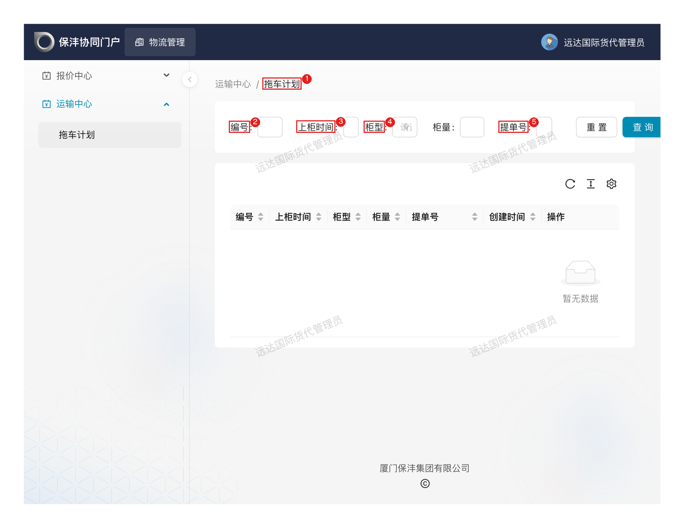

# 国外物流 — 供应商（托运）

> 角色：外部拖车/运输供应商（2026-05 起从货代独立管理、独立招标）。操作界面：**保沣微信公众号内嵌系统界面**（移动端为主）+ **对外协同平台 PC 端**（拖车计划查询）。排车等业务通知通过微信公众号模板消息推送。

## 1. 角色说明

拖车供应商负责海外柜源的**拖车执行**环节，按排车计划把柜子按时提出来、装上货、交回场站：

- **接收排车任务**：物流管理员完成上柜计划、分配拖车公司后，通过公众号模板消息收到排车通知（含计划上柜日期和时段）
- **安排运力并回填信息**：按计划时段安排车辆，回填司机姓名、电话、车牌号
- **提柜与装柜执行**：按时段提柜、装柜，柜号/封条等交接数据通过 EIR（设备交接单）自动回传

> 协作关系：上柜计划与拖车公司分配由物流管理员在 PC 端完成；柜子到场数据（毛重/VGM、进出场时间、车牌、司机）由云当网 Trackingeyes 通过 EIR 自动同步，无需人工重复录入。

## 2. 登录入口

- **PC 端**：浏览器打开对外协同平台 <https://collab.xmbaofeng.com/>，使用平台账号登录 → **运输中心 → 拖车计划**（查询排车计划）
- **移动端**：微信公众号「**厦门保沣集团有限公司**」→ 公众号底部菜单进入 LMS 系统界面
- 排车任务通过公众号模板消息推送，点开消息可直接进入对应页面

> 注：拖车供应商账号与货代账号分角色管理（`lms_overseas_trucking`）。登录后首页仅显示本角色可用的功能入口。

## 3. 页面速查表

| 页面 | 入口 | 主要内容 |
|------|------|---------|
| 排车任务通知 | 公众号模板消息 | 计划上柜日期、时段、柜型数量 |
| 排车任务/调度单 | 移动端系统界面 | 回填司机姓名、电话、车牌 |
| 拖车计划（PC） | 协同平台 → 运输中心 → 拖车计划 | 查询排车安排（编号/上柜时间/柜型/柜量/提单号） |
| 我的 | 移动端底部导航 | 账号信息、任务核对 |

> 移动端拖车角色页面暂未实测（测试账号无该入口），以上按系统设计整理；界面以实际上线为准。

## 4. 流程

### 4.1 接收排车通知：知道哪天几点、拉几柜

**什么时候做**：物流管理员完成上柜计划并分配给你的当天。通知会给出**计划上柜日期、时段、柜型与数量**。

**这一步要达成**：按时段备好运力——时段是保沣按装柜顺序和场地容量错峰排的，不是参考值。

**怎么做**：微信收到「排车任务通知」模板消息 → 点开进入排车任务页 → 核对日期/时段/柜型柜量 → 安排车辆。

**注意**：

- 通知里是**柜型 + 数量**（如 2×40'HQ），核对车辆承载与柜型匹配（大柜小柜用车不同）
- 时段冲突（同一天别家任务撞车）第一时间说，调得动就调，调不动保沣好换排——拖到当天才说等于违约

**特殊情况**：

| 情况 | 怎么办 |
|------|--------|
| 没收到通知但确有任务 | 确认微信已关注/未屏蔽公众号；联系物流管理员重新推送（通知支持手动重发） |
| 运力不足/时段冲突 | 立即联系物流管理员调整时段或换排其他拖车公司 |

### 4.2 回填车辆与司机信息：现场放行凭它

**什么时候做**：确定执行车辆后、**到场前提早**回填。

**这一步要达成**：调度单上司机/车牌与实际执行车辆完全一致——保沣门禁与堆场按调度单放行，信息对不上车进不了场。

**怎么做**：排车任务/物流调度单页面，**扫码**或手动进入对应柜子的调度单 → 回填**司机姓名、联系电话、车牌号**。

**注意**：

- **车牌号是关键匹配字段**：EIR 回传、门禁核放、费用归属都靠它，临时换车必须更新
- 一柜一单，多柜任务逐柜核对，别串填

**特殊情况**：

| 情况 | 怎么办 |
|------|--------|
| 司机/车牌临时变更 | 到场前在系统里更新回填，并电话告知现场，避免核放受阻 |

### 4.3 提柜与装柜确认：干完活，数据自动回来

**什么时候做**：按计划时段执行提柜、装柜、还场。

**这一步要达成**：按时完成交接，柜子数据完整回传——**这是结算的依据**。

**怎么做**：

1. 按时段到场提柜、装柜
2. 柜号、柜型、封条号及交接数据（毛重 / VGM、放箱 / 进场 / 出场时间、车牌、司机、提还箱港口及时间）由 **EIR 设备交接单**自动回传系统（Trackingeyes 推送），无需手工录入
3. 在移动端「我的」/任务页面核对柜子状态与交接信息是否正确

**注意**：

- VGM/毛重数据影响报关与配载，磅重务必如实
- **拖车费按地磅单结算：城市单价 × 柜数**——干几柜结几柜的钱，交接数据就是凭证

**结果**：柜子交接数据完整回传，费用结算以此为准。

**PC 端查询拖车计划**：协同平台 → 运输中心 → 拖车计划，按编号/上柜时间/柜型/提单号筛选，查看排车安排（柜量、创建时间等）。

图中：
- 1 拖车计划页面；
- 2 3 4 5 筛选条件（编号 / 上柜时间 / 柜型 / 提单号）；
- 列表列：编号、上柜时间、柜型、柜量、提单号、创建时间、操作。

<!-- 截图占位：移动端排车任务页、调度单回填页（待实测拖车供应商账号后补充）

-->

## 5. 异常情况处理

| 情况 | 处理方式 |
|------|---------|
| 未收到排车通知 | 先确认微信是否关注/置顶公众号；仍无则联系物流管理员重新发送（通知可手动触发） |
| 时段冲突/运力不足 | 立即联系物流管理员调整上柜计划时段或换排其他拖车公司 |
| 司机/车牌临时变更 | 及时在系统中更新回填信息，避免现场核放受阻 |
| EIR 数据未回传 | 核对柜号是否正确；联系物流管理员检查 Trackingeyes 对接状态 |
| 柜号/封条异常 | 现场拍照留证并联系物流管理员，按货代/船东要求处理 |
| 压夜/滞期 | 提前预警给物流管理员（涉及截单时间与堆场费用归属） |

## 6. 常见问题

**Q：排车通知里有时段，具体几点到？**
A：按通知中的计划上柜日期和时段安排，建议提前到场；现场以门禁/堆场安排为准。

**Q：司机信息一定要回填吗？**
A：要。调度单的运输人员信息（司机姓名、电话、车牌）用于现场核对放行与费用归属，车牌不一致车进不了场。

**Q：柜子交接数据要我自己录入吗？**
A：不用。柜号、封条、毛重/VGM、进出场时间等由 EIR 自动回传；你只需在移动端核对无误。

**Q：拖车费怎么算？**
A：按地磅单结算：城市单价 × 柜数。交接数据完整是结算前提，干完一柜核对一柜。

**Q：临时有事执行不了怎么办？**
A：第一时间联系物流管理员换排，不要空放时段——影响的是保沣整船的装柜计划。
