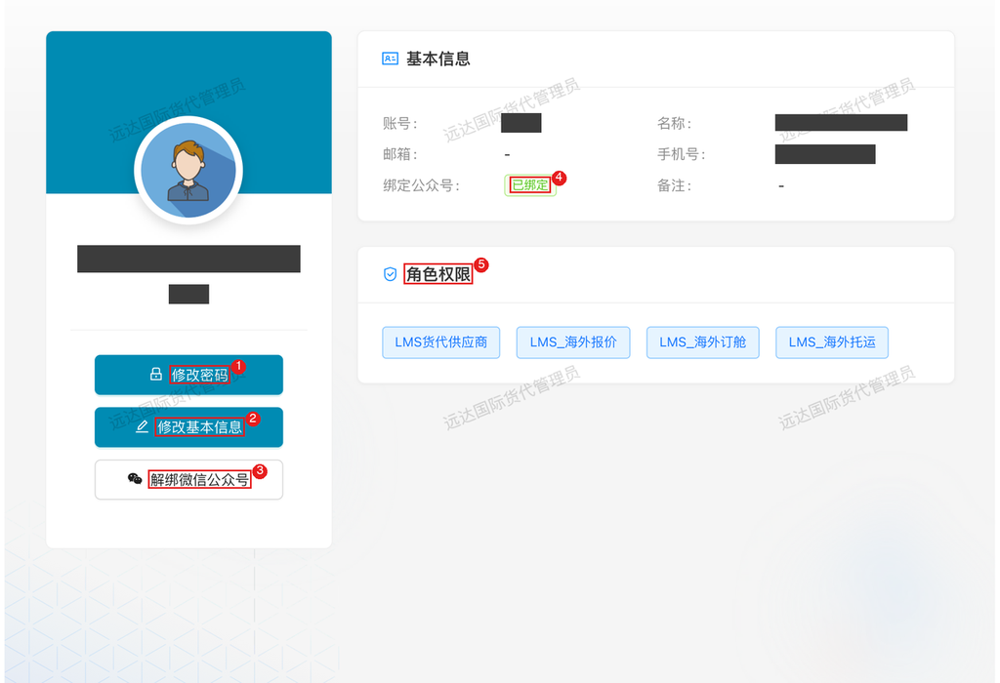

# 系统平台 — 账号管理

> 适用对象：协同门户所有用户（内部员工与外部供应商）。账号由信息部统一创建，本人可管理密码与微信绑定。

## 1. 角色说明

每个账号能做什么，由账号上的**角色权限**决定：不同角色登录后看到的系统菜单不同（如物流管理员看到物流管理，货代供应商看到报价中心）。账号本身的管理（改密码、绑微信）人人一样，就是本篇内容。

**协同门户提供了这些系统**（登录后顶部菜单可见，按角色权限显示）：

| 系统 | 用途 | 文档 |
|------|------|------|
| 物流管理（LMS） | 国内运输询价、海外海运出运全流程 | [LMS物流](../LMS_物流管理/README.md) |
| 数据中心 | 报表、数据查询、字典与采集管理 | — |
| 客户协作 | 客户协同业务 | — |
| 设备管理 | 设备台账与运维 | — |
| 系统管理 | 平台级基础配置 | — |
| 移动端（公众号内嵌） | 手机端操作入口，按角色显示（如供应商的海运报价、订舱委托、拖车任务） | 各业务文档「移动端」章节 |

## 2. 登录入口

| 场景 | 入口 | 说明 |
|------|------|------|
| 内部员工 | 云之家 → 点「**协同门户**」 | 免登录直达 |
| 外部供应商 | <https://collab.xmbaofeng.com/>（对外网站） | 账号密码登录；也可从微信公众号「**厦门保沣集团有限公司**」菜单进入移动端（需先按 4.3 绑定微信） |
| 首次使用 | 联系信息部管理员开账号 | 账号规则：内部员工=工号 |

## 3. 页面速查表

| 页面 | 位置 | 主要操作 |
|------|------|---------|
| 个人中心 | 右上角头像 → 个人中心 | 查看基本信息、角色权限，修改密码、绑定/解绑微信公众号 |
| 修改密码 | 右上角头像 → 修改密码（或个人中心左侧按钮） | 输入旧密码和新密码 |
| 移动端个人中心 | 微信公众号「厦门保沣集团有限公司」→ 供应商协同 | 个人信息、解绑微信公众号（人员变动建议用网页版操作） |

## 4. 流程

### 4.1 查看个人信息与角色权限：确认自己的账号状态

**什么时候做**：想确认自己的资料、能进哪些系统，或排查「为什么我看不到某个菜单」时。

**怎么做**：登录协同门户 → 右上角头像 → **个人中心**。

图中：
1. 「修改密码」按钮；
2. 「修改基本信息」按钮（**供应商账号特有**，可自助维护资料；内部员工账号无此按钮）；
3. 「解绑微信公众号」按钮（未绑定时此处为绑定入口）；
4. 绑定公众号状态——**已绑定**表示微信绑定生效，能收到公众号业务通知；
5. 角色权限——这里列出的每个角色决定你在各系统里能看什么、做什么。

**注意**：

- **供应商账号**：名称、邮箱、手机号等资料可点「修改基本信息」自助维护，改完即生效
- **内部员工账号**：基本资料只读，由信息部维护；发现资料有误联系管理员修改

**结果**：对自己的账号状态、微信绑定情况、系统权限一目了然。

### 4.2 修改密码：自己定期换，不外借

**什么时候做**：首次拿到账号后；定期（建议每季度）；怀疑密码泄露时立即。

**怎么做**：右上角头像 → **修改密码**，弹窗里填「旧密码、新密码、确认密码」→ 确定。

**注意**：

- 新密码需输入两次且完全一致
- 密码是你在这套系统里所有操作的唯一凭证，**不要写在群里、便签上或借给同事**——要给他人查数据，让管理员给对方开对应权限的账号

**结果**：旧密码立即失效，新密码即刻生效。

### 4.3 绑定微信公众号：收通知和用移动端的前提

**什么时候做**：第一次使用账号就应该绑定。业务通知（供应商的询价邀请、订舱委托、排车任务，员工的审批提醒等）都通过公众号模板消息推送，**不绑定就收不到**；公众号里的移动端页面也靠绑定识别身份，**不绑定页面无法正常显示和使用**。

**怎么做**：个人中心 → 绑定公众号处点击**绑定入口** → 系统生成二维码 → 用微信扫码 → 在微信里确认授权 → 自动完成绑定。

**注意**：

- 一个微信只能绑一个账号，一个账号也只能绑一个微信（互斥）
- 扫码授权时确认微信提示里显示的是「厦门保沣集团有限公司」公众号
- 绑定后通知有**分钟级延迟**，不要因为晚收到几分钟就重复操作

**结果**：个人中心「绑定公众号」显示**已绑定**；此后业务通知会推送到你的微信，公众号里的移动端页面也能正常打开使用。

### 4.4 解绑微信公众号：换微信时才需要

**什么时候做**：更换个人微信、或账号微信绑错人时。

**怎么做**：人员变动、换绑微信**建议用电脑登录网页版操作**：协同门户 → 右上角头像 → 个人中心 → 「**解绑微信公众号**」→ 确认。解绑后按 4.3 重新绑定新微信。

**注意**：

- 移动端个人中心虽也有解绑入口，但**没有退出登录**，人员交接时用网页版操作更稳妥
- 解绑期间你将**收不到任何公众号通知**（包括询价邀请、排车任务），尽快完成重新绑定
- 解绑前确认没有正在进行的待办通知

**结果**：公众号绑定解除，状态回到未绑定；原有通知推送立即停止。

## 5. 常见问题

| 情况 | 怎么办 |
|------|--------|
| 忘记密码登录不了 | 联系信息部管理员重置，重置后尽快按 4.2 自行改密 |
| 收不到业务通知 | 按 4.1 确认「绑定公众号」为已绑定、微信已关注「厦门保沣集团有限公司」且未开启免打扰；仍无则联系管理员重新触发通知 |
| 公众号里页面打不开、显示异常 | 微信未绑定或绑定失效，按 4.3 重新绑定后再试 |
| 换了手机/微信 | 老微信解绑（4.4）→ 新微信绑定（4.3）；换手机不影响，登录凭账号密码 |
| 看不到某个系统菜单 | 角色权限没配，联系信息部管理员按岗位开通 |
| 资料（手机号/邮箱）要改 | 供应商账号在个人中心点「修改基本信息」自助修改；内部员工账号联系信息部管理员维护 |
| 微信扫码绑定失败 | 确认该微信没绑过其他保沣账号（互斥）；曾绑过离职同事账号的先让管理员协助解绑 |
