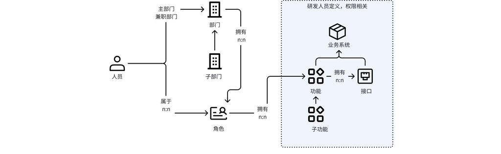

# 权限服务

> 统一认证授权服务（user_auth），实现 OAuth2 协议，提供用户管理、权限控制（基于 `product_key` 的多产品权限隔离）和第三方系统集成。核心实体关系模型描述人员、部门、角色、业务系统、功能/接口之间的归属与拥有关系（均为 n:n）。

## 架构图



## 实体关系

| 层级 | 实体 | 关联关系 |
|------|------|----------|
| 人员层 | 人员 | → 主部门 / 兼职部门 / 角色（属于，n:n） |
| 部门层 | 部门 | → 子部门（上下级）/ 角色（拥有，n:n） |
| 角色层 | 角色 | → 业务系统（拥有，n:n） |
| 业务系统层 | 业务系统 | → 功能 / 接口（拥有，由研发定义权限，n:n） |
| 功能层 | 功能 | → 子功能（上下级） |

## 关系说明

**人员 ↔ 部门：** 一个人可属主部门 + 多个兼职部门，一个部门可挂多个人员。

**部门 ↔ 角色：** 角色归属于部门，一个部门可拥有多个角色（如"部门管理员""普通成员"等）。

**角色 ↔ 业务系统：** 角色与业务系统为多对多关系，一个角色可访问多个系统，一个系统可分配给多个角色。

**业务系统 ↔ 功能/接口：** 权限细粒度落到业务系统的功能 + 接口两级，由研发人员在系统中定义。功能支持父子层级。

## 核心要点

- 所有关联均为 **n:n 多对多**关系
- 权限的细粒度落到 **业务系统的功能 + 接口** 两级
- 一个人可属主部门 + 多个兼职部门，一个部门可挂多个角色
- 虚线区域内（业务系统 → 功能 → 接口）为研发人员定义的权限模型

## 认证能力

### OAuth2 授权模式

| 授权模式 | 说明 | 适用场景 |
| -------------- | -------------- | -------------- |
| `password` | 密码模式 | 自有应用登录 |
| `client_credentials` | 客户端凭证模式 | 服务间调用 |
| `authorization_code` | 授权码模式 | 第三方应用授权 |
| `refresh_token` | 刷新令牌 | 令牌续期 |

**扩展认证能力：**

- **MES 认证** — `mes_password` 授权类型，验证 MES 系统账号
- **保沣 ECP 认证** — `ecp_password` 授权类型，验证 ECP 系统账号
- **密码加密** — AES-GCM 加密传输，客户端使用 `client_secret` 解密
- **登录保护** — 错误次数限制，自动锁定机制

### 微信扫码登录

PC 网站扫码登录流程：

1. Web 端获取二维码 URL（`/auth/wechat/login/url`）
2. 用户微信扫码授权
3. 移动端确认登录（`/auth/wechat/login/confirm`）
4. Web 端轮询获取 token（`/auth/wechat/login/check`）

### 云之家免登

用户从云之家点击应用入口，携带 `ticket` 参数 → 本系统验证 `ticket` 建立登录态（反向验证流程）。

前提条件：

- `user.yunzhijia_openid` 已填充
- `oauth2_client` 表有 `key='yunzhijia'` 且 `enable=true`

### 第三方系统免登（SSO）

通过 `/auth/token/url` 接口实现单点登录跳转：

| product_key | 系统 | 说明 |
| ------------- | -------- | -------------- |
| `yunxuetang` | 云学堂 | 在线学习平台 |
| `xinluzhou` | 新鹭洲 | 费控云平台 |
| `smartbi` | Smartbi | 商业智能分析 |
| 不传/任意值 | 通用跳转 | 使用 `redirect_url` 参数 |

各系统地址见 [系统地址](../README.md#系统地址)。

## Kong 网关集成

与自研 Kong `auth-check` 插件配合，实现 API 网关层面的统一鉴权（网关整体架构见 [API 网关](06_API网关.md)）：

```
客户端请求 → Kong（auth-check 插件）→ 调用 user_auth 鉴权 → 缓存结果 → 转发到后端服务
```

**Token 来源优先级：**

1. **URL 参数** — `?ticket=xxx`（云之家）或 `?token=xxx`；云之家 ticket 会设置 `X-Token-Source: yunzhijia` header
2. **请求 Header** — `Authorization: Bearer xxx`
3. **Cookie** — `token=xxx`

当 token 来自 URL 或 Cookie 时，Kong 自动注入 `Authorization: Bearer <token>` header，后端服务无需关心 token 来源。

**插件配置：**

| 字段 | 说明 |
| ----------------- | ------------------------ |
| `auth_url` | user_auth 鉴权服务地址 |
| `product_key` | 产品标识 |
| `skip_paths` | 跳过校验的路径前缀 |
| `skip_ips` | 跳过校验的 IP 前缀 |
| `cache_ttl` | 权限缓存时间（秒） |

## 数据同步与推送

**从外部系统同步（入向）：**

| 系统 | 同步内容 |
| -------- | -------------------- |
| 云之家 | 用户、部门、角色 |
| K3 | 组织架构 |
| MES | 生产相关数据 |
| EHR | 人力资源数据 |

**向第三方系统推送（出向）：**

| 目标系统 | 推送内容 |
| -------- | ---------------------------- |
| 云学堂 | 用户、部门、岗位（角色） |
| 新鹭洲 | 员工信息 |
