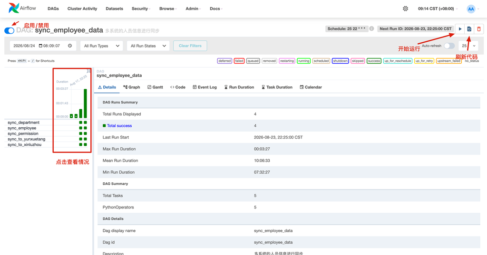

# 定时任务

## 应用场景

所有需要**周期性自动执行**的任务统一接入 Airflow 调度，不散落在各系统内部实现 cron，便于统一管理、失败通知和补数重跑。典型场景：

| 场景 | 示例 |
|------|------|
| 数据同步与报表刷新 | 数据中心报表刷新、金蝶数据同步、云之家打卡同步 EHR |
| 业务消息推送 | MES 转产/交接班/异常数据通知、云之家审批超时提醒 |
| 设备与系统监控告警 | 设备采集监控、电表数据监控、SCADA 监控 |
| 数据库维护 | 索引重建、快照创建、长事务清理、日志清理 |
| 外部数据获取 | 天气数据、能耗数据上报、门禁信息 |

## 基本信息

| 项目 | 说明 |
|------|------|
| 地址 | 见 [开发服务地址](../README.md#开发服务地址) |
| 用途 | 工作流、定时任务和数据任务调度 |
| 元数据库 | PostgreSQL |
| 部署方式 | Docker |

## DAG 仓库

DAG 脚本统一维护在独立的 Gitea 仓库，当前共 **85 个 DAG**，按模块分组：

| 模块 | 数量 | 内容 |
|------|------|------|
| data_center | 27 | 报表刷新、数据同步、归档 |
| mes | 31 | MES 消息推送、生产计划、排程 |
| monitor | 6 | 设备监控和告警 |
| maintence | 10 | 数据库维护（索引重建、快照、清理） |
| yunzhijia | 5 | 云之家集成（签到、表单、员工同步） |
| 其他 | 6 | 多系统人员同步、SCADA、天气、证书等 |

仓库 `util/` 目录提供认证、消息通知、数据库维护等工具函数（见下文[工具函数](#工具函数)）。部署 compose 文件不在仓库中。

## 开发指南

### 最小 DAG 模板

```python
from datetime import datetime
from airflow import DAG
from airflow.operators.python import PythonOperator
from util.message import notify_failure

default_args = {
    "owner": "airflow",
    "start_date": datetime(2025, 1, 1),
    "retries": 0,
}

dag = DAG(
    "dag_id",                      # DAG 唯一标识
    description="任务描述",
    default_args=default_args,
    schedule="0 1 * * *",          # cron 表达式
    catchup=False,                 # 不回补历史
    max_active_runs=1,             # 禁止并发
    on_failure_callback=notify_failure,
    tags=["标签1", "标签2"],
)

def my_task_func():
    # 任务逻辑
    pass

my_task = PythonOperator(
    task_id="my_task",
    python_callable=my_task_func,
    dag=dag,
)
```

### 开发约定

| 约定 | 说明 | 原因 |
|------|------|------|
| `catchup=False` | 禁止历史回补 | 防止启动时大量任务堆积 |
| `max_active_runs=1` | 禁止并发执行 | 防止数据竞争和资源冲突 |
| `on_failure_callback=notify_failure` | 失败通知 | 确保异常及时告警 |
| `retries=0` | 默认不重试 | 关键任务失败需人工介入 |
| 中文注释 | 代码和文档使用中文 | 团队协作要求 |

### 调度时间配置

Cron 表达式：

```python
schedule="0 1 * * *"        # 每天 01:00
schedule="*/5 * * * *"      # 每 5 分钟
schedule="0 8,12,18 * * *"  # 每天 8/12/18 点
schedule="0 2 * * 0"        # 每周日 02:00
```

Timedelta 间隔（高频任务）：

```python
from datetime import timedelta

schedule=timedelta(seconds=30)   # 每 30 秒
schedule=timedelta(minutes=5)    # 每 5 分钟
```

### 常用 Operator

PythonOperator 执行 Python 函数：

```python
def task_func(param1, param2):
    # 业务逻辑
    pass

task = PythonOperator(
    task_id="task_name",
    python_callable=task_func,
    op_kwargs={"param1": "value1", "param2": "value2"},
    dag=dag,
)
```

TriggerDagRunOperator 触发其他 DAG：

```python
from airflow.operators.trigger_dagrun import TriggerDagRunOperator

trigger = TriggerDagRunOperator(
    task_id="trigger_downstream",
    trigger_dag_id="target_dag_id",
    dag=dag,
)
```

### 任务依赖与状态共享

任务依赖：

```python
task_a >> task_b >> task_c           # A → B → C
task_a >> [task_b, task_c] >> task_d # A → B,C → D
```

XCom 跨任务传递数据：

```python
def push_data(**context):
    data = {"key": "value"}
    context["ti"].xcom_push(key="my_data", value=data)

def pull_data(**context):
    data = context["ti"].xcom_pull(key="my_data", task_ids="push_task")
```

## 配置管理

### Connections（连接）

Admin → Connections，管理外部系统连接信息（数据库、SSH 主机、API 等）。DAG 和工具函数中的 `conn_id` 都引用这里的配置。

| 常用字段 | 说明 |
|----------|------|
| Conn Id | DAG 中引用的连接标识（如 `mes_db`） |
| Conn Type | 连接类型（如 `Postgres`、`SSH`） |
| Host / Login / Password | 连接凭据 |

### Variables（变量）

Admin → Variables，管理 DAG 中使用的动态配置（不硬编码到代码中）。

```python
from airflow.models import Variable

# 读取变量
db_schema = Variable.get("mes_schema", default_var="dbo")
```

## 工具函数

仓库 `util/` 提供的工具函数，导入即可调用。

### auth.py — OAuth2 认证

#### oauth_simple_http_request

带 OAuth2 的 HTTP 请求：自动从 Airflow Connection 获取配置，令牌自动获取、缓存（跨进程共享）和过期刷新，返回 `requests.Response`。

```python
from util.auth import oauth_simple_http_request
import json

response = oauth_simple_http_request(
    http_conn_id="kong_service",              # Airflow 连接 ID
    endpoint="api/data_center/job/execute",   # API 端点
    method="POST",
    data=json.dumps({"key": "value"}),
    headers={"Content-Type": "application/json"},
    timeout=1800,                             # 超时时间（秒）
)
```

#### oauth_request

同上，但直接使用完整 URL，不走 Airflow Connection。

```python
from util.auth import oauth_request

response = oauth_request(url="http://api.example.com/endpoint", method="POST", json={"key": "value"}, timeout=30)
```

#### get_auth_header

获取认证请求头，用于自定义 HTTP 调用。

```python
from util.auth import get_auth_header

headers = get_auth_header()
# {'Authorization': 'Bearer xxx...'}
```

### message.py — 消息通知

#### notify_failure

任务失败回调，自动发送告警邮件，内容包含 DAG ID / Task ID、执行时间、日志 URL、异常信息。

```python
from util.message import notify_failure

dag = DAG(
    ...,
    on_failure_callback=notify_failure,
)
# 需指定通知人员时用 lambda：
# on_failure_callback=lambda ctx: notify_failure(ctx, name_list=["吴汉楚"])
```

#### send_message

发送邮件通知，`name_list` 需在 `notify_map` 中存在（当前支持：吴汉楚、高少宏、黄湖广、王垚鑫、李志彬）。

```python
from util.message import send_message

send_message(
    title="任务告警",
    body="任务执行异常，请检查",
    name_list=["吴汉楚", "高少宏"],
)
```

#### send_department_message

发送云之家部门群消息并 @ 指定人员。

```python
from util.message import send_department_message

send_department_message(
    content="生产计划已更新，请查看",
    name_list=["吴汉楚"],  # @ 的人员
)
```

#### get_task_log_url

获取任务日志 URL，用于在自定义消息中附带日志链接。

```python
from util.message import get_task_log_url

url = get_task_log_url(context)
```

### db.py — MSSQL 索引维护

#### find_fragmented_indexes

查询 MSSQL 数据库中需要优化的索引，返回 `[(索引名, 碎片率, 页数), ...]`。

```python
from util.db import find_fragmented_indexes

indexes = find_fragmented_indexes(
    conn_id="db_mes_xm_sa",                # MSSQL 连接 ID
    database_name="XMBF",                  # 数据库名
    max_page_count=50000,                  # 最大页数限制
    like_pattern="AND o.name LIKE 'T_%'",  # 表名过滤（可选）
)
```

#### optimize_indexes

执行索引优化（存储过程方式），参数同 `find_fragmented_indexes`。优化策略：碎片率 ≥ 30% REBUILD ONLINE，< 30% REORGANIZE。

#### optimize_indexes_batch

批量 ALTER INDEX 方式执行优化，参数同上。

### http.py — 响应处理

#### log_response

记录响应日志并检查状态码，失败时抛出异常。

```python
from util.http import log_response

response = requests.get("https://api.example.com/data")
log_response(response)
```

## 数据库操作

通过 Airflow Hook 连接数据库，连接 ID 在 Admin → Connections 配置：

| 数据库 | Hook | 调用 |
|--------|------|------|
| PostgreSQL | `PostgresHook` | `hook = PostgresHook(postgres_conn_id="pg_prod")`，查询用 `hook.get_records("SELECT ...")` |
| MSSQL | `MsSqlHook` | `hook = MsSqlHook(mssql_conn_id="db_mes_xm_sa")`，取 `hook.get_sqlalchemy_engine()` |
| Redis | `RedisHook` | `conn = RedisHook(redis_conn_id="redis_device_monitor").get_conn()`，再 `conn.get("key")` |

事务写法（MSSQL 示例，PostgreSQL 相同）：

```python
with hook.get_sqlalchemy_engine().begin() as conn:
    result = conn.execute(text("SELECT * FROM XMBF.dbo.Table"))
    rows = [dict(row) for row in result]
```

云之家机器人通知（webhook 直发，不走 util.message 时用）：

```python
import requests

def notify_yzj(message, token):
    url = f"https://www.yunzhijia.com/gateway/robot/webhook/send?yzjtype=0&yzjtoken={token}"
    requests.post(url, json={"content": message})

# 厦门群: 527b77075db744b583a5f668b00397f9
# 湖北群: 9dab9051d1ea4ff7a4e7133d458f8878
```

## 典型场景示例

**定时调用 API**（参考 `data_center/refresh_report_production.py`）：

```python
def call_api_task():
    oauth_simple_http_request(
        "kong_service",
        "api/endpoint",
        method="POST",
        data=json.dumps({"param": "value"}),
        headers={"Content-Type": "application/json"},
        timeout=1800,
    )
```

**数据库查询 + 消息推送**（参考 `mes/mes_message_notify.py`）：

```python
def process_and_notify():
    hook = MsSqlHook(mssql_conn_id="db_mes_xm_sa")
    engine = hook.get_sqlalchemy_engine()

    with engine.begin() as conn:
        result = conn.execute(text("SELECT * FROM queue WHERE status='PENDING'"))
        records = [dict(row) for row in result]

        for record in records:
            process(record)
            conn.execute(text("UPDATE queue SET status='DONE' WHERE id=:id"), {"id": record["id"]})
```

**监控告警**（参考 `monitor/device_monitor.py`）：

```python
def monitor_task(**context):
    # 获取上一次状态
    last_state = context["ti"].xcom_pull(key="state", include_prior_dates=True) or {}

    # 检测逻辑
    current_state = check_status()

    # 告警判断
    if should_alert(last_state, current_state):
        send_message("告警", "检测到异常", ["吴汉楚"])

    # 保存状态
    context["ti"].xcom_push(key="state", value=current_state)
```

## 调试与部署

本地测试函数：

```python
if __name__ == "__main__":
    # 本地调试
    my_task_func()
```

查看日志：Web UI → DAG → Task Instance → Logs，或用 `util.message.get_task_log_url(context)` 获取日志 URL。

部署流程：

1. 编写 DAG 脚本，放在对应业务目录
2. 本地测试函数逻辑
3. 提交到 Git 仓库
4. Airflow 自动同步（约 1 分钟）
5. 在 Web UI 检查 DAG 是否加载成功
6. 手动触发测试
7. 确认调度时间正确

## DAG 管理


### 启停 DAG

在 DAG 列表页，左侧开关控制 DAG 的**激活/暂停**状态：
- **激活（蓝色）**：调度器会按 `schedule_interval` 自动触发任务
- **暂停（灰色）**：不会自动触发，但可手动触发

### 手动触发 DAG Run

点击 DAG 名称进入详情页 → 右上角 **▶ (Trigger DAG)** 按钮。

如需传入自定义参数，点击 **▶ 旁的下拉箭头** → 填写 JSON Configuration。

### 清除任务状态（重跑）

清除 DAG Run 中失败或成功的任务，使其回到可执行状态：

1. 进入 DAG 详情页 → 选择目标 DAG Run
2. 点击目标任务 → **Clear**（清除状态）
3. 或批量清除：勾选多个任务 → **Clear selected**

清除后任务状态变为 `None`，调度器会重新调度执行。

### 标记成功/失败

无法重跑但需要跳过的任务，可手动标记状态：
- **Mark Success**：标记为成功，后续依赖任务继续执行
- **Mark Failed**：标记为失败

## 常见问题

**DAG 不执行？** 检查：`start_date` 是否已过、`schedule` 是否正确、Airflow Scheduler 是否运行。

**任务超时？** 设置 `execution_timeout` 或调整请求 `timeout`：

```python
task = PythonOperator(
    task_id="long_task",
    python_callable=long_func,
    execution_timeout=timedelta(hours=1),
)
```

**需要重试？** 设置 `retries` 和 `retry_delay`：

```python
default_args = {
    "retries": 3,
    "retry_delay": timedelta(minutes=5),
}
```

## 注意事项

### DAG 启动会补执行历史任务

Airflow 的 `catchup` 默认为 `True`，新部署或长时间暂停后重新激活 DAG 时，会补执行从上次到现在的所有调度周期。

**解决方法**：DAG 定义中必须显式 `catchup=False`（见开发约定）。若已产生堆积：先暂停 DAG → 清除不需要的历史 DAG Run → 再激活。

### SSH Operator 不读取 .bash_profile

通过 `SSHOperator` 执行远程命令时，不会加载用户的 `.bash_profile` 环境变量。

需要在 DAG 中手动配置环境变量，或在命令前 `source ~/.bash_profile &&`：

```python
run_task = SSHOperator(
    task_id="run_job",
    ssh_conn_id="target_server",
    command="source ~/.bash_profile && python /opt/jobs/my_job.py",
    dag=dag,
)
```
