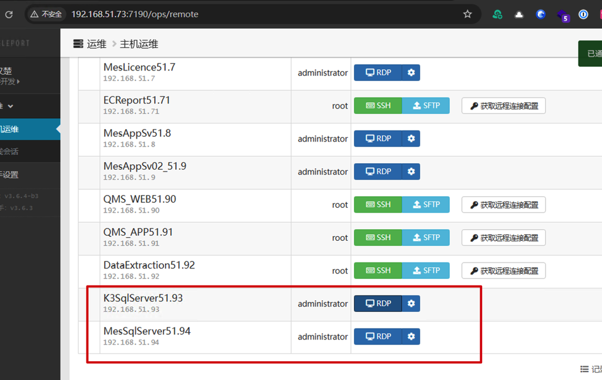
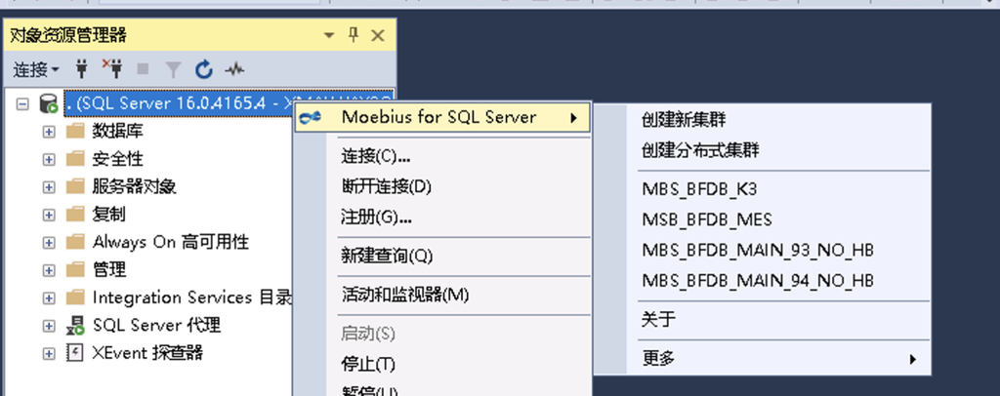
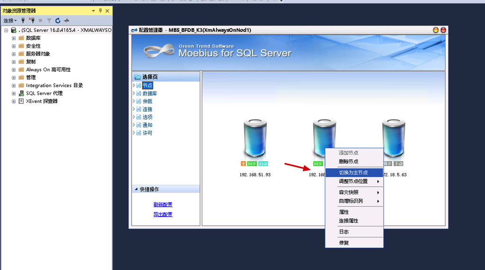
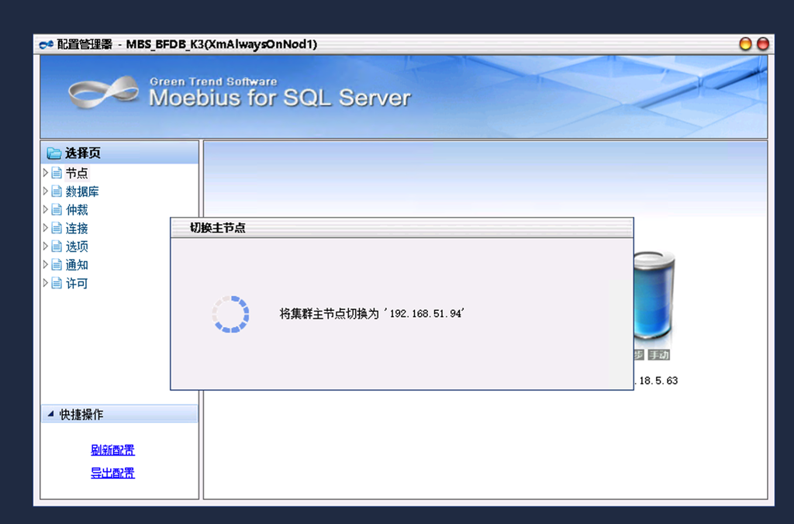
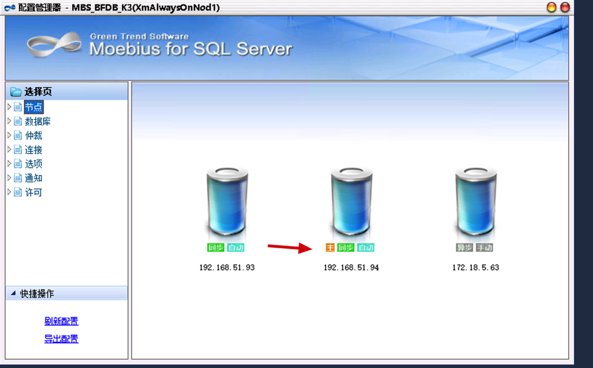

# SQLServer 集群

## 服务器集群

- 192.168.51.93 K3主数据
- 192.168.51.94 MES主数据
- 172.18.5.63 湖北异地备份库

## 数据库集群

| 集群名 | 日常节点情况 | 备注 |
|---|---|---|
| MBS_BFDB_K3 | 51.93->51.94->5.63(湖北) | K3 数据库为主的集群 |
| MBS_BFDB_MES | 51.94->51.93->5.63(湖北) | MES 数据库为主的集群 |
| MBS_BFDB_MAIN_93_NO_HB | 51.93->51.94 | 主要运行在 93 上，不需要异地同步的集群。 |
| MBS_BFDB_MAIN_94_NO_HB | 51.94->51.93 | 主要运行在 94 上，不需要异地同步的集群。 |

## 集群切换主节点

在特定情况下，例如需要对服务器进行运维的情况下，需要人工操作切换数据库集群主节点，让运维服务器处理备节点的情况，再对服务器进行运维。

1. 使用 堡垒机 连接到集群的主节点对应的远程桌面。

2. 使用 Sql Server Management Studio 连上本地数据库，选择对应的操作的集群。

3. 可以看到集群当前的情况和主节点，在备节点上 右键 选择 **切换成主节点。**

4. 开始切换节点，需要等待一点的时间。

5. 切换完，可以看到 **主节点** 已经切换到另一台服务器上。

