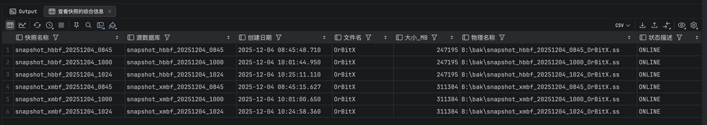
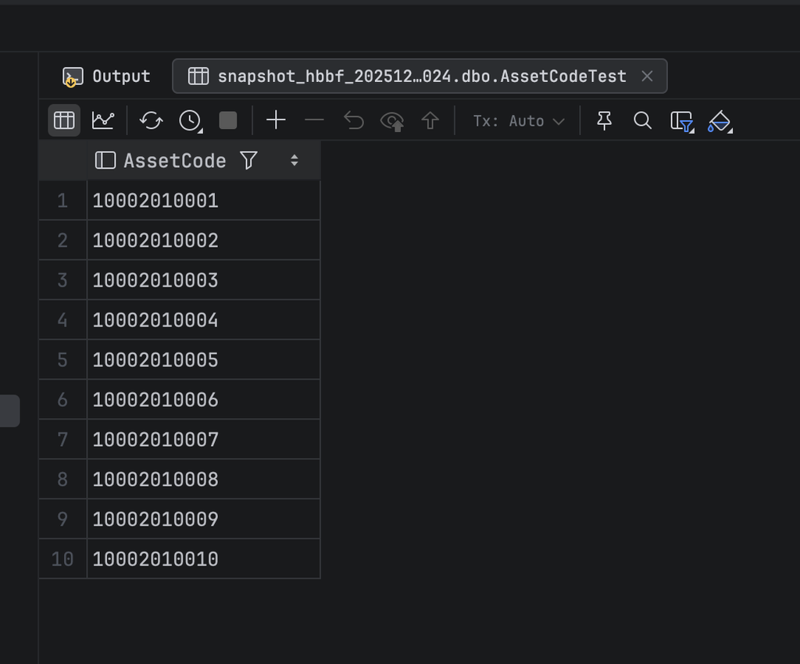

# 数据库快照

## 快照

我们已在湖北服务器上的 MES 数据库配置了**定期快照构建任务**。

这一机制为您提供了强大的数据安全和恢复能力：

- **🎣 历史数据查询：** 快照能完整、准确地反映**创建时刻的数据库状态**，是进行历史数据追踪、分析和审计的可靠来源。
- **🛡️ 快速数据恢复：** 如果发生**误操作、逻辑错误或数据丢失**，我们可以利用最近的快照，快速将数据库恢复到快照创建时的状态，最大限度地减少业务中断和数据损失。

**核心价值：** 快照是实现数据回溯和灾难恢复的重要保障。

查询当前快照列表：

```sql
-- 查看快照
SELECT db.name AS 快照名称,
       DB_NAME(db.source_database_id) AS 源数据库,
       db.create_date AS 创建日期,
       mf.name AS 文件名,
       mf.size * 8 / 1024 AS 大小_MB,
       mf.physical_name AS 物理名称,
       mf.state_desc AS 状态描述
FROM sys.databases db
         INNER JOIN sys.master_files mf ON db.database_id = mf.database_id
WHERE db.source_database_id IS NOT NULL
ORDER BY 快照名称;
```

结果会类似：



使用快照查询：

```sql
SELECT TOP 10 * FROM snapshot_hbbf_20251204_1024.dbo.AssetCodeTest;
```

查询结果：


