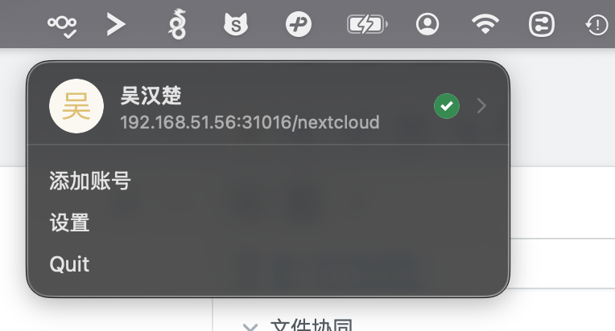
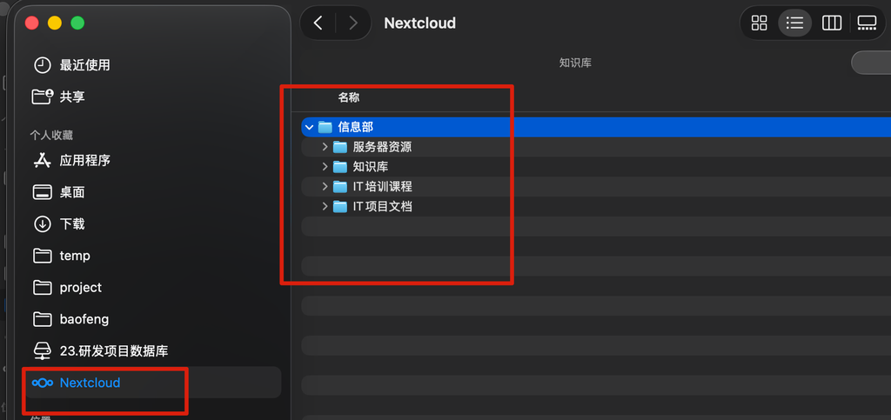
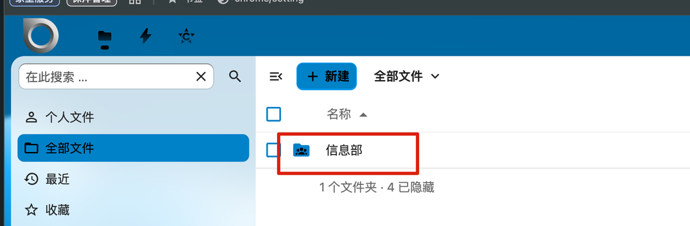
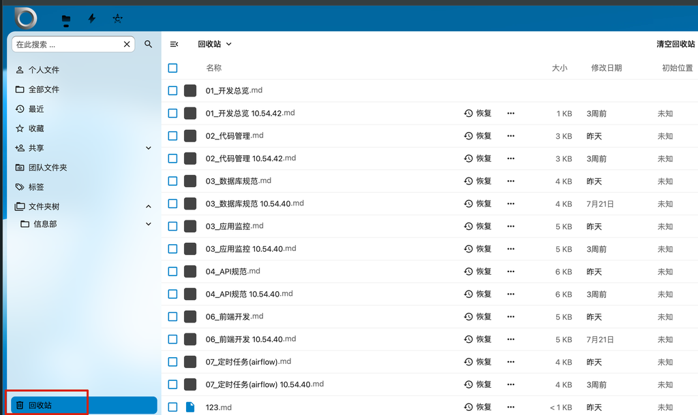

# 文件协同

## 解决什么问题

资料散落在个人电脑、U 盘、微信群文件里：找不到、传不动、易丢失，人员离职资料无法交接。需要统一的文件存储与共享入口，数据留在公司内网。

## 选择的软件

| 平台 | 用途 | 地址 |
|------|------|------|
| Nextcloud Baofeng | 文件存储、资料共享、协同办公 | [http://192.168.51.56:31016/nextcloud](http://192.168.51.56:31016/nextcloud/index.php/login) |

Nextcloud 为开源自建，部署在公司内网，文件数据不出企业边界。

## 主要功能

- **文件存储**：个人网盘空间，按文件夹整理资料
- **共享协作**：内部共享给同事/部门，外部分享链接（可设密码、有效期）
- **多端同步**：电脑/手机客户端，本地文件夹双向自动同步
- **安全保障**：历史版本回退、已删除文件恢复

## 登录

浏览器访问 [Nextcloud](http://192.168.51.56:31016/nextcloud/index.php/login)，使用工号账号登录。

## 常见操作

### 上传与整理

- 拖拽文件/文件夹到文件列表直接上传，或点击 **+** → 上传文件 / 上传文件夹
- 点击 **+** → 新建文件夹，按项目/部门整理资料

### 分享给同事

1. 文件或文件夹右侧点击 **分享** 图标
2. 搜索同事姓名或部门，选择权限（可编辑 / 只读）
3. 对方登录后在「共享」中查看

### 分享链接（外部人员）

1. 分享 → 勾选 **分享链接**
2. 建议设置：**密码保护**、**有效期**，按需勾选「允许编辑」「允许下载」
3. 复制链接发给对方，密码另行告知

### 客户端同步

1. 电脑/手机安装 Nextcloud 客户端：
   - **电脑（Windows/macOS/Linux）**：官网下载 https://nextcloud.com/install/ → Desktop clients，或联系信息部获取安装包
   - **手机**：应用商店搜索 **Nextcloud**（App Store / 各大安卓应用市场）
2. 服务器地址填公司 Nextcloud 地址，登录后客户端显示已连接：

3. 选择本地同步文件夹后，文件自动双向同步，离线也可编辑。同步完成后可在文件管理器侧边栏直接访问：

### 团队文件夹

团队文件夹是部门/项目组共用的存储空间，由管理员统一构建和分配。登录后在文件列表中可见被授权的团队空间（带成员图标）：

1. 按权限直接上传、编辑、删除文件，与个人网盘操作一致
2. 团队文件夹内的文件对所有授权成员可见，适合放部门资料、项目文档等公共资料

需要新建团队文件夹、调整成员或权限，联系管理员申请。

### 误删恢复与历史版本

删除的文件在左下角 **回收站** 中可选中恢复：

文件详情 → **版本**，可回退到历史版本。

## 注意事项

- 仅限公司内网环境访问
- 含敏感数据的文件分享链接必须设置密码和有效期
- 重要资料不要只存本地，同步到 Nextcloud 作为备份
