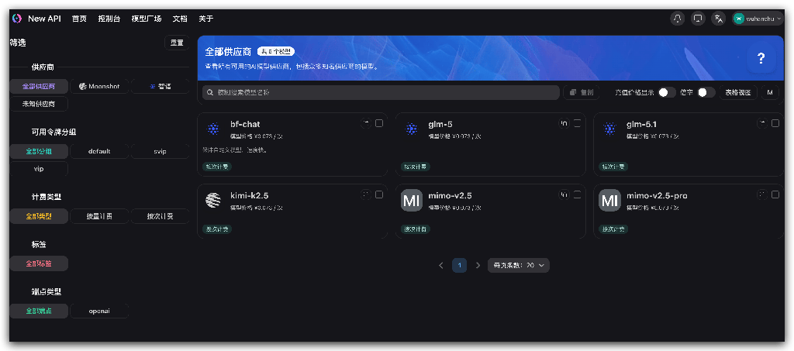
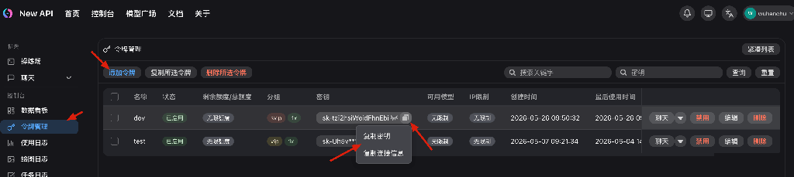
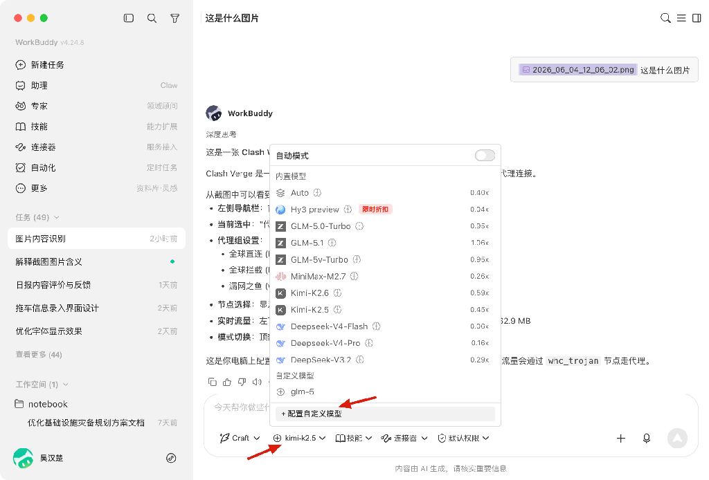
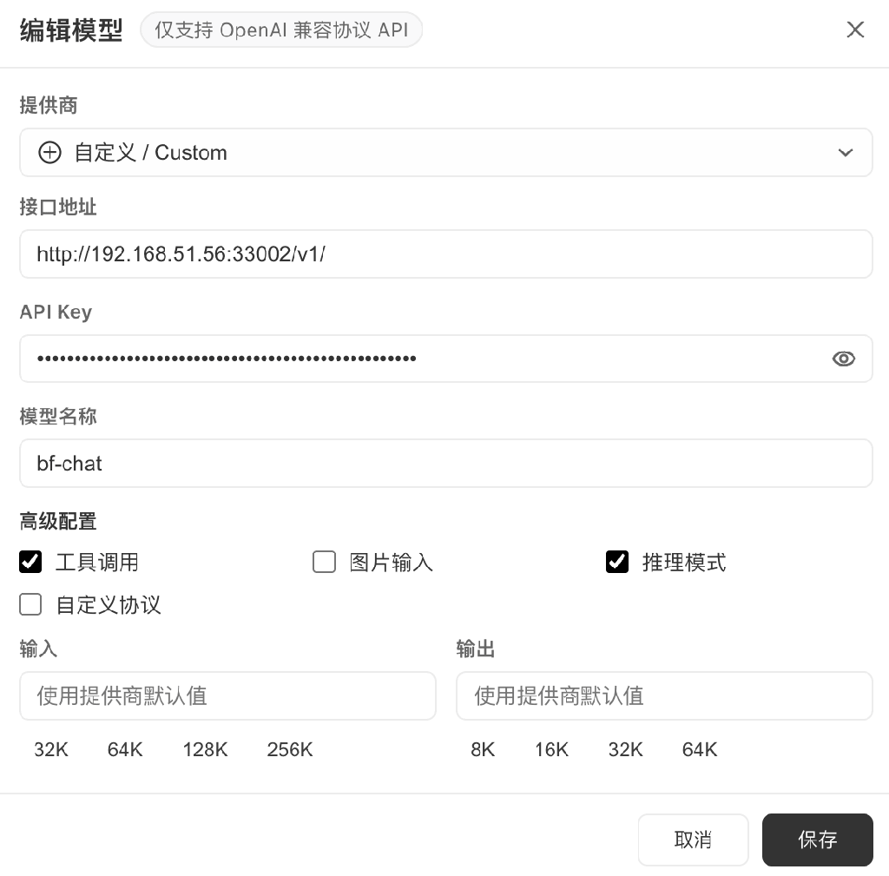
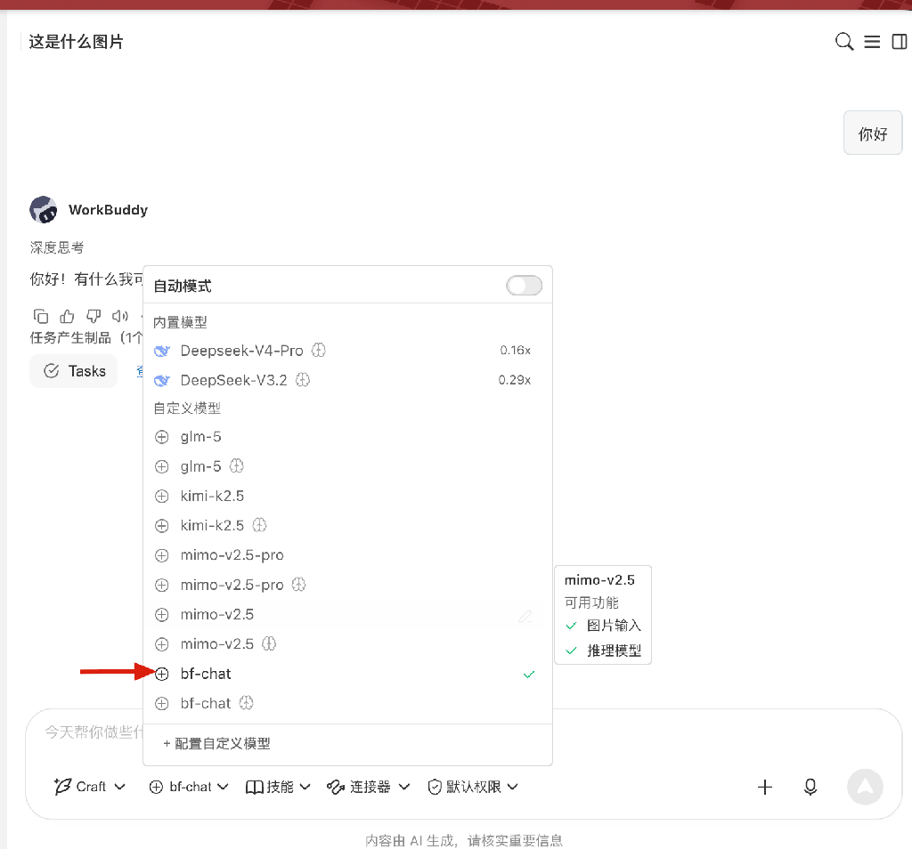

# AI 模型申请

## 解决什么问题

员工使用 AI 提效的需求越来越多，各自注册外部 AI 服务存在数据泄露风险，费用也无法管控。公司统一提供 AI 模型能力额度，内网调用、数据不出企业边界，额度统一管理。

## 选择的软件

| 平台 | 用途 | 地址 |
|------|------|------|
| New API | AI 模型统一网关 | [http://192.168.51.56:33002](http://192.168.51.56:33002) |

New API 作为统一网关对接各 AI 模型，员工申请账号和 API Key 后即可在各类工具中调用。

## 主要功能

- **统一接口**：OpenAI 兼容格式，WorkBuddy、opencode 等工具均可接入
- **额度管理**：按账号分配调用额度，用量可查
- **API Key 管理**：自助创建、独立标识到人

## 申请

### 申请条件

- 保沣集团正式员工
- 明确的业务用途（非娱乐/个人用途）

### 申请方式

云之家搜索"信息部 郑坚杰"，说明使用场景和需求即可创建账号并获取 API Key。

### 使用要求

- 仅限公司内网环境使用
- API Key 仅限本人使用，不得分享给外部人员
- 不得用于处理未经脱敏的敏感数据
- 不得生成违规内容

## WorkBuddy 配置

申请到账号后，按以下步骤配置到 WorkBuddy：

### 第一步：登录 New API 网站

1. 确保已连接公司内网
2. 浏览器访问 [New API](http://192.168.51.56:33002)
3. 使用申请到的工号账号登录

### 第二步：创建 API Key

1. 登录后进入 API Key 管理页面
2. 点击"创建新 Key"
3. 妥善保存生成的 API Key

### 第三步：在 WorkBuddy 配置新模板

1. 登录 WorkBuddy
2. 进入设置页面，找到模型配置

3. 供应商选择「自定义」，填入接口地址 `http://192.168.51.56:33002/v1` 和 API Key 并保存

### 第四步：选择新模型进行测试

1. 在 WorkBuddy 中选择刚配置的新模型

2. 发送一条简单消息验证 AI 响应正常即配置成功
