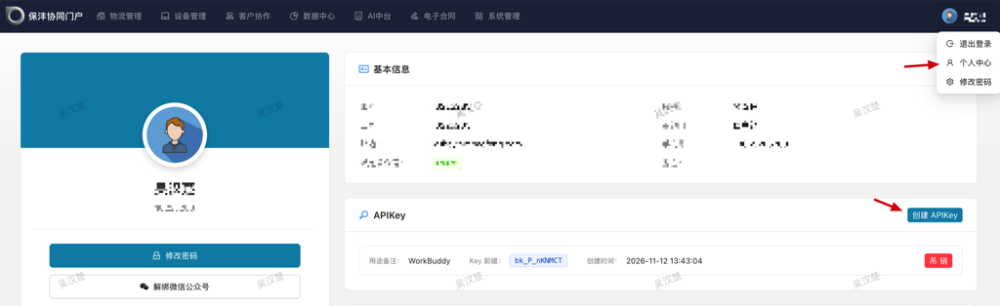
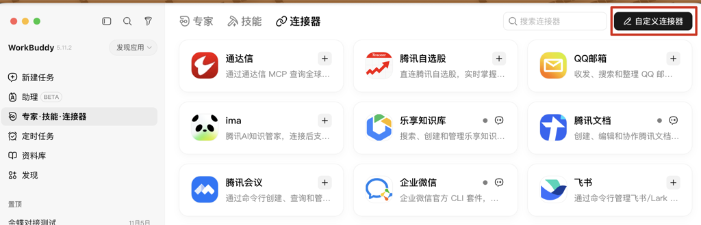
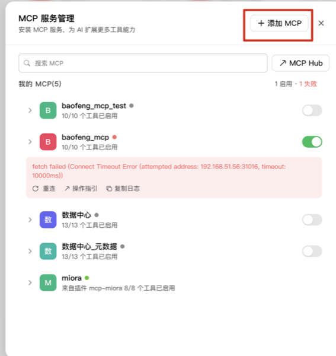
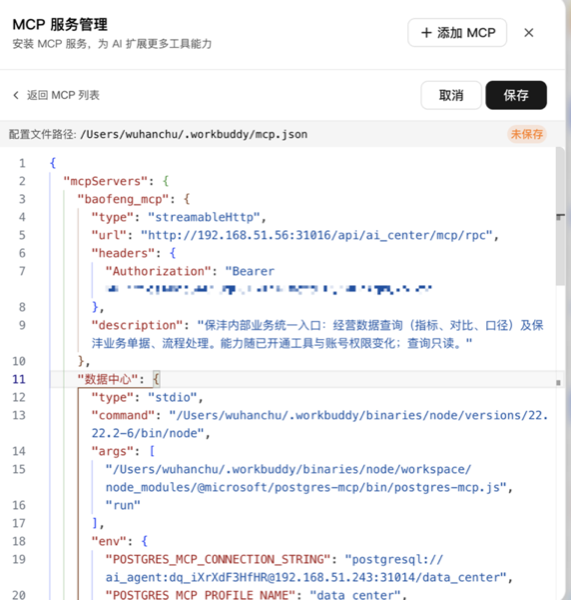
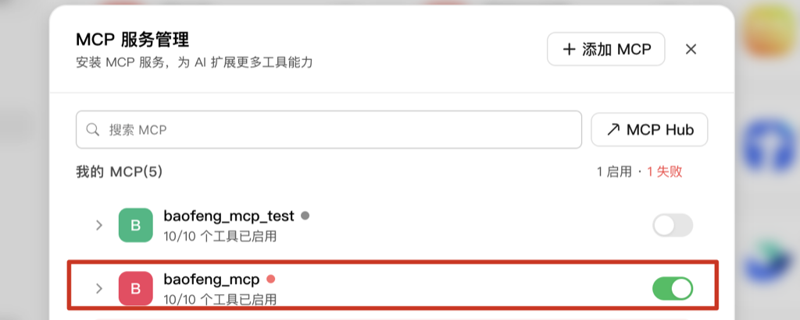
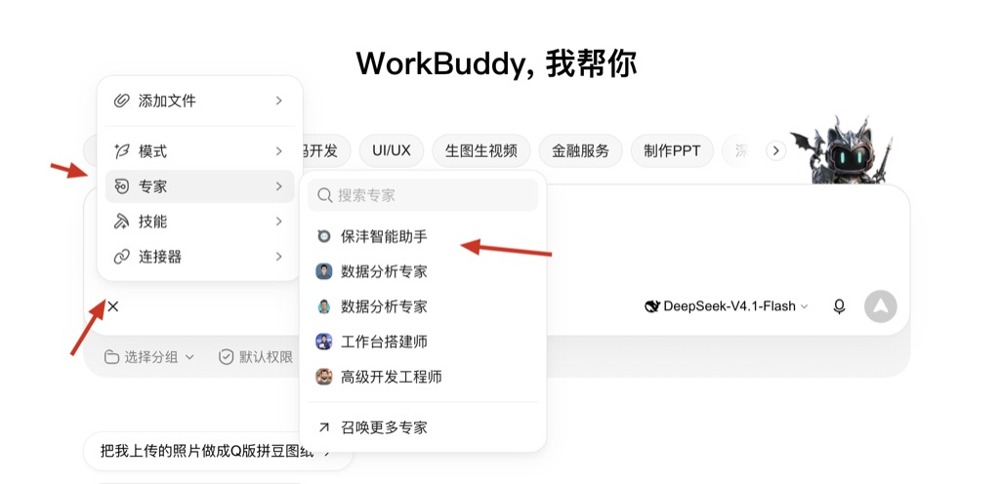
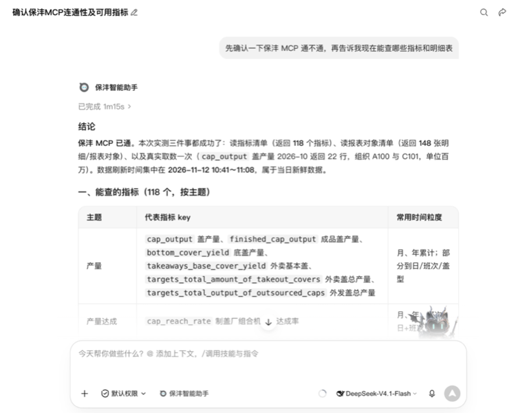

# 保沣 MCP 配置

## 解决什么问题

WorkBuddy 等 AI 工具无法直接访问公司业务数据，查数据要手动登录系统翻页面。通过 MCP 协议接入协同平台后，AI 可直接查询经营数据（指标、对比、口径）与业务单据、流程，查询只读、结果可溯源。

## 第一章 申请认证 Key

1. 打开云之家 → 点击「协同门户」进入保沣协同平台
2. 点击右上角头像 → **个人中心**



3. 在「APIKey」区域点击 **创建 APIKey**，用途备注填写实际用途（如 WorkBuddy）
4. 创建后复制保存完整 Key，第二章配置 MCP 时填入；页面仅显示 Key 前缀用于识别

> Key 仅限本人使用；怀疑泄露或不再使用时，在个人中心「APIKey」区域点击 **吊销** 即可作废。

## 第二章 WorkBuddy 配置 MCP

前提：已完成第一章，拿到认证 Key。

### 打开 MCP 服务管理

1. 打开 WorkBuddy → 左侧「专家·技能·连接器」→「连接器」页签，点击右上角 **自定义连接器**



2. 在「MCP 服务管理」弹窗点击 **+ 添加 MCP**



### 填写 MCP 配置

在配置中填入以下内容，`{认证密钥}` 替换为第一章申请的 Key，点击 **保存**：

```json
"baofeng_mcp": {
  "type": "streamableHttp",
  "url": "http://192.168.51.56:31016/api/ai_center/mcp/rpc",
  "headers": {
    "Authorization": "Bearer {认证密钥}"
  },
  "description": "保沣内部业务统一入口：经营数据查询（指标、对比、口径）及保沣业务单据、流程处理。能力随已开通工具与账号权限变化；查询只读。"
}
```



### 启用 MCP

回到 MCP 列表，打开 `baofeng_mcp` 的开关，显示工具已启用即配置成功：



> 连接失败提示 `fetch failed` / 超时：先确认电脑已连接公司内网（MCP 地址仅内网可访问），再点 **重连**。

## 第三章 导入保沣智能体（可选）

无需自己创建智能体，直接选择已创建好的「**保沣智能助手**」即可，它主要提供以下功能：

- **经营数据查询**：产量、达成率等经营指标查询，支持数据对比与口径说明
- **业务单据与流程**：查询保沣业务单据与流程状态
- **制度问答**：检索内部制度知识库，解答公司制度相关问题

结论均来自 MCP 取数与知识库检索，只读、可溯源，查不到就明说绝不编造。

在浏览器打开以下链接，即可一键导入使用：

https://www.workbuddy.cn/work/launch/?sharecode=VGhBIYJVviCcgmC69RiJpQl9rPfffQ0CXuFTYVCqQVNirXE4XbzPG-Ql7AP0OAmq&expertname=%E4%BF%9D%E6%B2%A3%E6%99%BA%E8%83%BD%E5%8A%A9%E6%89%8B&buddy_type=workbuddy

### 验证

1. 新建任务 → **+** → **专家** → 选择「保沣智能助手」：



2. 问一句「确认一下保沣 MCP 通不通，现在能查哪些指标」，能返回指标清单即一切正常：



> 不使用智能体可跳过本章，按第一、二章配置后即可在普通对话中使用。

## 注意事项

- 认证 Key 仅限本人使用，不得分享给外部人员
- MCP 地址仅限公司内网环境访问
- 查询只读，能力随已开通工具与账号权限变化
