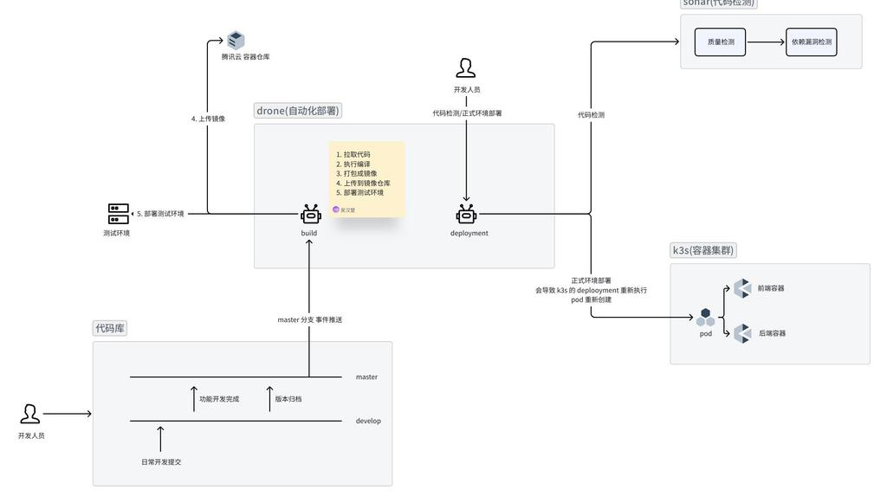
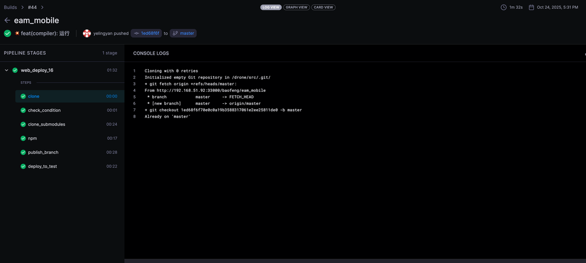
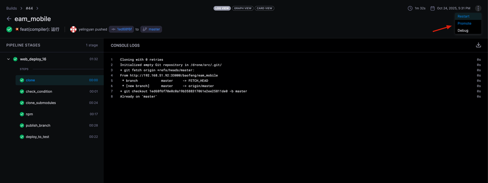
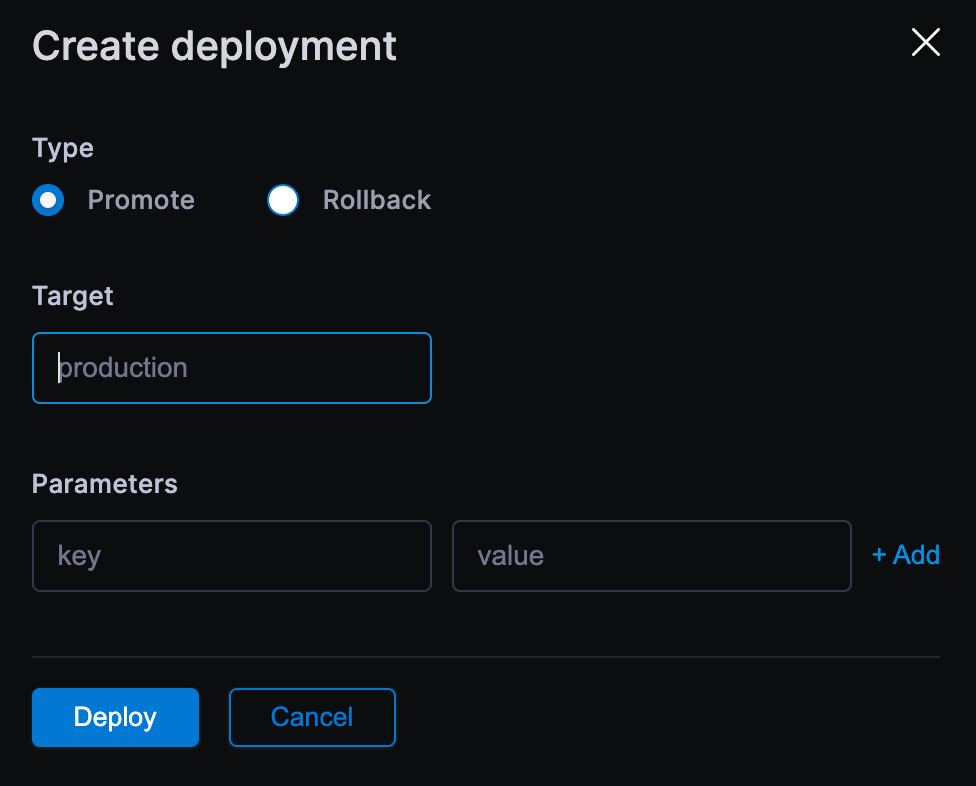
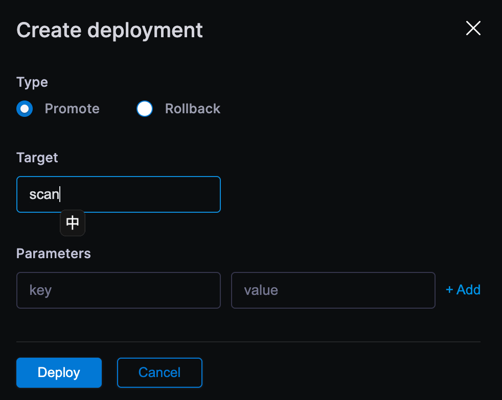
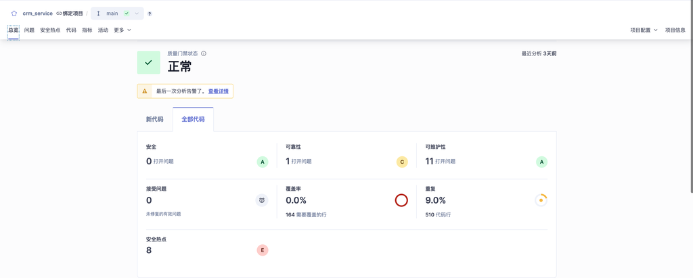
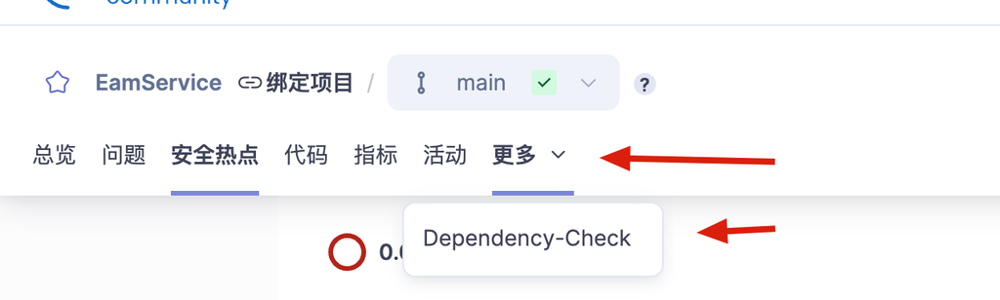
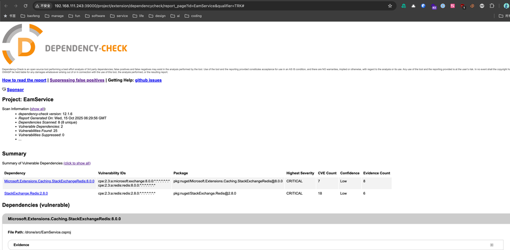

# 代码管理

## CI/CD 流程总览



### 流程说明

**代码库管理：** 采用 master + develop 双分支模型。日常开发在 develop 分支提交，功能开发完成后合并至 master 触发自动流水线。

**Drone 自动化部署：** 代码推送至 master 后，Drone build 自动执行：
1. 拉取代码
2. 执行编译
3. 打包成镜像
4. 上传到腾讯云容器仓库
5. 部署测试环境

**正式环境部署：** 开发人员手动触发 Drone deployment，通过 promote 填入 `production` 触发。正式环境部署会重新创建 k3s pod（旧 pod 在新 pod 就绪后删除）。

**代码检测：** promote 填入 `scan` 触发 Sonar 代码检测，包含质量检测和依赖漏洞检测两个环节。

---

## 代码仓库

所有代码仓库在 Gitea 统一创建管理，地址见 [开发服务地址](../Readme.md#开发服务地址)。

## 开发流程

基于 git-flow，使用 **master** 和 **develop** 两个分支：

- **master** — 正式发布分支
- **develop** — 开发分支，日常开发在此提交

### 日常开发

1. 克隆仓库后切换到 develop 分支开发

```bash
git checkout develop
```

2. 功能完成后，合并到 master 分支，**自动触发** Drone 编译并部署到测试环境

```bash
git push origin develop:master
```



### 正式部署

测试环境验证通过后，到 Drone **手动触发**正式环境部署（地址见 [开发服务地址](../Readme.md#开发服务地址)）。

1. 在最新的 build 右上角点击 **promote**



2. 填入 **production** 部署正式环境，填入 **scan** 触发代码检测



正式环境基于 k3s 容器集群，Drone 触发后拉取最新镜像重新创建 pod（旧 pod 在新 pod 就绪后才删除）。大版本更新前需提前打 tag，以便出问题时回滚。

部署成功后，可在 [应用监控](02_应用监控.md) 的 Portainer 中查看容器运行状态和应用详情。

### 版本号与 Tag

重大更新时打 tag 构建版本镜像，便于回滚：

```bash
git tag 1.0.0
git push --tags
```

版本号格式：**主版本.功能版本.修复版本**

| 位置 | 说明 |
|------|------|
| 主版本 | 架构重大变更、不兼容更新 |
| 功能版本 | 新增功能、功能改进 |
| 修复版本 | bug 修复、小优化 |

默认正式环境部署的 tag 都是 master。如需回退版本，联系 @吴汉楚 修改部署的 tag。

新项目接入自动化部署需联系 @吴汉楚 进行评估和脚本编写。

## 代码检测

使用 Sonar 进行代码检测，地址见 [开发服务地址](../Readme.md#开发服务地址)。

在对应 build 的 **promote** 填入 **scan** 触发。



### 代码质量



- **安全和可靠性** — 尽量保持 A
- **安全热点** — 需人工审核，无问题可设置为"安全"避免告警
- **重复率** — 保持在 10% 以内，尽量不要超过 20%

### 依赖漏洞

基于 dependency-check + NVD（美国国家漏洞数据库）检测。

点击 Sonar 项目的 更多 → dependency-check 查看漏洞信息。





**字段说明**：

| 字段名称 | 说明 |
|----------|------|
| Dependency | 存在潜在漏洞的依赖库名称及版本号 |
| Vulnerability IDs (CPE) | 工具识别出的软件产品标准名称（可能误报，需结合置信度判断） |
| Package | 依赖库在包管理器中的唯一坐标 |
| Highest Severity | 该依赖项所有关联漏洞的最高风险等级 |
| CVE Count | 被匹配到的已知公开漏洞总数 |
| Confidence | 工具对识别结果准确性的信心程度（Low 表示误报可能高） |
| Evidence Count | 从依赖项文件中提取的证据条目数 |

**处理说明**：

- 并非所有检测都准确，参考置信度
- 大部分需通过提升版本或替换工具库解决
- 优先处理可信度高且严重等级高的

## 参考文档

- [Gitea 中文文档](https://docs.gitea.com/zh-cn/)
- [Drone 中文文档](https://drone.cool/)
