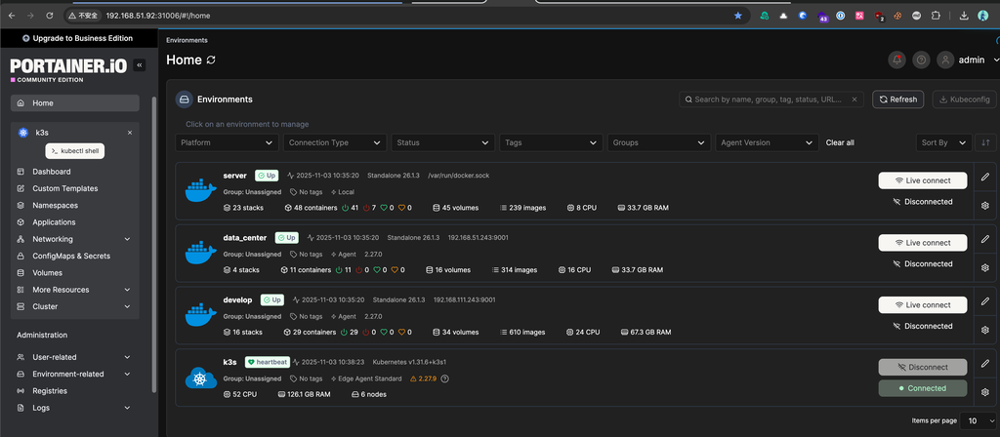
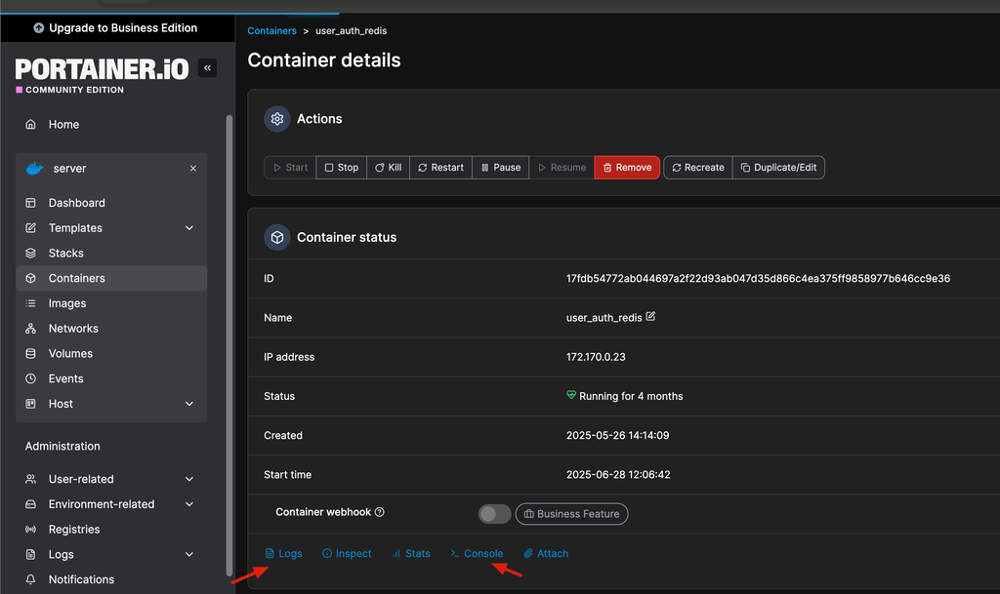
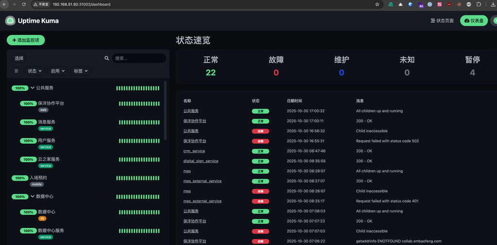
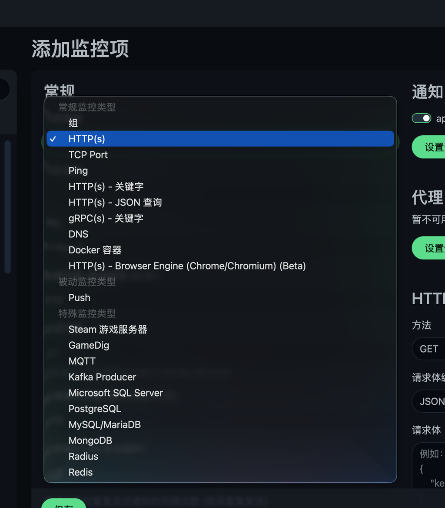
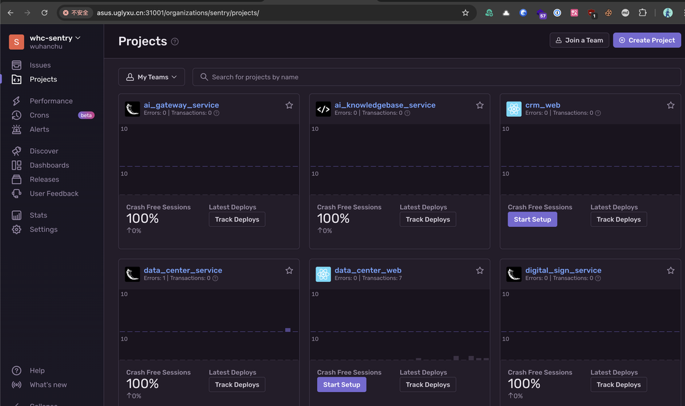
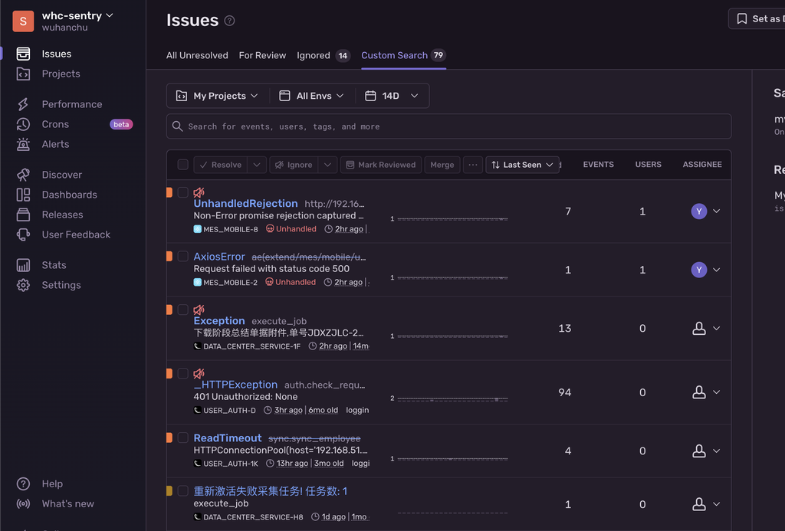
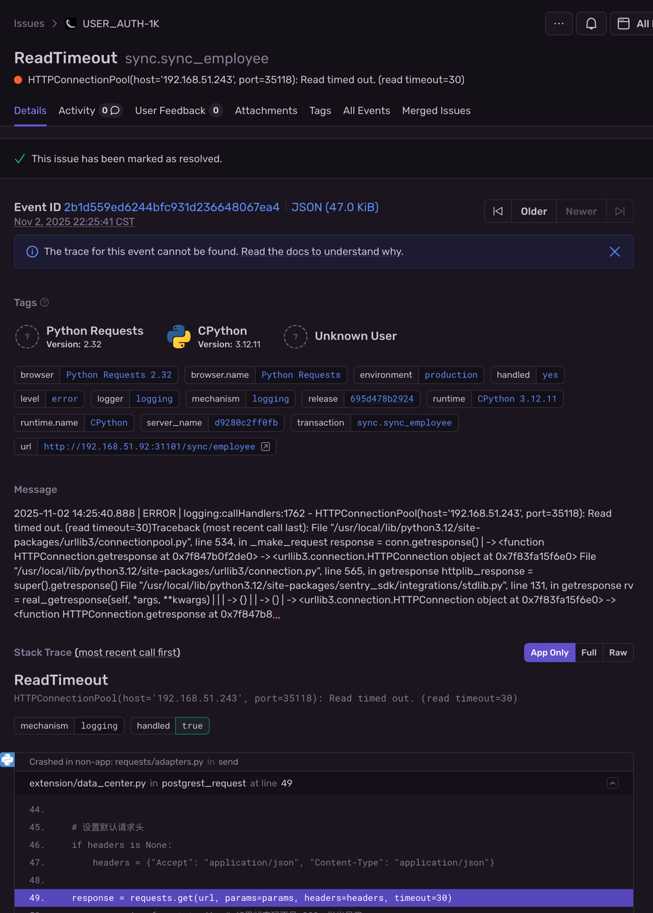
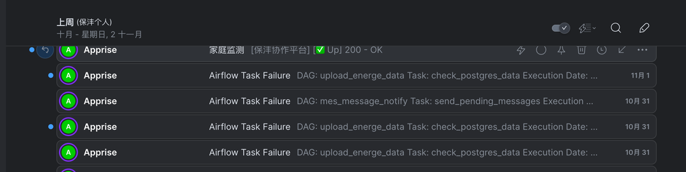
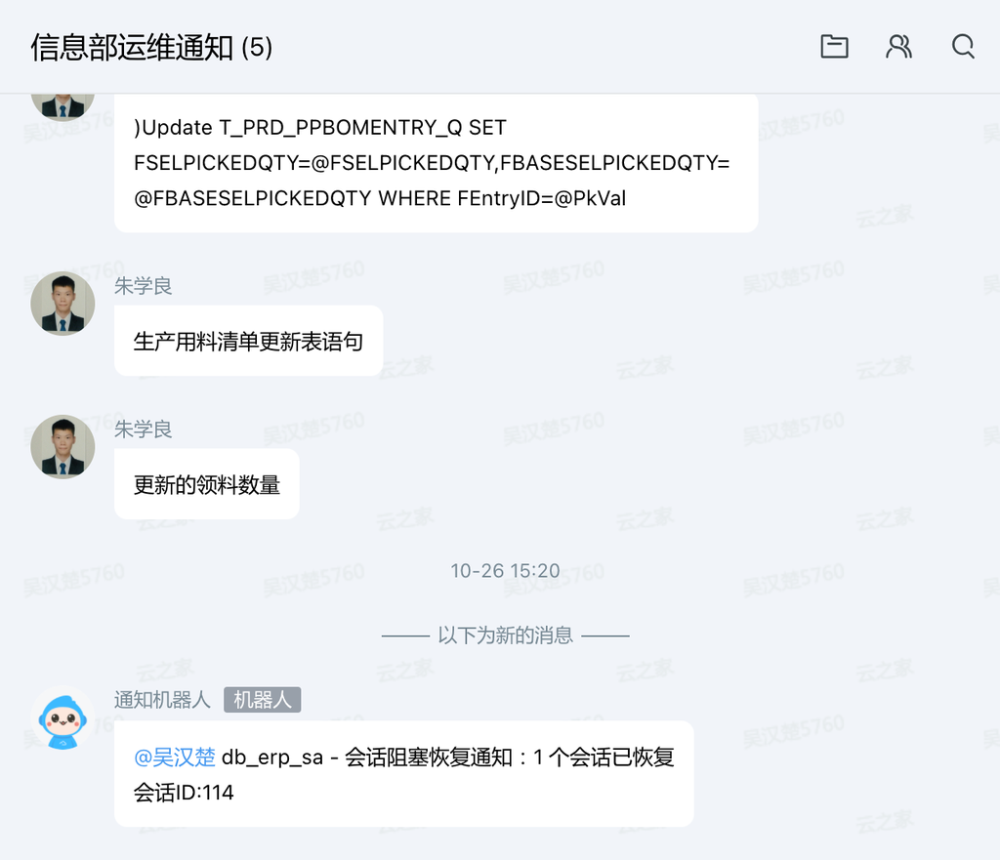

# 应用监控

## 监控体系总览

从硬件底座到代码错误的全链路监控，从被动"救火"转向主动预防：

| 工具 | 层级 | 核心能力 | 业务价值 |
|------|------|----------|----------|
| Zabbix | 硬件底座 | 全天候监测服务器 CPU、内存、磁盘及网络负载 | 在硬件损耗或空间存满前预警，将突发故障转化为计划内维护 |
| Prometheus | 服务指标 | 深度采集容器集群与数据库内部运行参数（并发数、连接池） | 通过数据曲线预判性能瓶颈，为扩容争取时间 |
| Uptime | 服务状态 | 模拟用户真实访问路径，实时检测业务接口可用性与响应速度 | 技术团队比用户更早发现"打不开"或"变慢了" |
| Sentry | 代码错误 | 毫秒级捕获程序运行中的隐蔽逻辑错误，定位至出错代码行 | 无需翻找日志即可快速修复，缩短故障处理时间 |
| Portainer | 容器管理 | Docker/K8s 可视化 | 见下文 |

## 容器监控（Portainer）

地址见 [开发服务地址](../README.md#开发服务地址)。

登录后进入 Environments(环境列表) 页面，可看到所有纳管环境：

| 环境 | 类型 | 地址 | 说明 |
|------|------|------|------|
| server | Standalone(独立节点) | /var/run/docker.sock | 主服务器，23 个 Stacks(应用栈)，48 个 Containers(容器) |
| data_center | Standalone(独立节点) | 192.168.51.243:9001 | 数据中心服务器，4 个 Stacks(应用栈)，11 个 Containers(容器) |
| develop | Standalone(独立节点) | 192.168.111.243:9001 | 开发环境服务器，16 个 Stacks(应用栈)，29 个 Containers(容器) |
| k3s | Kubernetes(集群) | — | K3s 集群，52 核，126.1 千兆内存，6 个 Nodes(节点) |

点击环境名称进入管理页面，左侧菜单可查看 Dashboard(仪表盘)、Containers(容器)、Volumes(存储卷)、Stacks(应用栈) 等。

### 日志查看与容器操作

进入对应环境后，点击左侧 **Containers(容器)** 可查看所有容器列表。点击容器名进入详情页：

- **Actions(操作)** 区域 — 可执行 Start(启动)、Stop(停止)、Kill(终止)、Restart(重启)、Pause(暂停)、Remove(移除)、Recreate(重建) 等操作
- **Container status(容器状态)** — 查看容器 ID、IP 地址、运行状态、创建时间
- **底部操作栏**：
  - **Logs(日志)** — 查看容器终端输出日志
  - **Console(终端)** — 进入容器内部执行命令（如查看文件日志）
  - **Stats(资源)** — 查看容器 CPU、内存、网络实时占用
  - **Inspect(检查)** — 查看容器完整配置（环境变量、挂载卷等）

## 服务可用性监控（Uptime）

地址见 [开发服务地址](../README.md#开发服务地址)。

登录后进入仪表盘，可看到所有监控项的运行状态：

- 左侧按**分组**展示（公共服务、数据中心、入场预约等），每项显示可用率和心跳曲线
- 顶部统计：正常（绿色）/ 故障（红色）/ 维护 / 未知 / 暂停
- 右侧为事件时间线，记录状态变更（正常↔故障），包含具体时间、状态和消息

### 添加监控项

点击左侧 **+ 添加监控项**，选择监控类型：

| 类型 | 适用场景 |
|------|----------|
| HTTP(s) | 网站服务、接口存活检测 |
| TCP Port | 数据库、缓存等端口检测 |
| Ping | 服务器网络连通性 |
| Docker 容器 | 容器运行状态 |
| PostgreSQL / MySQL / SQL Server | 数据库连接检测 |
| Redis | 缓存连接检测 |

配置完成后可设置通知渠道（邮件、webhook 等），异常时自动通知。

## 代码错误监控（Sentry）

地址见 [开发服务地址](../README.md#开发服务地址)。

### 项目列表

登录后进入 Projects(项目列表) 页面，可看到所有接入的项目。每个项目卡片展示：

- **Errors(错误数)** — 当前未解决的错误数量
- **Crash Free Sessions(无崩溃会话占比)** — 无崩溃会话占比（百分百 = 无崩溃）
- **Latest Deploys(最新部署)** — 最新部署记录（可点击 Track Deploys 追踪部署）

点击项目名进入该项目的错误详情。

### 错误列表

进入项目后，默认展示 **Issues(问题列表)**：

- 按 **Last Seen(最近出现)** 排序，每条显示错误类型、所属项目、影响人数和事件数
- 可通过筛选器过滤：项目、环境、时间范围（14天/30天等）
- 顶部操作栏可批量 **Resolve(标记已解决)** 或 **Ignore(忽略)**

### 错误详情

点击具体错误进入详情页，可查看：

- **Tags(标签)** — 运行环境信息（语言版本、框架、环境、服务器名称、统一资源定位符等）
- **Message(消息)** — 完整错误日志
- **Stack Trace(堆栈跟踪)** — 定位出错代码行，可切换 App Only / Full / Raw 视图
- **Activity(活动)** — 错误处理记录（谁标记了解决等）

## 通知

### 邮件通知

通过 [统一消息通知服务](../技术架构/04_消息通知.md) 发送邮件通知，包括：

- **服务异常通知** — 服务状态变更（故障/恢复）时发送
- **任务失败通知** — 自动化任务执行失败时发送（含任务名称、执行日期）
- **代码错误通知** — 新错误或错误频率异常时发送

### 群组通知

通过云之家「信息部运维通知」群，通知机器人自动推送：

- **数据库死锁通知** — 检测到死锁时自动通知相关人员，包含数据库名、会话编号和恢复状态
- **其他运维事件** — 关键运维操作记录
