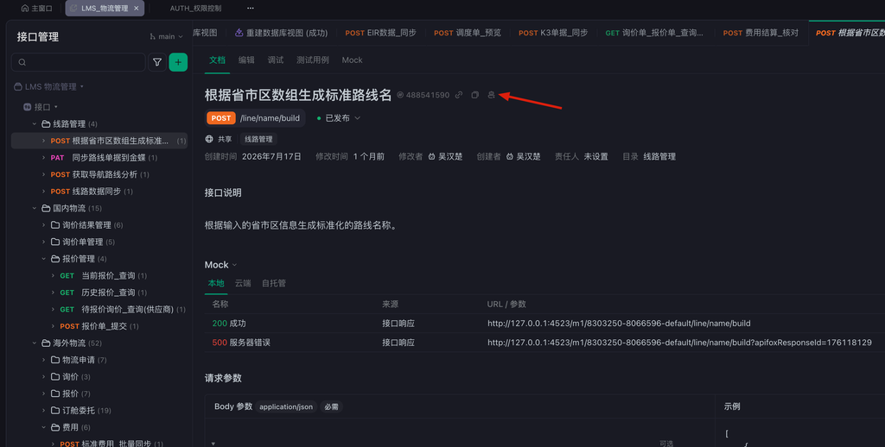

# Apifox API 文档

## 账号加入

| 项目 | 说明 |
|------|------|
| 实例 | 云版 https://apifox.com |
| 用途 | API 文档管理、接口调试、Mock、自动化测试 |
| 账号 | 云之家找 @吴汉楚 邀请加入对应项目 |

每个自研系统在 Apifox 中对应一个独立项目，接口文档随代码自动同步。

## 接口规范

API 开发规范（URL 设计、请求方法、查询操作符、返回结构等）见 [API 开发规范](../技术架构/08_API规范.md)，本节仅说明 Apifox 文档相关约定。

### 接口命名

中文标题采用 **「名词_动词」** 格式：

```
✅ 询价单_保存、报价单_提交、申请单_可用价格_查询
❌ 保存询价单信息、提交报价单
```

### 分组

tags 使用 `/` 分隔符创建层级分组：

```yaml
tags:
  - 国内物流/询价单管理
  - 海外物流/外销询价单
```

### 其他约定

| 约定 | 说明 |
|------|------|
| 参数单数 | 数组参数也用单数命名（`settlement_id` 而非 `settlement_ids`） |
| 枚举中文说明 | description 格式：`字段说明\|value1:中文1,value2:中文2` |
| 废弃接口 | 注释中加 `deprecated: true`，并说明替代接口 |
| 可选参数默认值 | 必须加 `default` 字段，否则 Apifox 不显示默认值 |

## 后端项目配置

写好代码注释即写好文档，文档随代码自动同步到 Apifox。Python 和 C# 项目配置方式如下。

### Python 项目（Flask）

接口文档由代码 docstring 自动同步到 Apifox，标准模板：

```python
@blueprint.route("/example", methods=["POST"])
def example_api():
    """
    名词_动词

    接口详细说明，描述接口的功能和使用场景。

    ---
    tags:
      - 一级分组/二级分组
    parameters:
      - in: body
        name: body
        required: true
        schema:
          type: object
          properties:
            field:
              type: string
              description: 字段说明
    responses:
      200:
        description: 成功响应
    """
```

### C# 项目

Apifox Helper 插件仅支持 IDEA（Java），C# 通过 **Swashbuckle 生成 OpenAPI + Apifox 定时自动导入** 实现同步。

**启用 Swagger：** 安装 `Swashbuckle.AspNetCore`，项目属性勾选「生成 XML 文档文件」，配置读取 XML 注释：

```csharp
builder.Services.AddSwaggerGen(options =>
{
    options.SwaggerDoc("v1", new OpenApiInfo { Title = "系统名", Version = "v1" });
    var xmlFile = $"{Assembly.GetExecutingAssembly().GetName().Name}.xml";
    options.IncludeXmlComments(Path.Combine(AppContext.BaseDirectory, xmlFile));
});
```

接口注释写在 XML 注释中，`summary` 沿用「名词_动词」命名规范，分组和响应用特性标注：

```csharp
[ApiController]
[Route("api/inquiry")]
public class InquiryController : ControllerBase
{
    /// <summary>
    /// 询价单_保存
    /// </summary>
    /// <remarks>保存询价单，包含明细行。已审批的单据不可修改。</remarks>
    /// <param name="form">询价单表单</param>
    /// <returns>询价单 ID</returns>
    /// <response code="200">保存成功，返回询价单 ID</response>
    /// <response code="400">表单校验失败</response>
    [HttpPost("save")]
    [SwaggerOperation(Tags = new[] { "国内物流/询价单管理" })]
    [ProducesResponseType(typeof(long), 200)]
    [ProducesResponseType(400)]
    public IActionResult Save([FromBody] InquiryForm form)
    {
        ...
    }
}
```

要点：

- `<summary>` 接口名（名词_动词）、`<param>` 参数说明、`<returns>` 返回值说明、`<response>` 响应码说明
- `[SwaggerOperation(Tags)]` 对应 Apifox 分组，沿用 `/` 层级
- `[ProducesResponseType]` 声明响应结构，导入 Apifox 后可生成响应示例
- 请求/响应模型类的属性加 `<summary>` 注释，会同步为字段的中文说明

**Apifox 导入：** Apifox 项目设置 → **导入数据 → 定时导入**：

- 数据源选 **URL**，填入 `http://<服务地址>/swagger/v1/swagger.json`
- 可设置导入周期自动同步，也可不设周期，需要时点**立即导入**手动触发
- 开启**覆盖模式**保持与代码一致

## 前端 MCP 使用

Apifox 官方提供 MCP Server，AI 编程工具（OpenCode、Claude 等）接入后可直接查询接口文档，前端让 AI 了解系统 API 而无需人工贴文档。

### 配置示例（OpenCode）



打开任意接口的文档页面，点击接口名称右侧的 **AI 图标**（图中箭头处），即可查看本项目的 MCP 接入信息（含项目 ID），按提示复制配置即可使用。

```json
{
  "mcp": {
    "api_doc_lms": {
      "type": "local",
      "command": ["npx", "-y", "apifox-mcp-server@latest", "--project-id=8303250"],
      "environment": {
        "APIFOX_ACCESS_TOKEN": "你的token"
      },
      "enabled": true
    }
  }
}
```

### 接入步骤

1. **生成访问令牌** — Apifox 右上角头像 → **账号设置 → API 访问令牌** → 新建，复制保存（仅显示一次）
2. **复制项目 ID** — 打开对应项目 → 左侧边栏 **项目设置 → 基本设置**，复制项目 ID
3. 按上方示例配置到 AI 工具的 MCP 设置：`--project-id` 填项目 ID，`APIFOX_ACCESS_TOKEN` 填访问令牌，每个项目一个 server

配置后可直接对 AI 说「查一下 LMS 询价单保存接口的参数」，AI 会自动检索 Apifox 文档。

注意：MCP Server 名称建议带「API 文档」字样（如 `api_doc_lms`），AI 更易识别用途；文档数据缓存在本地，Apifox 更新后可让 AI 刷新接口文档数据。

## 接口调试

- 顶部切换**环境**（测试环境 / 正式环境），环境变量自动替换地址和凭证
- 接口页面直接发送请求调试，支持保存用例、批量运行
- 后端未就绪时使用 **Mock** 功能，前端按文档先行开发

## 参考文档

- [Apifox 官方文档](https://apifox.com/help/)
- [apifox-mcp-server](https://github.com/apifox/apifox-mcp-server)
