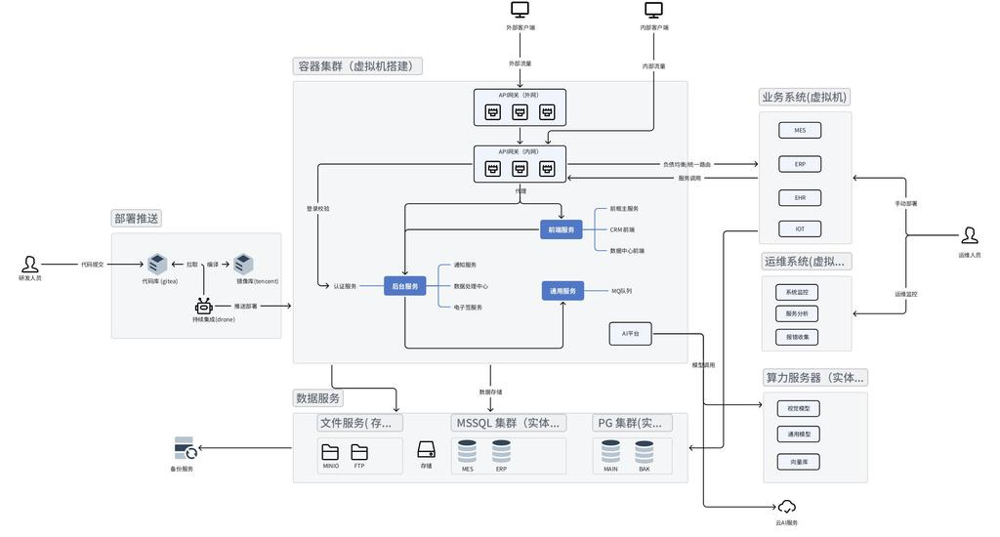
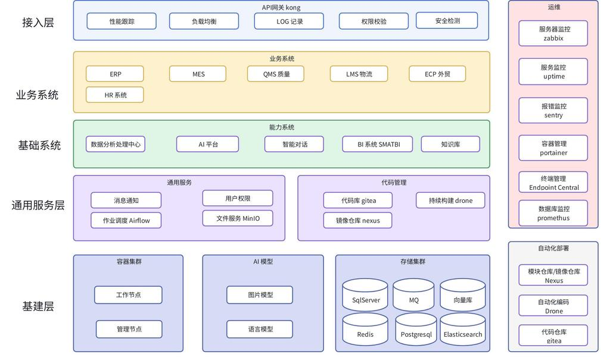

# 服务体系

## 服务架构

> 部署原则概要：资源池化管理、容器化优先、AI 算力隔离、算存分离；业务连续性分级保障、数据多重备份、CI/CD 自动化交付。详见下文「体系说明」。

### 架构概要

**部署形态：** 系统采用三种部署形态并存：

| 形态 | 位置 | 说明 |
|------|------|------|
| 容器集群（虚拟机搭建） | 自研服务 | 前端服务、后台服务、通用服务、AI 平台、MQ 队列 |
| 业务系统（虚拟机） | 采购系统 | MES、ERP、EHR、IOT 等封闭式商业系统 |
| 算力服务器（实体机） | AI 推理 | 视觉模型、语言模型、向量库，独立物理机保障算力 |

**双层网关：** 外网网关处理外部流量接入，内网网关处理内部服务调用与负载均衡，两层网关分离。

**镜像分发：** 自研服务走腾讯云镜像库（外部拉取），业务系统通过运维人员手动部署至虚拟机。

**备份架构：** 备份服务独立于主链路，直接对接文件服务（MinIO / FTP），确保数据保护与业务链路解耦。

### 数据流向

**研发与部署链路：** 研发人员提交代码 → Gitea 代码库 → 编译 → 腾讯云镜像库 → Drone 持续集成 → 推送部署至容器集群。

**外部访问链路：** 外部客户端 → 外部流量 → API 网关（外网）→ API 网关（内网）→ 前端服务 / 后台服务。

**内部访问链路：** 内部客户端 → 内部流量 → API 网关（内网）→ 通过负载均衡/统一路由访问业务系统或自研服务。

**自研服务调用链路：** API 网关（内网）→ 前端服务（前框主服务 / CRM 前端 / 数据中心前端）→ 后台服务（认证服务 → 通知服务 / 数据处理中心 / 电子签服务）→ 通用服务（MQ 队列）→ 数据服务。

**业务系统调用链路：** API 网关（内网）→ 负载均衡/统一路由 → 业务系统（MES / ERP / EHR / IOT），业务系统返回服务调用。

**数据存储链路：** 后台服务 / 通用服务 → 数据存储 → 文件服务（MinIO / FTP）/ MSSQL 集群（MES / ERP）/ PG 集群（MAIN / BAK）。

**AI 调用链路：** 通用服务 → AI 平台 → 模型调用 → 算力服务器（视觉模型 / 通用模型 / 向量库）或云 AI 服务。

**运维链路：** 运维人员 → 运维系统（系统监控 / 服务分析 / 报错收集）→ 运维监控 → 业务系统与自研服务。

**备份链路：** 备份服务 → 文件服务（MinIO / FTP）。

---

## 服务层级

### 接入层 (Access Layer)

- **API网关 Kong**：作为统一入口，负责处理内外网流量的接入与转发。
- **性能跟踪与负载均衡**：监控请求链路，并将流量高效分配至后端服务器，确保系统响应速度与稳定性。
- **权限校验与安全检测**：在流量进入业务系统前进行身份认证、LOG日志记录及恶意攻击拦截。

### 业务系统层 (Business Systems)

- **核心管理集群**：部署企业经营的核心系统，包括 ERP（资源计划）、MES（制造执行）、HR（人力资源）等。
- **生产协同中枢**：涵盖 QMS（质量管理）、LMS（物流管理）及 ECP（外贸系统），支撑生产、质量与进出口业务的数字化运行。

### 基础系统层 (Infrastructure Services)

- **数字化分析**：依托数据分析处理中心与 BI 系统 SMATBI，将业务数据转化为决策洞察。
- **AI 能力平台**：集成智能对话、知识库及 AI 计算平台，为业务层提供智能化插件支持。

### 通用服务层 (Common Services)

- **基础中间件**：提供用户权限、消息通知、文件服务（MinIO）及作业调度（Airflow）等公共能力。
- **研发基础设施**：包含代码管理（Gitea）、镜像仓库（Nexus）及持续构建（Drone），支撑整个研发链路的自动化。

### 基建层 (Resource Layer)

- **容器化集群**：基于工作节点与管理节点构建，为所有应用提供动态扩容与故障自愈的运行环境。
- **AI 模型底座**：存储并运行图片模型、语言模型，为上层 AI 能力提供算法支撑。
- **多模态存储集群**：针对不同业务需求，提供关系型数据库（SQL Server、Postgresql）、缓存（Redis）、消息队列（MQ）及向量库/搜索（Elasticsearch）。

### 运维与自动化部署 (Operations & CI/CD)

- **运维监控体系** — Zabbix（硬件）、Uptime（可用性）、Sentry（错误）、Portainer（容器）、Endpoint Central（终端）、Prometheus（数据库），详见 [应用监控](../开发工具/02_应用监控.md)
- **自动化流水线** — Gitea（代码仓库）→ Drone（持续构建）→ Nexus（镜像仓库），详见 [代码管理](../开发工具/01_代码管理.md)

---

## 技术选型

技术栈按场景标准化：主栈为 **React + Python + PostgreSQL**（新系统默认组合），业务系统延续 C# + SQL Server，中间件统一 Kong / MinIO / Redis / RabbitMQ，部署基于 VMware + Docker + K3s。

各场景的完整选型表与选型原则（延续性、标准化、容器化、开源优先、可扩展），详见 [技术选型](07_技术选型.md)。

---

## 体系说明

### 基础设施部署原则：资源池化与效能最大化

- **计算底座虚拟化**：基于 VMware 构建高性能虚拟机集群，为商业采购应用及容器集群提供稳固、可灵活调配的底层算力，确保服务器硬件利用率最大化。
- **容器化优先策略**：推行"容器化"部署，将自研服务封装在标准化容器中。除特殊硬件依赖外，核心业务优先入驻容器集群，实现服务的秒级启动、自动修复与资源精细化管控。
- **中间件标准化管理**：对数据库（DB）、消息队列（MQ）及缓存（Redis）实施统一构建与集群化管理，消除单点故障风险，确保存储层具备支撑大规模并发的能力。

### 持续集成与自动化交付：消除人为因素导致的生产事故

- **研发流程自动化**：标准化的 CI/CD 流水线解决"开发环境正常，生产环境报错"的典型痛点，代码推送主分支即自动部署测试环境，人工核验后一键发布正式环境（详见 [代码管理](../开发工具/01_代码管理.md)）。
- **采购系统回滚机制**：针对无法容器化的封闭式系统，在大版本更新前强制执行虚拟机全量快照及关键配置备份，确保在升级失败时具备"瞬间还原"的能力。

### 业务连续性分级保障：根据重要程度精准分配资源

- **核心业务系统（P0级）**：如 MES、ERP 等核心枢纽，要求 7×24 小时零宕机。
  - 可以容器化的，通过容器集群的故障转移特性保障可用性
  - 不可容器化，必须通过多机冗余及网关负载均衡实现高可用
- **普通业务系统（P1级）**：允许 1-12 小时的业务中断，承诺当日内恢复。主要依托虚拟化高可用技术，在硬件故障时自动在其他节点重启服务。
- **辅助系统（P2级）**：如内部监控、运维小工具，允许数日不可用。不占用昂贵的高可用资源，侧重于低成本运行。

### 多维备份与灾难恢复：构建企业数据的"最后防线"

- **文件级实时备份**：利用专业备份一体机对关键文件服务进行增量同步，确保非结构化数据在物理损坏时可即时找回。
- **数据库双重保护**：在维持数据库集群高可用性的基础上，配置定时全量落地备份任务，防御勒索病毒或人为误删导致的逻辑灾难。
- **容器环境快速重建**：所有部署脚本与容器镜像均在云端备份。极端情况下，即使本地机房全毁，也可在异地快速拉起一套完全一致的业务环境。
- **算存分离架构**：集群数据挂载至外部存储并实施实时镜像，确保计算节点与数据节点互不干扰，提升数据安全性。

### 双层 API 网关架构：兼顾内部效率与外部防御

内网网关处理内部服务间访问（接口调用必须通过认证中心授权），外网网关统一接入外部请求（IP 黑白名单控制），网关前置 IPS 硬件防御。详见 [API 网关](06_API网关.md)。

### 系统弹性扩展规划：保障业务高峰期的稳定性

- **数据库读写分离架构**：通过增加"只读副本"将查询压力从主库分流，防止报表或高频查询任务拖慢核心生产写入，实现计算能力的即时水平扩充。
- **SQL Server 垂直扩展**：针对无法原声分布式的系统，通过升级物理 CPU、内存及 NVMe 极速存储阵列，结合资源池化管理，确保单机处理性能达到工业级峰值。
- **PostgreSQL (Citus) 分布式扩展**：针对视觉检测和 IoT 产生的大数据量，利用 Citus 插件实现数据分片（Sharding），支持跨服务器横向扩展，打破单机存储容量与算力瓶颈。
- **容器化自动缩容**：应用层支持根据实时负载自动增减实例数量，在业务高峰（如月度结存）时自动借用集群资源，高峰过后释放资源，维持系统运行的最优效能比。

### AI 算力中台：实现智能应用的降本增效

- **中台化能力输出**：构建统一的 AI 中台作为计算请求的"调度员"，解耦前端业务逻辑与后端复杂算法。
- **资源灵活配置**：后端可无缝对接本地 GPU 服务器或按需调用云端算力，实现本地高频推理与云端大规模训练的结合。
- **资产轻量化管理**：由于模型多为开源、数据多为临时特征，对 AI 算力机采取"重算力、轻备份"策略，避免在非关键数据备份上产生额外硬件开销。

### 全链路数字化监控：从被动"救火"转向主动预防

构建硬件底座（Zabbix）→ 服务指标（Prometheus）→ 服务状态（Uptime）→ 代码错误（Sentry）的四层监控体系，各工具的核心能力与业务价值详见 [应用监控](../开发工具/02_应用监控.md)。
