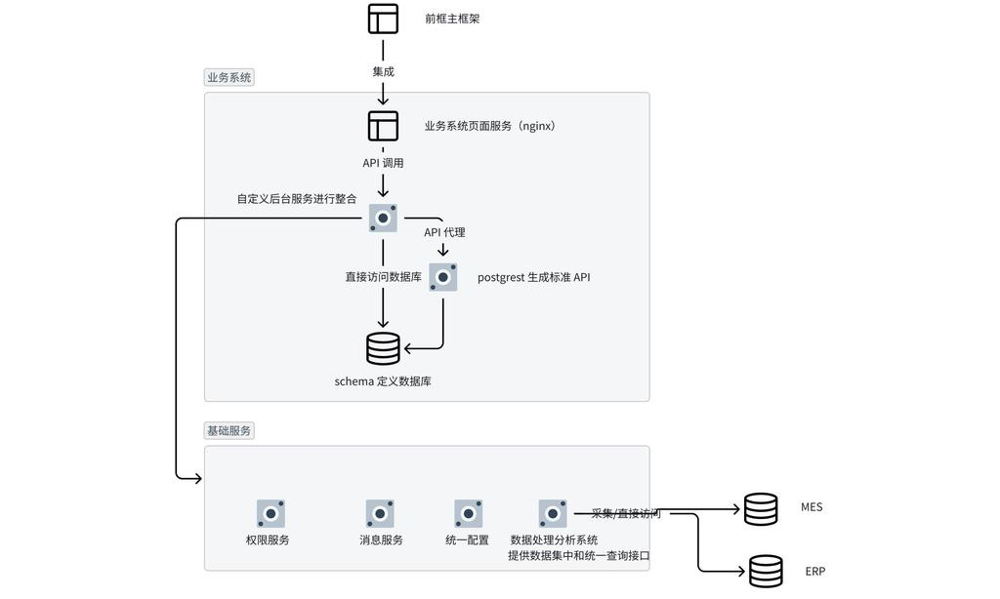

# 应用通用架构

> 业务系统的通用分层架构，从展示层到基础服务层，并对接 MES、ERP 等外部业务系统。

## 架构图

## 架构说明

### 分层结构

| 分层 | 组成 | 职责 |
|------|------|------|
| 展示层 | 前框主框架 | 前端界面 |
| 应用层 | 业务系统页面服务（nginx） | 与展示层集成，调用服务层 API |
| 服务层 | 自定义后台服务、API 代理、postgrest 生成标准 API | 接收应用层 API 调用，整合后访问数据层 |
| 数据层 | schema 定义数据库 | 存储业务数据 |
| 基础服务层 | 权限服务、消息服务、统一配置、数据处理分析系统 | 公共能力，可采集/直连外部系统 |
| 外部系统 | MES、ERP | 数据处理分析系统采集 / 直接访问 |

### 三种数据访问路径

自定义后台服务通过三种方式访问数据库：

| 路径 | 说明 | 适用场景 |
|------|------|----------|
| 直接访问数据库 | 后台服务直接查询 schema | 复杂查询、业务逻辑 |
| API 代理 | 后台服务转发请求至 postgrest | 需要权限校验的 CRUD |
| postgrest 生成标准 API | postgrest 根据 schema 自动生成 RESTful API | 标准 CRUD，无需手写代码 |

**设计要点：**
- postgrest 根据数据库 schema 自动生成标准 RESTful API，减少重复开发
- 自定义后台服务负责业务逻辑整合，不直接暴露 postgrest
- 基础服务层的数据处理分析系统提供统一数据接入点，可采集或直连 MES/ERP
